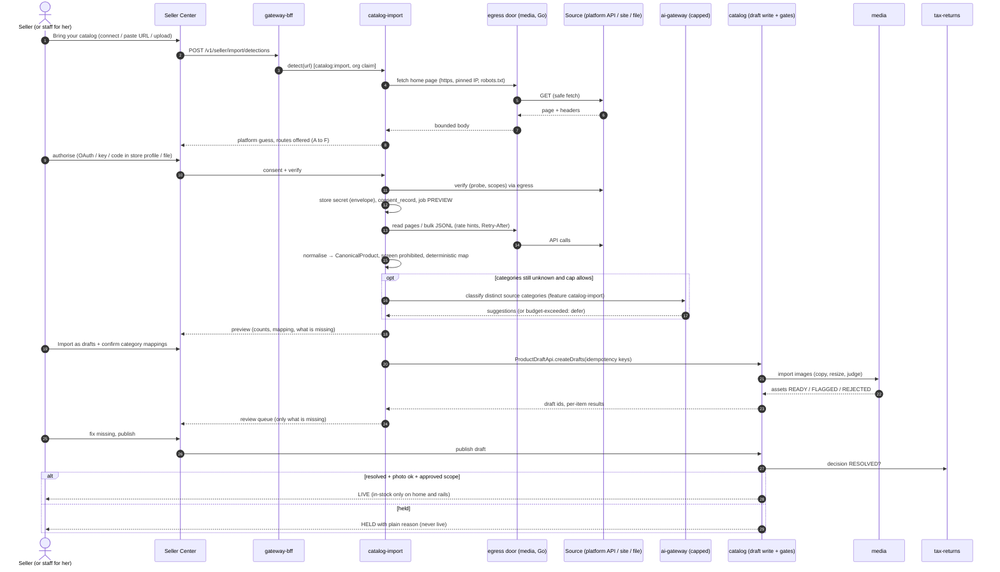

# Bring your catalog: seller catalog import (SPIKE: research and design)

**Status:** spike, documents only. Nothing here is built or approved. Decision record: [ADR 0012](../adr/0012-seller-catalog-import.md) (Proposed).
**Applies to both architectures:** microservices (`main`, `develop`) and the modular monolith (`release-1`, `afrotransact-core` + `afrotransact-go`). It is
a functional feature, so by [CLAUDE.md "One product, three branches"](../../CLAUDE.md) it lands identically on all three lines.
**Related:** [bulk-upload-and-images.md](./bulk-upload-and-images.md), [listing-rules.md](./listing-rules.md), [product-matching-without-barcode.md](./product-matching-without-barcode.md),
[tax-gate-paths.md](./tax-gate-paths.md), [taxonomy.md](./taxonomy.md), [seller-catalog-scope.md](./seller-catalog-scope.md),
[mcp-tool-proposals.md](./mcp-tool-proposals.md) (entry I1 added, proposed only), `release-1-architecture.md` and
`release-1-parity.md` (on `release-1`). Proof of concept (local fixtures only): [tools/spikes/catalog-import/](../../tools/spikes/catalog-import/README.md).

## 0. The answer in one page

**Problem.** A seller we onboarded in v1 refused to re-key her products because she already has a website and it took her a long time to set them up
there. The same will be said by every seller with a Shopify, WooCommerce, BigCommerce, Squarespace, Wix, Amazon or Walmart store, a custom site, a POS
or a spreadsheet. The owner wants a **global** answer for any vendor, platform not known in advance. Her real storefront
(`nrsgo.com/blackhairbeautysupply`) is treated here as an **unidentified source**: nothing about it was fetched or verified (section 7).

**Recommendation.** One feature, "Bring your catalog", with one rule above all: **the seller's own export or authorisation is the primary route, public reading
is the exception, and nothing is ever a dead end.** Concretely:

1. **Build first (Phase 0, the "universal importer")**: bring *any* platform's own product export (Shopify, WooCommerce, BigCommerce, Squarespace, Wix, Etsy, Amazon
   flat file, Google Merchant feed, plain spreadsheet) through the existing bulk-upload pipeline, with header-fingerprint presets, category and attribute mapping,
   import as **drafts**, and a review queue that asks only for what is missing. It needs no OAuth, no domain ownership proof and no platform approval, it works
   for a platform nobody on the team has heard of, and every platform we researched has a built-in export (Shopify product CSV up to 15 MB, WooCommerce built-in exporter,
   BigCommerce Products > Export, Squarespace up to 10,000 products, Wix up to 5,000 rows per file). Add the generic schema.org JSON-LD reader for domains the seller proves
   she controls, and a feed-URL fetch for Google Merchant style feeds.
2. **Same week, to win her back: the concierge path.** A staff member, with her recorded consent, runs the same tool: she sends an export (or screenshots, or a price list),
   staff import to **drafts under her organisation**, she fixes only what is missing and publishes. Target: first listing in one business day.
3. **Then connectors** (Phase 1 Shopify and WooCommerce, Phase 2 BigCommerce, Squarespace, Wix) for one-click connect and ongoing sync; Amazon and Walmart only through
   their **official seller APIs and exports** (Phase 3, long lead time); two-way inventory last (Phase 4) and not promised before then.
4. **Everything goes through the existing gates.** Imports create **drafts**. A product is never live without a resolved tax decision (sellers never type tax codes),
   a real photo that passes the media rules, a category that matches our taxonomy, and the approval scope of the category. Sold-out items never appear on home or rails.

**What surprised me (details in section 2).**

* **Shopify's terms forbid automated storefront access** ("any robot, spider, scraper, or other automated means") and its API terms forbid scraping merchant data
  except as authorised; Feb 2026 updates tightened it. So even the "easy" public `/products.json` is a legal question, not only a technical one. Seller-provided export
  or an authorised app is the clean route.
* **Shopify no longer lets merchants create legacy custom apps** (from 1 Jan 2026). A merchant-made token is now a Dev Dashboard app with client credentials,
  which is hard for a non-technical seller; a public/unlisted app still needs Shopify review. So for Shopify the *export file* beats the API for the first release.
* **The AI spend cap is far too small for AI-heavy import as it stands:** USD 2/day for the whole gateway and USD 0.50/day per caller
  (`docs/runbooks/ai-spend-and-mcp-access.md`). Deterministic mapping must carry nearly everything and AI be the capped last resort (section 3.5).
* **Regulated kinds will never be "publishable without edits" from web data.** The proof of concept shows every beauty product (her likely catalog) missing
  ingredients, label photo, dangerous-goods answer, package size and shelf life, which no platform feed carries. The review queue is the product; "approve all"
  is not.
* **Her path (`/blackhairbeautysupply`) suggests a store inside someone else's domain**, which breaks DNS/file ownership proof. Section 3.2 gives alternative proofs
  (platform login/OAuth, a code in her store's own description field, or staff-assisted consent) and section 3.2 says plainly that the host's terms still bind.
* Walmart's seller APIs are throttled hard for bulk (item feeds 10 requests per hour) and its terms ban scraping and AI training on its data; Amazon's SP-API needs a
  developer registration and role approvals and Amazon's terms exclude collecting listings, descriptions or prices by robots.

**Decisions needed from the owner:** section 6.7.

## 1. Evidence legend and what could not be verified

The sandbox could **not open any developer site** (`WebFetch` failed to resolve `shopify.dev` and `woocommerce.github.io`: the hosts are not on the session's network
allow-list). All platform facts below therefore come from **web-search summaries of the official pages** (shopify.dev, developer.woocommerce.com,
developer.bigcommerce.com, developers.squarespace.com, dev.wix.com, developer-docs.amazon.com, developer.walmart.com, developers.etsy.com, developer.ebay.com,
support.google.com/merchants, developers.google.com, datatracker.ietf.org, cheatsheetseries.owasp.org). No owner, seller or personal data was sent in any query.

| Tag | Meaning |
|---|---|
| **[D]** | The search summary quotes an official documentation page. The page itself was not opened. Re-read it before building. |
| **[C]** | Community forum, seller forum or third-party text. Treat as a lead, not a fact. |
| **[U]** | Not verified in this spike (my general knowledge or inference). Must be checked by whoever builds the connector. |

Everything about `nrsgo.com` is **[U]** by definition. To allow real verification, the owner can add the developer hosts above to the session's network settings
(`read_documentation` topic `environment.network`); until then every row below has the caveat that numbers change (Shopify's own pages disagree with each other on rate
limits and webhook retries).

## 2. Options matrix per source

Reading guide: *Auth* is how we get in; *Data* is what comes back; *Limits* are rate limits and caps; *ToS* is the legal constraint; *Effort* is for us (S under 1 week,
M 1 to 3 weeks, L over 3 weeks, for one connector with tests, excluding the shared core); *Reliability* is how likely it works unattended; *Cost* is money to us.

### 2.1 Summary matrix

| Source | Best route for us | Auth model | Data completeness (title, desc, variants, price, compare-at, stock, images, category, weight/dims, SKU/GTIN) | Effort | Reliability | Cost | Legal risk |
|---|---|---|---|---|---|---|---|
| **Any platform: built-in CSV/XLSX export** | Seller exports, uploads | none (the seller is logged in to her own admin) | varies by platform, usually all but dims; images as URLs | S (presets) | High (file is explicit) | none | Low |
| **Google Merchant / product feed** (text, XML) | Seller gives a file or a feed URL | none, or a feed URL we fetch through the safe fetcher | id, title, description, link, image_link(s), price, sale price, availability, GTIN, brand, item_group_id, product_type / google category, shipping weight [D+U] | S | High | none | Low |
| **Shopify** | Phase 0: CSV export. Phase 1: our app, GraphQL bulk read | OAuth authorization code (public/custom-distribution app); merchant-made apps now via Dev Dashboard | Full: product, up to 2048 variants, media, inventory item (SKU, tracked), per-location levels, weight, barcode, compare-at, collections, metafields [D] | M | High | free API; app review effort | Medium for public `/products.json`, low via authorised app/export |
| **WooCommerce** | Phase 0: CSV export. Phase 1: REST keys, Store API as read fallback | REST: consumer key/secret (Basic over HTTPS); Store API public read | Full via REST v3; Store API gives prices in minor units, stock flag, categories, images, attributes, variations [D] | M | Medium (self-hosted: plugins, WAFs, old versions) | none | Low |
| **BigCommerce** | Phase 2: API account token or app | OAuth only for V3; merchant creates an API account (scopes `store_v2_products_read_only`) [D] | Full catalog V3 | M | High | none | Low |
| **Squarespace** | Phase 2: Products API key (merchant-created) or OAuth | API key or OAuth; webhooks need OAuth [D] | Products, variants, images; inventory API separate; products attached to store pages | M | Medium (plan gating, OAuth requires an extension) | none | Low |
| **Wix** | Phase 2: Stores Catalog V3 via OAuth app | OAuth app, scope "Read products in v3 catalog" [D] | Query up to 100 products per call; V1 and V3 catalogs not compatible [D] | M to L | Medium | none | Low |
| **Amazon** | Phase 3: SP-API (Listings Items, Reports) with seller authorization | LWA OAuth; seller authorizes our application in Seller Central; reauthorize every 365 days [D] | Listings and reports of the seller's own listings; PII roles not needed | L (registration, role review) | Medium | free API; unverified fee claim [C] | High if scraped, low via API |
| **Walmart** | Phase 3: Marketplace APIs / seller-authorized exports | OAuth token API with seller-created credentials [D+U] | Items API; bulk item feeds | L | Medium | none | High if scraped, low via API |
| **Etsy** | Later, only if sellers ask | API key plus OAuth 2.0; commercial access approval [D] | Listings, inventory, images | M | Medium | none | Low |
| **eBay** | Later | OAuth authorization code; legacy listings need migration to Inventory API objects [D] | Inventory items, offers | M to L | Medium | none | Low |
| **schema.org JSON-LD / Open Graph + sitemap on a site** | Phase 0, only for domains the seller proves she controls (or staff-assisted with consent) | none (public read) | title, description, brand, sku, gtin, image(s), price, currency, availability, variants via ProductGroup; **no stock count, rarely weight/dimensions** [D+U] | M | Low to medium (markup quality varies) | none | Medium (see 4.1) |
| **Unknown or custom site** | Detection ladder (3.1), then export/feed/JSON-LD, then AI-assisted extraction, then concierge | varies | varies | M (once) | Low | AI spend | Medium |
| **GS1 / UPC / Open Food Facts** | Not an import source: optional enrichment suggestions (barcode, net content), never images | GS1 US Data Hub is a paid subscription; Open Food Facts is open under ODbL / DbCL / CC BY-SA [C+D] | brand-owner data; names, GTIN, sometimes images | already exists (`GtinPrefillService`) | Medium | GS1 add-on priced from USD 6,500 [C] | Licence mixing risk [D] |

### 2.2 Shopify

* **Auth** [D]: OAuth authorization code grant for apps installed by merchants; public apps must use **expiring offline tokens** (1 hour, with refresh token). The
  client-credentials grant is only for stores in the developer's own organisation (24 h tokens, no refresh). **Legacy custom apps (admin-created token) cannot be created
  after 1 Jan 2026**; existing ones keep working; new ones go through the Dev Dashboard. **All public apps, even unlisted, go through Shopify review**; custom apps are
  review-free but for one merchant or organisation and cloning one per merchant breaks the partner agreement [C]. Consequence: a merchant cannot simply "paste an API
  key" any more; she would create a Dev Dashboard app and share a client ID and secret [C], which is a poor experience. A **public app (even custom distribution)
  is the real connector** and its review lead time is **[U]**.
* **Data** [D]: GraphQL Admin `Product` (title, description HTML, vendor, product type, tags, status, media/images with size, options, up to 2048 variants);
  `ProductVariant` (SKU, barcode, price, compare-at price, inventory item); `InventoryItem` (SKU, tracked, measurement/weight) and per-location `inventoryLevels`.
  Field names to be checked on the live reference [U]. Collections and metafields carry categories and custom attributes.
* **Bulk read** [D]: `bulkOperationRunQuery` produces JSONL (one object per line, children carry `__parentId`), runs up to **10 days**, query shape **max 5 connections, 2 levels
  of nesting**, result `url` expires after **7 days**, bulk execution is not subject to the normal rate limit; from API **2026-01** up to **5 concurrent bulk queries per app per
  shop** (one per type before). The PoC parses this shape (`from_shopify_bulk_jsonl`).
* **Rate limits** [D]: GraphQL leaky bucket by plan: Standard 100 points/s, Advanced 200, Plus 1000, enterprise 2000; one query may not cost over 1000 points; older pages
  say 50 points/s default. Read `throttleStatus` from each response; never hard-code.
* **Webhooks** [D]: HMAC-SHA256 of the raw body with the app's client secret in `X-Shopify-Hmac-SHA256` (base64); deduplicate by `X-Shopify-Webhook-Id`; failed deliveries are
  retried 8 times over about 4 hours and an Admin-API subscription is deleted after 8 consecutive failures (an older page says 19 retries over 48 h); Shopify itself says
  to run **reconciliation jobs** because delivery is not guaranteed. Topics for us: `products/create|update|delete`, `inventory_levels/update`.
* **Public `/products.json`** [C]: default 30 items, `limit` up to 250, `page` pagination, no `Link` header, only published products, no inventory counts (a boolean
  `available`), prices as strings. This is the "easy" concierge source, but **Shopify's Terms of Service bar accessing or monitoring the Services with "any robot,
  spider, scraper, or other automated means"** and the API terms bar scraping Merchant Data or a Merchant Store except as Shopify authorises in writing; Feb 2026 updates
  tightened the language [D]. A merchant's consent does not obviously override a term she accepted. **Do not build the public-JSON route as a product feature**; treat it
  as legal-review-only (open question Q4). Not verified whether `robots.txt` disallows it.
* **CSV export** [D]: built-in; file limit **15 MB**; Shopify changed its template columns (a current help page lists `Description` and `Price`, not the older
  `Body (HTML)`), so presets must tolerate both generations of headers (PoC README, "traps").
* **Effort** M for the app and connector (OAuth, token refresh, bulk JSONL, webhooks, GDPR mandatory webhooks [U]); S for the CSV preset. **Cost** free.

### 2.3 WooCommerce (and WordPress multi-vendor plugins)

* **Auth** [D]: REST API keys created in the WordPress admin; over HTTPS, HTTP Basic with consumer key as username and secret as password; a query-string fallback exists for
  hosts that drop the `Authorization` header. Keys have read, write or read/write permission [U]: ask for **read only**.
* **Store API** [D]: public, read-only `GET /wp-json/wc/store/v1/products`; `per_page` default 10, **max 100** (WooCommerce 10.6 returns 400 for `per_page=0`; use `per_page=100&page=n`);
  `X-WP-Total`, `X-WP-TotalPages` and `Link` headers. Prices in **minor units** with `currency_minor_unit`; PoC handles it. Whether a given site exposes it, or a security plugin /
  WAF blocks it, is site-specific [U].
* **Data**: name, SKU, descriptions (HTML), categories, tags, brands (plugin), images, weight, dimensions, attributes, variation ids, stock flag and `low_stock_remaining`;
  GTIN is not core (a plugin field or meta) [U]; REST v3 adds regular/sale price, `stock_quantity`, `manage_stock`.
* **Webhooks** [D]: `product.created`, `product.updated`, `product.deleted` (10.8 adds `product.published`), HMAC-SHA256 in `X-WC-Webhook-Signature` (base64) with the secret; a webhook
  goes Disabled after delivery failures (threshold not confirmed). Creating webhooks through the API needs a write-capable key [U], so for a read-only key we **poll**
  (`modified_after` filter on `wc/v3/products` [U]).
* **CSV export**: built-in exporter [D].
* **Reliability** depends on the seller's hosting; the connector must treat timeouts, 5xx, HTML error pages and security-plugin challenges as normal. **ToS**: the software is open
  source; the *site* and its host have their own terms; reading a seller's own store with her key is clean. **Effort** M.

### 2.4 BigCommerce

**Auth** [D]: V3 APIs OAuth only; a merchant can create a store-level **API account** (up to 50) and share client ID and access token with scopes
`store_v2_products_read_only` (the modify scope is `store_v2_products`); or an app. **Limits** [D]: requests per 30 s window by plan (Trial/Core/Growth 150, Scale 450,
Performance unlimited per the Platform Limits page, which carries an age caveat); 429 with `X-Rate-Limit-*` headers; up to **250 products per request**. **Webhooks** [D]:
`store/product/updated` and `store/product/inventory/updated` recommended; max 10 per store+client+scope; do not use `date_modified` to detect inventory changes.
**Export**: Products > Export, CSV [D]. **Effort** M. The "merchant creates an API account" path is the best concierge-grade credential for any platform that offers it.

### 2.5 Squarespace

**Auth** [D]: Products API accepts an **API key** (merchant-created, never expires while the site is active) or an OAuth token; **webhook subscriptions require OAuth** and OAuth requires
a Squarespace **extension**; access tokens last 30 minutes (use refresh). Plan requirements conflict between pages (Orders, Inventory, Transactions on Commerce Advanced vs a help
article listing Inventory on more plans) [D/C]. Products are attached to store pages (fetch store page ids through the Website API first). **Export** [D]: up to **10,000 products**
as CSV. **Effort** M. **Reliability** medium (plan gating can surprise the seller). Webhook topics for inventory not confirmed.

### 2.6 Wix

**Auth** [D]: OAuth app; scope "Read products in v3 catalog" (or "Product v3 read admin" for hidden products). `POST /stores/v3/products/query` returns up to **100 per call**; the search
endpoint omits variants. **V1 and V3 catalogs are not backwards compatible**: call `GetCatalogVersion` first and keep two parsers. Product created/updated webhooks exist in V3 [D].
Rate limits not found [U]. **Export** [D]: CSV, **5,000 rows** per file, digital products not exportable. **Effort** M to L (two catalog versions, app registration).

### 2.7 Amazon (SP-API) and Walmart

**Amazon [D]:**
* **Authorization**: the seller authorizes *our* application in Seller Central (Website Authorization Workflow: consent URI with our application id and a `state` value, then a
  `spapi_oauth_code` to exchange for a refresh token at Login with Amazon; or via the Selling Partner Appstore). Public apps must use LWA OAuth; private apps may self-authorize
  but only for the developer's own account. Reauthorization every **365 days** or when a role is added. Registration as a developer and role approval come first (lead time **[U]**).
* **Data**: Listings Items API (`getListingsItem`, `searchListingsItems`): 5 requests/s, burst 5 (account-application pair), search limited to **1,000 listings across all pages**,
  so a full catalog uses the **Reports API** (`GET_MERCHANT_LISTINGS_ALL_DATA` is a seller-only listing report) [D]. Push notifications are Amazon's own advice against throttling.
  Product images and attributes in those listings are what the seller submitted; Amazon **catalog** content is Amazon's and brand owners', not hers [U legal].
* **PII**: we need none; do not request Restricted roles. If ever needed, the Data Protection Policy applies (30-day retention after delivery, AES-128+ at rest, 12 months of logs) [D].
* **Scraping**: Amazon's Conditions of Use exclude "data mining, robots, or similar data gathering and extraction tools" and collecting product listings, descriptions or prices;
  agents must identify themselves and not circumvent CAPTCHAs [D]. **We never scrape Amazon pages.** A claimed SP-API usage fee (USD 1,500) appears only in a seller forum [C]: unverified.

**Walmart [D]:**
* **API**: Marketplace Item Management: *All items* **300/min** (60/min with query parameters), single item 900/min; bulk item setup feed up to 10,000 items, **item feeds 10 requests per hour**,
  25 MB; token-bucket with `x-current-token-count`; use `Retry-After` and backoff. OAuth token API; seller-created consumer key/secret (Basic header in examples) [D+U].
* **Scraping**: Walmart.com terms prohibit robots, spiders, data mining and using the content to train AI/ML without written consent; the *Agentic Access Terms* ban systematic or
  bulk scraping [D]. **We never scrape Walmart pages.** The only routes: her authorised API credentials, or an item report she exports from Seller Center and uploads [U].

### 2.8 Etsy and eBay (only if sellers ask)

* **Etsy** [D]: Open API v3, API key plus OAuth 2.0; `listings_r` for non-public listings; per-app QPS/QPD limits (a stale page shows 150 QPS and 100,000 QPD; read the console); **Commercial Access**
  (approval) is needed to serve any seller who consents.
* **eBay** [D]: Inventory API with OAuth authorization code grant; legacy (Trading API) listings must be **migrated** with `bulkMigrateListing` (1 to 5 listings per call) before they are
  readable as inventory objects, which is a write on the seller's eBay account (consent must say so).

### 2.9 Feeds, JSON-LD, sitemaps, GS1

* **Google Merchant feeds** [D]: text or XML or API; unique `id`; GTIN with valid check digit (made-up values get products disapproved); `item_group_id` groups variants; all free text in one language.
  A seller who advertises on Google already has one: the **best generic, platform-neutral import format**. (The Content API for Shopping is deprecated in favour of the Merchant API [D].)
* **schema.org JSON-LD** [D]: Google documents `Product`, `Offer` (price, `priceCurrency`, `availability`), `sku`, `gtin*`, `image`, and `ProductGroup` with `hasVariant`. Gives **availability but no stock
  count**, usually no weight or dimensions, and only product-detail pages carry it. Open Graph (`og:title`, `og:image`) is a fallback for title and one image only.
* **Sitemap** (sitemaps.org protocol [U]) lists product URLs; `robots.txt` per RFC 9309 [D]: crawlers must honour it; parsing limit at least 500 KiB; 4xx means "unavailable, MAY access"; **5xx means assume complete disallow**; follow
  at least 5 redirects when fetching it.
* **GS1 / UPC / Open Food Facts** [C+D]: GS1 US Data Hub is a paid subscription (API add-on from USD 6,500) with brand-owner-supplied data; Open Food Facts data is ODbL, contents DbCL, images CC BY-SA and its
  guidance is not to mix its data with other product data. Use only as optional **suggestions** (barcode, net content) behind the existing prefill; never attach their images (already D4 in bulk-upload-and-images.md).

## 3. Recommended product design: "Bring your catalog"

Seller Center copy rule (existing): the word "offer" is banned in English seller copy; the UI says "Sell this product" and "Selling on another seller's page".

### 3.1 Entry and the detection ladder (any URL, platform unknown)

The seller opens **Catalog > Bring your catalog** and picks one of: *Connect my store*, *Paste my website address*, *Upload a file* (export, spreadsheet, feed), *Send photos or a price list*,
*Ask us to do it for me*. All five end in the same staging, mapping and review (3.4 to 3.6). "Paste my website address" runs this ladder; **each rung stops at the first success and every
rung is optional**, so a site we cannot read is never a dead end.

| Rung | What it does | Network? | Needs proof of control? | Stops when |
|---|---|---|---|---|
| 0. Ask | "Where is your shop? Which software do you log in to?" plus the address. Ask whether she can log in and see an *Export* or *Download* button (the single most useful question) | no | no | she names a platform or says she has an export |
| 1. Safe fetch of the home page | One GET of the address through the safe fetcher (4.3): https only, redirect cap, size/time cap, honours `robots.txt` (RFC 9309), identifies itself with a stable User-Agent and a contact URL, never executes JavaScript, stores nothing but headers and a bounded body hash | yes (one page) | **no** (it is one page view, the same a browser does) | page or an error; an error is shown plainly and goes to rung 5 |
| 2. Fingerprint | `detect.py` in the PoC: response headers (`X-ShopId`, `X-Wix-Request-Id`, `Server`), markup (`cdn.shopify.com`, `wp-content/plugins/woocommerce`, `static1.squarespace.com`, `static.wixstatic.com`, `cdn*.bigcommerce.com`), meta generator, known paths. A hit is a **hypothesis** that the connector's own probe must confirm; a miss is normal (empty list, no guess) | no (already fetched) | no | ranked platform guesses, or none |
| 3. Structured data | `application/ld+json` (`Product`, `ProductGroup`), Open Graph, `sitemap.xml`/`robots.txt`-listed sitemaps, `<link rel=alternate>` feeds (RSS/Atom/Merchant feed) | yes, **only after authorisation (3.2)**: more than one page of a site is a crawl | **yes** | products found, or none |
| 4. Structured extraction (assisted) | Page text, screenshot or PDF to a draft record by an AI model under the daily cap (3.5), always flagged "read from a page, please check", never auto-published | yes (as 3) plus AI | **yes** | rows produced |
| 5. Human and file routes | The universal fallback (3.7): the platform's export, our spreadsheet template, photo-assisted listing, or the done-for-you path (3.8) | no | no | she has drafts |

Rungs 0 to 2 are one safe page view and tell us which connector to offer. Rungs 3 and 4 read more than that, so they are gated by 3.2. If the detected platform has a connector (Phase 1+), the seller is offered
"Connect" first; otherwise "Upload your export" with a platform-specific help card (where the Export button is: Shopify product CSV, Woo exporter, BigCommerce Products > Export, Squarespace Export all,
Wix More actions > Export).

### 3.2 Authorisation routes (ownership is not always provable by DNS)

The principle: **we read a source only (a) with the seller's own credentials or export, or (b) the public pages of a source we have good reason to believe she controls, after she consents, and (c)
never a marketplace listing page (Amazon, Walmart, Etsy, eBay) by any means other than their official APIs.** One consent record per connection (4.5). Routes, strongest first:

| # | Route | Proof of control | Use for | Limits |
|---|---|---|---|---|
| A | **Platform OAuth / app install** in her own admin (Shopify, BigCommerce, Wix, Squarespace OAuth, Amazon LWA, Etsy, eBay) | the platform itself authenticated her as the store's admin | connectors, sync | scopes read-only in Phase 1 to 3 |
| B | **API key / API account she creates** (WooCommerce read-only key, BigCommerce API account, Squarespace API key, Walmart consumer key) | she could log in to the admin to create it | connectors without an app approval | key shown once to us, stored per 4.4 |
| C | **Export file or feed she uploads or links** (CSV, XLSX, Merchant feed, platform export) | she downloaded it from her admin | Phase 0 for any platform | file only; feed URL fetched via safe fetcher |
| D | **Domain control**: DNS TXT record `afrotransact-verify=<token>`, or a meta tag in the home page, or a file at `/.well-known/afrotransact-verify.txt` (any one) | proves she controls the **domain** | public read of her own custom domain (JSON-LD reader, sitemap, public JSON) | not available when the domain is somebody else's |
| E | **Storefront control without domain control** (the `nrsgo.com/blackhairbeautysupply` case, a store page inside a platform she does not own): a **verification code placed in a field of her own store page that the public can see** (store description, bio, "about" text, a product description) which our safe fetcher reads back; or a platform-side login/OAuth if the host platform has one; or an email from the address published on that page plus her statement | proves control of **that storefront profile**, not of the domain | public read of **that store's pages only** (path-scoped: only URLs under her store path) | **the host platform's terms and robots.txt still bind us**: staff check them first and record the result; a host that forbids automated access (or whose `robots.txt` disallows the path) means route E is refused and she uses C or F |
| F | **Staff-assisted with recorded consent** (3.8) | her recorded, specific consent (signed in Seller Center, or a logged call/email reference) plus a second staff member's approval for E-type sources | getting her started when A to E are not possible | staff read only what she could export herself; volume cap; every fetch audited; drafts only |

Rules that hold for every route:

1. **robots.txt and ToS are checked before any public read**: refused if disallowed (RFC 9309: 4xx = no rules, 5xx = assume disallow); staff maintain a **source policy** table (host or platform → allow / deny / manual review) with the reason and date. Shopify storefronts default to **deny** for automated public reading until legal review (2.2).
2. **Path scope**: with route E, only URLs under the verified store path are fetched; a link out of the path is not followed.
3. **Re-verification**: the code or record must still be present when we sync (a seller cannot hand over a store and keep reading it); a failed check pauses the connection.
4. **Marketplaces never**: Amazon, Walmart (and Etsy, eBay unless via their APIs) are connector-only; a pasted `amazon.com` or `walmart.com` URL gets "We can't read Amazon pages. Connect your seller account, or upload your listings report" and never a fetch.
5. **Importing someone else's store** is the abuse case (4.6): proofs A to E exist to stop it; F needs two people.

### 3.3 Connect or paste, then preview

After authorisation (or upload) a **preview** shows, before anything is written: the platform detected, number of products and variants, how many have photos, how many are in stock, an
estimated time, which of our categories they map to (3.4), the scopes requested, what we will **not** read (customers, orders, payments), and the consent text. Nothing is staged as a product yet;
the seller (or staff acting for her) clicks **Import as drafts**.

### 3.4 Category and attribute mapping to OUR taxonomy and rules

Deterministic first, then AI as a capped last resort, then a person. The target is the existing taxonomy (13 departments > 73 categories > product types, `tools/listing-rules/rules.json`, `taxonomy.md`)
and the schema-driven listing rules (`kind` of the category decides which fields are required, `listing-rules.md`), never anything hard-coded per category.

```
source item ──► 1. exact/learned rule (source category or product_type + connection → our category)   [free, instant]
            ──► 2. synonym seeds + token overlap on title, source category, tags (PoC: SEEDS)         [free]
            ──► 3. search-first match: the existing CandidateMatchService (name, category; no barcode) finds
                   pages that already exist → "Sell this product" candidates, **always a click**    [free, existing]
            ──► 4. AI classification, one call per DISTINCT (source category, title shape), batched,
                   cached into a mapping rule, under the USD/day cap (3.5)                           [capped]
            ──► 5. person: the review queue asks "Which category is this?" once per source category
```

* **Confidence and who decides**: rule or exact hit at or above 0.7 → auto-suggested, shown pre-selected; 0.4 to 0.7 or a tie → "please confirm"; below → AI or person. Nothing is silently accepted: the seller confirms each **source category**
  once ("All 14 'Hair Oils' → Haircare"), which turns into a learned `mapping_rule` for that connection (and, after staff review, a candidate global synonym).
* **Match by name and category (owner preference)**: items whose search-first candidates look like an existing page (`likely`) are offered as **Sell this product** with the existing size confirmation ("Same size, 12 oz?"); the page's photos
  and title stay the page's. The importer never creates a duplicate page behind the seller's back: unmatched items become new draft pages; the server's rule that a `SELL_EXISTING` choice must come from the list the seller was shown is kept, so
  the review queue **shows the list**.
* **Attributes**: source fields map to listing-rule field ids by a connector-declared table (title, brand, description, `product_id` from barcode/GTIN with check digit, `images`, `price`, `quantity`, package weight from the source weight,
  package size from dimensions, `sizes` from options, net content read from the title as a **suggestion**). Fields that exist in no platform (ingredients, label photo, shelf life, dangerous-goods answer, material of a non-apparel item) are left **missing** and
  asked for. Source HTML is sanitised to our description rules; invalid GTINs are dropped with a note (never stored); all strings are length-capped; unknown source fields are kept in the staging payload only, then purged (4.5).
* **Excluded on purpose**: services (kind `SRV`; they come from the Provider Hub and are in-person, never virtual), digital products and gift cards (their own approvals); each is shown as "not imported, here is why".
* **Seller approval scopes still apply**: a mapped category that is approval-gated or brand-gated (listing-rules D2) imports as a draft **held for the seller's approval**, never live.

### 3.5 AI-assisted steps under the daily cap

The AI gateway enforces a global USD/day cap (USD 2 by default, staff-editable, ceiling configured; `AiSpendCapPolicy`) and a per-caller share (USD 0.50) and per-feature budgets (`at.ai.budgets.*`) [`ai-spend-and-mcp-access.md`].
Design consequences:

* Add a feature name `catalog-import` (and a caller `catalog-import-service`) with its own configurable per-seller and per-job budget; **never call AI per product** when a per-category call will do (a 400-item catalog usually has under 30 distinct source categories).
* **Pre-flight estimate**: before an AI step the preview says "This will use about N AI checks"; if `AiSpendCapPolicy.capMicros` minus today's spend cannot cover it, the step is **deferred, not failed**: items stay `NEEDS_CATEGORY` and the review queue asks a person. The cap change path stays staff-only (console, audited).
* Cache by normalised key `(connection, source category, title shape)` and by content hash so a re-sync never re-pays; AI output is a **suggestion** with confidence and rationale, stored, never final.
* Vision/PDF extraction (3.7 item 3) is the most expensive call; it is staff-triggered or seller-triggered with the preview estimate, one page at a time with a page cap.
* **Cost reality (unverified [U])**: one text classification costs a fraction of a cent and one page of vision extraction costs more; with USD 2/day for the whole platform only a handful of catalogs a day can use AI at all, so the **owner decision Q5 is whether to raise the ceiling for onboarding days** (the change path exists and is audited).
* Prompt-injection safe: source text is data, never instructions; the model output is parsed against a closed schema (category code from the taxonomy list, field ids from the rules book); anything else is dropped. Source text is minimised before it leaves (no customer data exists in it; sellers' contact details stripped).

### 3.6 Import as drafts, the review queue, and publishing through the existing gates

1. **Import creates drafts only**, owned by the seller's organisation, status `DRAFT`, created through catalog's product writer (never by writing tables), each carrying `import_id`, `connection_id`, external ids, and a per-field "source" tag.
2. **Review queue** ("Finish your listings", Seller Center): grouped by *what is missing*, not by product. Examples: "12 products need a photo", "9 need package size and weight" (bulk-fill with a table and copy-down), "Pick a category for 3 source categories", "Confirm
   20 'Sell this product' matches", "Answer the ingredients question" (a photo of the label, per listing-rules D10), "3 are sold out (kept as drafts)". Each row says in plain words why it is not ready. **Only what is missing is asked**; fields that came from the source are shown collapsed and editable.
3. **Publish** is the existing path: `ProductWriter` → `ProductLiveGate`. Nothing the importer does can set LIVE; the existing `ArchitectureTest` (`TaxGateArchitectureTest`, `LiveRequiresTax` write guard) must keep passing and gets an import-specific case.
   The gates, unchanged:
   * **Tax**: no LIVE without a stored, RESOLVED tax decision for every variant; the seller never sees or types a tax code (tax-gate-paths.md). Drafts waiting for tax show "We are checking the tax details for this item" (existing HELD wording).
   * **Photo**: at least one real photo; main image through media rules (longest side at least 1000 px, pure white background, product fill at least 75%; others warn under 1000 px, reject under 500 px; WebP/JPEG/PNG, 8 MB). Icons, logos, SVG, GIF, placeholder graphics and emoji are rejected as product images (PoC `image_findings`). Source images under the floor import as "replace me", never silently upscaled.
   * **Stock**: only in-stock items appear on home and rails; sold-out source items import as drafts (or stay unpublished) and are listed under "sold out", never as live with zero stock.
   * **Approvals**: department scope (`seller-catalog-scope.md`), category/brand approval, GTIN exemption approval, trust-ops moderation of flagged listings: all unchanged.
   * **Services and virtual items** are not importable as products (3.4).
4. **Idempotent and resumable**: re-running an import updates drafts by the external id mapping (4.2), never duplicates; failed items are retried individually with per-item results.

### 3.7 The universal fallback: nothing is a dead end

If rungs 1 to 4 fail, the seller still has all of these (all feed the same staging):

1. **Platform export or feed** (CSV/XLSX/XML) with header-fingerprint presets: Shopify (both header generations), WooCommerce, BigCommerce, Squarespace, Wix, Etsy, Google Merchant, Amazon inventory flat file, and a **generic mapper** ("which column is the title?") that remembers her mapping. This **extends the existing bulk upload** (`ProductImportService`, `ImportColumns`, `ImportMatcher`, limits 10 MB, 5,000 rows, formula-injection guard).
2. **Our spreadsheet template**, generated from the rules book for the category (exists), with the **photo-assisted** option: a zip or the image library with file names `SKU.MAIN.jpg` (exists, S310).
3. **AI-assisted extraction** from a **photo of a shelf or label, a screenshot, or a PDF price list**: model reads name, size, price, brand into draft rows under the cap; every row is "read from a picture, please check"; no row can be published until a person confirms; the original file is kept as evidence of the source. Needs the vision-capable model route in `ai-gateway` (new endpoint, contract first; not an MCP tool).
4. **Done for you** (3.8).
5. **Start with a few**: "Add your best 10 now, import the rest later" so the first listing appears quickly and the long tail follows.

### 3.8 The done-for-you (staff-assisted) path, with the same tool

* Staff console, **Sellers > Import for a seller**, permission `catalog:import:assist` (the existing Catalog Manager staff role; an Onboarding role may be added by the owner), tenant-scoped to the target organisation.
* **Consent first**: a `consent_record` (4.5) with the seller's member, text version, the source (URL, file names), scope (read products and photos; draft import only), expiry (default 30 days), and evidence (signed in Seller Center, or a reference to a call or email in the audit trail). No consent, no fetch.
* Staff run the same pipeline (preview → mapping → drafts) **as the seller's organisation**, with an `actor` of the staff member and `onBehalfOf` the org in every event; the audit lands in trust-ops's hash-chained log (as `ai.spend-cap.changed` does).
* **Staff never publish for her.** She gets a notification "We prepared 43 drafts for you", opens the review queue, fixes only what is missing and publishes. This keeps her accountable for content and the tax/photo gates unchanged (the existing rule "staff may upload on behalf with reason" stays for files).
* Source type E (a store inside someone else's domain) needs a **second staff approver** (4.6).
* Metrics: assisted imports are tagged so we can see how many sellers still need staff after Phase 0 and 1 (the success measure of the self-serve flow).

### 3.9 Ongoing sync (Phase 1+): webhooks where available, polling otherwise

* **Detect**: Shopify `products/*`, `inventory_levels/update`; Woo `product.*` (needs a write key; otherwise poll with `modified_after`); BigCommerce `store/product/updated` and `.../inventory/updated`; Wix V3 product events; Squarespace webhooks need OAuth; Amazon/Walmart: poll reports.
  Every webhook is HMAC-verified on the raw body, deduplicated by the delivery id, acknowledged in under a second and processed from a queue; **webhooks are an optimisation, not the truth**: a **reconciliation poll** (delta every 15 to 60 minutes where cheap, full daily) always runs because Shopify says delivery is not guaranteed and subscriptions are dropped after repeated failures.
* **Field-level conflict rules** (defaults, per connection, visible and changeable by the seller):

| Field | Default who wins | Why |
|---|---|---|
| Price, compare-at | **External wins** while the product is *linked*; changes over a threshold (default 30%) or to zero are **held for confirmation** | the shop is where she edits prices; a typo must not go live |
| Stock | **External wins**, with a **buffer** (default 1 unit or 10%, configurable) subtracted | oversell protection while we do not write back (below) |
| New products | arrive as **drafts** in the review queue (never auto-live) | gates |
| Title, description, images, category | **AfroTransact wins after first import** (she may have edited them to pass our rules); source changes appear as a "suggested update" she can accept per field | her fixes are not overwritten |
| Removed or archived at source | product is **paused** after a grace period (default 7 days) and she is told; never deleted | avoid accidental loss |
| Out of stock at source | stock 0, hidden from home and rails; back in stock returns it only if still approved and tax-resolved | existing rules |
| Variant added/removed | goes through the same draft/pause path | gates |

* **Order sync back / two-way stock (oversell risk)**: **not in Phases 0 to 3.** When a shopper buys on AfroTransact the external shop's stock is **not** reduced; with the buffer and a short poll interval the risk is lowered, not removed, and the seller is told so on the connect screen. Phase 4 adds write-back
  (Shopify `inventoryAdjustQuantities`, Woo stock update, BigCommerce inventory adjustments) through **write scopes granted separately and explicitly**, as an outbox-driven push of our inventory ledger events, with the same idempotency keys. We never import **orders or customers** (data minimisation, 4.5); decrement on the other channel is driven by *our* order events, not by reading hers.
* **Do NOT do**: import customers or orders; sync reviews or ratings (they are the platform's, with licence and authenticity issues); write prices back; scrape marketplace pages; auto-publish; overwrite her edited copy; run unbounded crawls; fetch behind a login by credential stuffing (we never accept a **password** to a third-party store; OAuth, keys and exports only).

## 4. Legal, ethical and safety design

### 4.1 Scraping policy (hard rules)

1. **Never scrape Amazon or Walmart listing pages** (or Etsy, eBay, or any marketplace page): their terms prohibit robots and data mining and Walmart's also AI training; Amazon's SP-API and Walmart's Marketplace APIs, or an export the seller downloads, are the only routes (2.7).
2. **Public site reading only for sources the seller has proven she controls** (3.2 routes D or E) or reads through staff-assisted consent (route F) **and** only where the source policy allows; every fetch honours `robots.txt` (RFC 9309), uses a stable identifying User-Agent with a contact URL, reads only product pages and sitemaps, does not run JavaScript, does not solve CAPTCHAs, backs off on 429/503, and stops when the seller disconnects.
3. **A seller's authorisation is not Shopify's or a host's**: where a platform's terms bar automated access (Shopify storefronts, any host that says so), public reading is **denied by default** and the seller uses an export or an authorised app instead. This is a legal-review item (Q4); the spike does not give legal advice.
4. **Rate limits**: per source host max 2 concurrent requests and 1 request/s by default (connector `rateHints` can lower, never raise beyond what the platform publishes); per seller daily fetch cap; per job request cap; honour `Retry-After`.
5. **No credential harvesting**: we never ask for the seller's password to any third-party site; OAuth, scoped keys and files only.

### 4.2 Image rights, hot-linking and provenance

* The seller **asserts rights** in the consent step ("I own these photos or have permission to use them"); staff-assisted imports record who asserted it. Photos taken from a supplier or a brand are the usual risk.
* **Never hot-link**: every image is **copied into our media service** (via catalog's existing `HttpImageImporter` → media `POST /v1/assets/import`, SSRF-safe, 8 MB, JPG/PNG/WebP only), resized and judged like an upload (quarantine, metadata strip, duplicate check by dHash, AI moderation). A failed copy leaves the draft without that image ("replace me"); we do not point at the source URL. Short-lived source URLs (Shopify bulk result files last 7 days) are fetched at once.
* **Provenance table** (`image_provenance`): source URL, fetched at, SHA-256, media asset id, the rights assertion, the connection and import. A perceptual-hash match with another organisation's image goes to moderation (copied photo or stock brand image).
* Matched pages keep the page's photos; the seller's own photo becomes an `IMAGE_ADD` change request (existing flow), not an overwrite.
* GS1 and Open Food Facts images are **never** attached (existing decision D4), because of licence and quality.

### 4.3 SSRF and the URL fetcher

The seller controls URLs that our servers fetch (her domain, her feed URL, her API base URL for a self-hosted Woo store), which makes this the highest-risk surface of the feature. Defences, in the order a request meets them (they extend the already-built `go/services/media/internal/adapter/urlfetch`, OWASP SSRF and Webhook Security cheat sheets [D]):

1. **One egress door.** Third-party hosts are fetched **only** by a hardened fetcher in a **different process from the module that holds secrets**: the Go `urlfetch` code (extracted to a shared package) behind a service-only route in media (`POST /v1/fetch/document`, scope `media:fetch`, new, contract first), so a bug in parsing cannot reach the core's database or tokens (release-1: media lives in `afrotransact-go`, the importer in `afrotransact-core`, HTTP between the two deployables as today; microservices: media is its own service). The importer module **never opens a socket to a third-party host**. (Option A, an in-module Java fetcher behind an egress proxy, is in the ADR as the alternative.)
2. **Scheme and port**: `https` only, port 443 only, no user info; IP literals refused in every spelling (dotted, decimal, octal, hex, bracketed IPv6).
3. **Resolve once, check every answer, dial the checked address** (DNS pinning; a name with any non-public answer is refused whole, defeating rebinding); re-check at dial; block loopback, RFC 1918, link-local (169.254.0.0/16 including cloud metadata 169.254.169.254 and `fd00:ec2::254`), CGNAT, multicast, documentation, reserved and IPv6-embedded-IPv4 forms; refuse internal names (`metadata.google.internal`, `*.internal`, `*.local`). The PoC `check_url` and `non_public` carry the test vectors.
4. **Redirects**: at most 3, each hop re-checked from step 2; a redirect to another host than the one authorised for that source is refused for API calls.
5. **Limits**: 20 s total, 10 MB for a document (feeds up to 25 MB by explicit mode), content-type allow-list (JSON, XML, CSV, text/html for the ladder), no decompression bombs (cap the decompressed size), no `file:`/`gopher:`.
6. **Sandboxed parse**: HTML/JSON/XML parsing in the importer with strict element and depth caps, XML external entities disabled, no script execution, no template evaluation; CSV/XLSX through the existing zip-bomb and formula-injection guards.
7. **Network policy**: the fetcher pod egress allows the public internet only; the importer pod has **no** direct internet egress except Temporal/DB/Kafka/in-cluster peers (an `infra/helm` NetworkPolicy; in `afrotransact-core` the importer is in-process, so the guarantee rests on 1 to 6, which is why the fetch is out of process).
8. **Per-seller allow-listing of API bases**: a connector's API host pattern is fixed in code (e.g. `*.myshopify.com`, `api.bigcommerce.com`, `api.squarespace.com`, `www.wixapis.com`, Amazon/Walmart hosts); only self-hosted platforms (WooCommerce, generic) accept a seller-supplied host, and for those the host must resolve public and pass route D or E first.

### 4.4 Secrets (OAuth tokens, API keys)

* **Envelope encryption**: a random data key per connection (AES-256-GCM) encrypts the credential JSON; the data key is wrapped by a key-encryption key from an environment variable (`CATALOG_IMPORT_DATA_KEY`, base64 of 32 bytes, plus `CATALOG_IMPORT_DATA_KEY_PREVIOUS` for rotation; the pattern of `IDENTITY_DATA_KEY` and `FIELD_ENCRYPTION_KEY`, rotation supported). Platform app secrets use env names such as `IMPORT_SHOPIFY_CLIENT_ID`, `IMPORT_SHOPIFY_CLIENT_SECRET`, `IMPORT_BIGCOMMERCE_CLIENT_SECRET`, `IMPORT_WIX_APP_SECRET`, `IMPORT_AMAZON_LWA_CLIENT_SECRET`; **values never in the repository, a chart or a log**. Added to the module's `# - NAME` list and `service_keys()` (parity `secrets` check).
* **Never logged, never returned**: no API returns a token or key (only "connected, scopes, last checked"); log scrubbing tests for the field names; the request/response logging of the safe fetcher redacts `Authorization`, `X-Shopify-Access-Token`, `X-Auth-Token`, query-string `consumer_key|consumer_secret|access_token`.
* **Least privilege**: read scopes only in Phases 0 to 3 (Shopify products and inventory, Woo read key, BigCommerce read-only products, Wix read products, Amazon listings roles only, no PII roles). A write scope exists only from Phase 4 and is a separate, explicit grant.
* **Lifecycle**: refresh before expiry (Shopify expiring offline tokens, Squarespace 30-minute tokens, Amazon 365-day reauthorisation with a reminder), **rotate on a schedule and on a failed check**, **revoke at the platform on disconnect** where the API allows, then delete the ciphertext; a nightly job lists connections not used for 90 days and asks the seller to reconnect or disconnects.
* **Webhook secrets** are per connection; signatures verified in constant time over the raw body (Shopify `X-Shopify-Hmac-SHA256`, Woo `X-WC-Webhook-Signature`).

### 4.5 Data minimisation, consent, retention, GDPR/CCPA

* **Read only products, variants, images and inventory counts.** No customers, orders, payments, staff or discount data are requested, parsed or stored; the preview says so. (Amazon PII roles are never requested.)
* **Consent record** (`consent_record`): who (member, org), what (connection, scopes, source URL(s)), why ("create draft listings in my AfroTransact catalog"), the consent text version, rights assertion on photos, timestamp, IP/user agent, expiry, and the staff member when assisted. Immutable; withdrawing writes a new row.
* **Retention**: raw source payloads are staged only to build the canonical record and are **purged after 30 days** (configurable); canonical staging rows after 90 days or on disconnect; `external_mapping` (external id → our product, a business record needed to avoid duplicates) lives as long as the product; credentials are deleted on disconnect.
* **Disconnect and deletion**: *Disconnect* = revoke token at the platform, delete ciphertext and webhook subscriptions, stop sync, keep the products she already has (they are her listings, edited by her), keep the consent trail. *Delete my import data* = also purge staging and the mapping (listings remain but become unlinked). Organisation closure purges everything not needed for audit. This satisfies right-to-erasure and CCPA deletion for the data we hold because of the import; the source platforms' own data is theirs and hers.
* **Residency/transfer**: staging is in our Postgres; model prompts carry product text only (no personal data), through the existing ai-gateway.

### 4.6 Abuse, counterfeit and prohibited items

* **Importing someone else's store**: routes A to C require access only the owner has; D and E require proof of control; F requires two staff approvals for E-type sources and a recorded statement. Additionally: an imported domain or store identifier that is **already connected by another organisation** is refused and goes to trust-ops; a perceptual-hash or title+brand match to another seller's catalog above a threshold marks the draft "possible copy" for moderation.
* **Counterfeit and brand risk**: imported products in brand-gated categories (clothing, bags, electronics, perfume; listing-rules D2) are held until the seller's brand/category approval exists (the existing `SellingPublishGate` path); a brand name on a title with no approval raises the existing "fake" flag path.
* **Prohibited items**: every draft goes through the same listing moderation as a hand-created one when it is submitted (`ListingModerationService`, trust-ops queues, AI image moderation in media). Import adds a **screen at staging** (keyword/category deny-list from the rules book: weapons, adult, regulated drugs, tobacco/vapes etc. [U list to be confirmed with trust-ops]) so prohibited items are rejected at the preview and never become drafts; the report says why. Trust-ops can suspend a connection (`catalog-import.connection.suspended`) and freeze its drafts.
* **Rate limiting and quotas**: per organisation: 1 running job per connection, 10 jobs per day, 20,000 items per job, daily fetch, image and AI budgets (4.7); trust-ops can lower them per seller.

### 4.7 Budgets (cost and rate)

| Budget | Default (configurable, staff-editable where noted) |
|---|---|
| AI | per-job and per-seller budgets under the global cap; defers instead of failing (3.5) |
| Images | max 200 MB per import and 200 images per product-batch inherited from bulk-upload-and-images.md 5.3; max 4 parallel, 2 per host |
| Fetch | per host 2 concurrent, 1 req/s; per seller 5,000 fetches/day |
| API quota | each connector declares platform limits; the engine uses 50% of the published rate so the seller's own tools keep working |
| Storage | staging row cap per org; purge schedule above |

## 5. Architecture (both deployments)

### 5.1 Decision summary

| Question | Decision | Reason |
|---|---|---|
| New bounded context? | **Yes: `catalog-import`**, a new service/module. The existing bulk upload in `catalog` stays and is **reused** through a published draft-write API; connectors, credentials, sync and the review queue live in the new context | credentials, external HTTP and long jobs should not be inside the catalog's blast radius; catalog keeps owning product truth and the gates |
| Java or Go? | **Java 25 / Spring Boot 4.1** (hexagonal, same rules as other Java services) | (1) In `release-1` the importer must call `catalog-api`, `offers-api` and `seller-api` **in-process** with no internal HTTP; only a Java module can be an in-process consumer in `afrotransact-core`, while a Go module would force HTTP edges (against the architecture rule). (2) Temporal Java SDK is already in `platform-parent` (orders' saga). (3) Reuses `platform-events` (outbox), `platform-security` (org claim, permissions), `platform-test` tenant kit, `ImportColumns`, `ImportMatcher` patterns, ArchUnit. (4) Go stays where it is strongest here: the hardened egress/media (`urlfetch`) |
| Orchestration | **Temporal workflows** (`ImportJobWorkflow`, `SyncWorkflow`) from Phase 1; Phase 0 (files) may use the existing resumable job pattern (row lock + `ImportResumeJob`) | resume, retries with backoff and `Retry-After`, per-item results, timers for polling; Temporal is in the prod launch set (`lean-prod`) |
| Fetching third-party URLs | **One egress door** in media (Go), out of process from the importer (4.3) | isolates SSRF blast radius; reuses the audited code |
| Where do drafts get created? | In `catalog`, through a new published `ProductDraftApi` (`catalog-api`) that wraps `ProductWriter` and keeps `ProductLiveGate` | the gates stay in one place |
| Seller UI | Seller Center pages call `gateway-bff` (Go), which calls `catalog-import` over HTTP in both architectures (it is another deployable) | existing pattern |

### 5.2 Hexagonal layout (`com.afrotransact.catalogimport.*`)

```
domain/        Connection, Consent, ImportJob, ImportItem, CanonicalProduct, MappingRule, ExternalMapping, GateReport   (no Spring/Jakarta)
application/   public interface ImportService / ConnectionService / MappingService / ReviewQueueService / SyncService / DetectionService
               package-private *Impl; Temporal workflow + activity interfaces (interface + impl)
port/          SourceConnector (inbound-to-source SPI, below), SafeFetcher, SecretVault, DraftSink (catalog), PriceStockSink (offers),
               SellerScope (seller), AiExtractor (ai-gateway), ImageHint (media via catalog), ClockPort, ImportEvents
adapter/in/web         controllers (OpenAPI generated), public webhook receiver and OAuth callback
adapter/in/module      CatalogImportApi provider (monolith, for other modules, e.g. seller-api cleanup on org close)
adapter/in/kafka       consumers (seller.org.closed, tax.decision.resolved for queue refresh)
adapter/in/temporal    workflow/activity registration
adapter/out/persistence   Spring Data JDBC repos (schema catalog_import), Flyway db/migration
adapter/out/connector/<platform>   one package per connector (shopify, woocommerce, ...), plus file adapters (csv, feed, jsonld)
adapter/out/http       MediaFetchHttp (the egress door), IdentityTokenClient
adapter/out/module     CatalogDraftModule (IN_PROCESS) / CatalogDraftHttp (HTTP) chosen by @ConditionalOnModuleMode(catalogimport, catalog, ...), same for offers, seller, ai-gateway
config/        properties, Temporal, security, metrics
```

`ArchitectureTest` (domain imports no Spring; only `adapter.out.module..` uses another module's `api`; no `@Autowired` fields; no Lombok; records for DTOs; no wildcard imports).

### 5.3 The plug-in contract: `SourceConnector`

Goal: **a new platform is added without touching the core.** A connector is a class (or, for file/feed formats, a JSON descriptor) that declares and implements this; the engine owns HTTP, secrets, rate limiting, retries, staging, mapping, drafts, sync scheduling and audit.

```java
public interface SourceConnector {
    String platform();                                  // "shopify", "woocommerce", "csv-shopify", "google-merchant-feed", "json-ld"
    int spiVersion();                                   // contract version; the engine refuses a newer one
    Set<Capability> capabilities();                     // FILE, PUBLIC_READ, AUTHORISED_READ, WEBHOOKS, DELTA, WRITE_STOCK (Phase 4 only)
    Fingerprint fingerprint();                          // declarative: headers, markup patterns, probe paths (for the ladder)
    AuthPlan authPlan();                                // OAUTH(authorizeUrl, tokenUrl, scopes, usesPkce) | API_KEY(fields, help text) | FILE_ONLY | NONE
    HostPolicy hostPolicy();                            // fixed host patterns, or "seller-supplied, must pass proof"
    RateHints rateHints();                              // published limits; the engine enforces them
    ConnectionCheck verify(SourceContext ctx);          // cheap probe: credential valid, scopes minimal, store name/country
    ReadResult read(SourceContext ctx, Cursor cursor);  // one bounded page or file chunk -> raw items + next cursor (ctx.http() is the ONLY egress)
    CanonicalProduct normalise(RawItem raw);            // pure function; golden-fixture tested
    Optional<ChangeSet> parseWebhook(RawWebhook hook);  // verifies the signature with ctx.webhookSecret(); returns what changed (ids), never data it did not verify
    FieldMap attributeMap();                            // source field -> listing-rule field ids (declarative, versioned)
}
```

* **No** database, no secrets handling, no HTTP client of its own: `SourceContext` hands in a `SafeHttp` (egress door, redacting logger), a `SecretRef` resolved inside the call, the connection's rate budget, and a clock.
* **Registration**: Spring discovers `List<SourceConnector>`; a connector is enabled per environment by `at.catalog-import.connectors.<platform>.enabled` (a platform without approved credentials stays off); descriptors for formats are data in `resources/connectors/*.json`.
* **Conformance kit** (`platform-test` style `ConnectorContractTest`): every connector must ship golden fixtures (raw payload → canonical JSON), pass the no-egress-outside-ctx ArchUnit rule, redaction tests, pagination/cursor resume tests, malformed-payload tests (never throw on junk, skip and report). The PoC `detect.py` and `from_*` functions are the prototype of `fingerprint()` and `normalise()`.
* **Canonical product** is a schema in `contracts/openapi/catalog-import.yaml` (`components/schemas/CanonicalProduct`): source ids, title, description (sanitised), brand, source category path, tags, variants (ids, SKU, GTIN, price, compare-at, currency, stock or availability, weight in grams, dimensions in cm, options), images (URL, size, alt), source status, `sourceUpdatedAt`, `provenance`.
* Go does not get connectors (one language for the module); the file format descriptors cover most community needs.

### 5.4 Data model (schema-per-module: schema and role `catalog_import`)

| Table | Purpose and key |
|---|---|
| `source_connection` | org_id, platform, auth_mode, display name, store identifier, status (`PENDING, ACTIVE, PAUSED, REVOKED`), scopes granted, verification route (A to F) and result, last_ok_at, version |
| `connection_secret` | connection_id, ciphertext, wrapped data key, key id, rotated_at (never selected by list queries) |
| `consent_record` | immutable: connection or upload ref, member, org, text version, rights assertion, assisted_by (staff), evidence ref, expires_at |
| `import_job` | org_id, connection_id, mode (`PREVIEW, DRAFTS, SYNC`), status, cursor, counters, started/finished, actor, onBehalfOf, `workflow_id`, budget used |
| `import_item` | job_id, external ids, content_hash, raw (jsonb, purged), canonical (jsonb), mapping (category code, confidence, decision), gate_report (jsonb), status (`STAGED, NEEDS_CATEGORY, NEEDS_SELLER, DRAFTED, HELD, SKIPPED, FAILED`), result product/variant ids, error |
| `external_mapping` | **idempotency**: unique (org_id, connection_id, external_product_id, external_variant_id) → product_id, variant_id, atin, linked (bool), last_hash, last_synced_at, field-owner overrides |
| `mapping_rule` | scope (connection, org or global-candidate), source category/product type key → category code, confirmed_by, created_from (`SELLER, STAFF, AI`) |
| `image_provenance` | import_item, source URL, fetched_at, sha256, media asset id, rights assertion |
| `sync_state` | connection_id, delta cursor, last full reconcile, webhook subscription ids, last webhook delivery id (dedupe window) |
| `ai_run` | job, feature, tokens, cost_micros, cache key, outcome |
| `fetch_audit` | host, URL hash, status, bytes, blocked reason (no bodies) |
| `source_policy` | host or platform, allow/deny/manual, reason, reviewed_by, date |
| `outbox` | platform-events outbox for `at.catalog-import.events` |

Idempotency keys: item key = SHA-256(connection id, external ids, content hash); the draft write carries it as `Idempotency-Key` so a retried activity cannot create two drafts; webhook dedupe on the platform's delivery id; OAuth `state` single use. **Tenant isolation**: every table carries `org_id`; every query is scoped by the caller's `org` claim (RBAC + claim + SQL scoping, ADR 0010: no OpenFGA); route drift guard classes declared; the `platform-test` tenant kit proves seller A cannot read seller B's connection, items or review queue; staff-assisted calls pass an explicit `onBehalfOf` that is permission-checked and audited.

### 5.5 Contracts (contract first)

* `contracts/openapi/catalog-import.yaml` (OpenAPI 3.1): `POST /v1/import/detections` (rungs 0 to 2), `POST/GET/DELETE /v1/import/connections`, `POST .../verification-challenges` and `.../verify`, `GET /v1/import/oauth/{platform}/callback`, `POST /v1/import/consents`, `POST /v1/import/jobs` (PREVIEW, DRAFTS), `GET /v1/import/jobs/{id}` and `/items`, `POST /v1/import/jobs/{id}/cancel`, `GET /v1/import/review-queue`, `POST /v1/import/items/{id}/decisions`, `GET/PUT /v1/import/mapping-rules`, `POST /v1/import/webhooks/{platform}/{connectionId}` (public, signature-verified, size-capped), uploads reuse `/v1/imports/*` of catalog for files in Phase 0; staff: `POST /v1/staff/import/assisted-jobs`, `GET/PUT /v1/staff/import/source-policies`. Errors are RFC 9457 `ProblemDetail`. The gateway-bff seller and staff OpenAPI files get the matching routes (and the embedded copy rule).
* `contracts/openapi/catalog.yaml`: new `POST /v1/products/drafts:batch` (service scope `catalog:draft.write`, org in the body checked against the token's `onBehalfOf` rule) and `catalog-api` `ProductDraftApi` for the monolith; **same behaviour in both modes**.
* `contracts/asyncapi/events.yaml`: topic `at.catalog-import.events` (partition key org id; DLQ like the other topics; ACL entries in `kafka-topics-and-acls.md`): `catalog-import.connection.connected|revoked|suspended`, `catalog-import.job.started|completed|failed`, `catalog-import.item.drafted`, `catalog-import.sync.conflict`, `catalog-import.consent.recorded`. Consumed: `seller.*` org closed, `catalog.product.*`, `tax.decision.resolved` (refresh the review queue), `catalog.import.completed` for file imports.
* **Permissions** (seeded in identity's `Permission.java`, tenant-isolation matrix updated): `catalog:import` (seller members with Listings EDIT: connect, preview, import, review, disconnect their own), `catalog:import:assist` (staff: act for an org with consent), `catalog:import:policy` (staff: source policies, limits, suspend), service scopes `catalog:draft.write` and `offers:write` (existing) for `catalog-import-service`.

### 5.6 How it publishes to catalog and offers (both deployments)

| Edge | Microservices (`main`, `develop`) | Modular monolith (`release-1`) |
|---|---|---|
| catalog-import → catalog (drafts) | HTTP `POST /v1/products/drafts:batch`, client-credentials token `catalog-import-service`, scope `catalog:draft.write` | `catalog-api` `ProductDraftApi` in-process, `@ConditionalOnModuleMode(catalogimport, catalog, IN_PROCESS)`; `CallerPrincipal` with the same scope; 403 without it (S6 test pattern) |
| catalog-import → offers (price, quantity for linked products) | HTTP `offers` price/stock batch (`offers:write`) | `offers-api` `OffersApi` (exists) in-process |
| catalog-import → seller (department scope, selling status) | HTTP `sellers:catalog-scope.read` | `seller-api` `SellerLookupApi` in-process |
| catalog-import → ai-gateway | HTTP new `/v1/ai/catalog-map` and `/v1/ai/extract` (contract first; feature `catalog-import`) | `ai-gateway-api` in-process when the gateway runs, HTTP when it is switched off (as seller → ai-gateway today) |
| catalog-import → media (images) | **via catalog**: draft images are fetched by catalog's `HttpImageImporter` → media (already the only path that fetches images, restricted to client `catalog-service`) | same (media is in `afrotransact-go`: HTTP between deployables, listed in `http-edges.txt` already for catalog) |
| catalog-import → egress door (documents/APIs) | HTTP to media `POST /v1/fetch/document` | HTTP between deployables, `http-edges.txt` entry with the reason |
| gateway-bff → catalog-import | HTTP | HTTP (different deployable, as every Go → Java call) |
| webhook/OAuth callbacks from platforms | Envoy route → catalog-import | Envoy route → `afrotransact-core` (module route `/v1/import/**` public sub-paths) |

No **internal HTTP between Java modules inside core**: every Java-to-Java edge above is in-process with a published `*-api` interface, a provider adapter in the callee's `adapter/in/module` behind the shared `ModuleEntry` guard, and a consumer adapter in `adapter/out/module`.

### 5.7 Deployment wiring

* **Microservices**: `java/services/catalog-import` with Dockerfile, `deploy/helm` chart (depends on `infra/helm/library/at-service`), a generated GitHub Actions workflow (`tools/ci/gen_workflows.py`), ApplicationSet-generated Argo CD Application per environment, port in `infra/local/PORTS.md`, database `catalog_import` in `infra/tofu/scripts/postgres-bootstrap.sh`, identity client `catalog-import-service`, entry in `infra/argocd/launch-set` **when Phase 0 ships** (uat/prod only deploy the launch set; dev runs everything). The prod launch set grows from 14 Java services to 15; **`check_capacity.py` must be re-run: the one-node plan was not checked here [U]**.
* **Monolith**: mount as a module: `plain` jar, `@ModuleSpec` in `CoreApplication`, `MODULE_CATALOG_IMPORT_ENABLED`, entry in `infra/argocd/launch-set/release-1.yaml` and the deployable chart `modules:` (schema `catalog_import`, pool, scheduler pool), schema and pool in `infra/ops/postgres/release-1-bootstrap.sql`, a line in `infra/ovh-vps/services.conf`, secret keys in `service_keys()` of `secrets.sh`, `chart_env_sync.py --write`, `route_diff.py`, `KafkaGroupIdsTest` (group `catalog-import-service`), `http-edges.txt` for the two media edges, observability by short name `service="catalog-import"`, `at_module_up{module="catalog-import"}` gauge from its readiness group. The module checklist (release-1-parity.md, "Adding a new service as a module") is part of each story's Done.
* **Observability**: metrics `catalog_import_jobs_total{platform,outcome}`, `catalog_import_items_total{status}`, `catalog_import_fetch_blocked_total{reason}` (a spike means SSRF probing), `catalog_import_webhook_rejected_total{reason}`, `catalog_import_token_refresh_failed_total`, `catalog_import_ai_cost_micros_total`, `catalog_import_sync_lag_seconds`, and the invariant `catalog_import_live_without_tax_decision` (must be 0, alert next to catalog's); traces propagate job and item ids; logs carry ids and hosts, never URLs with query strings or credentials.

### 5.8 Sequence: import



### 5.9 Sequence: ongoing sync

```mermaid
sequenceDiagram
    autonumber
    participant SRC as Source platform
    participant RX as catalog-import webhook receiver
    participant Q as Temporal SyncWorkflow
    participant CI as catalog-import (conflict engine)
    participant EG as egress door
    participant OFF as offers / inventory
    participant CAT as catalog
    actor S as Seller
    SRC->>RX: webhook (HMAC over raw body, delivery id)
    RX->>RX: verify signature, size cap, dedupe by delivery id
    RX-->>SRC: 200 (fast)
    RX->>Q: signal(connection, changed ids)
    Note over Q: timer: delta poll every 15 to 60 min, full reconcile daily (webhooks are not guaranteed)
    Q->>EG: read changed items / delta since cursor
    EG->>SRC: API (rate hints)
    Q->>CI: apply policy per field
    alt price/stock change
        CI->>CI: guard (over 30% change or zero → hold), subtract buffer
        CI->>OFF: update price / quantity (idempotent)
    else new product
        CI->>CAT: draft (never live) → review queue
    else removed or archived
        CI->>CAT: pause after grace period (never delete)
    else title / description / images changed
        CI-->>S: "suggested update" (AfroTransact copy wins)
    end
    CI->>CI: outbox: catalog-import.sync.conflict / item events
    Note over CI,SRC: stock sold on AfroTransact is NOT written back to the source before Phase 4 (buffer lowers oversell risk)
```

## 6. Phased plan, sizing, first build, metrics, risks, open questions

Sizing is a rough T-shirt for a team of two backend engineers, one frontend engineer and part-time QA, **including** tests, parity on all three lines, docs and the module checklist; it is a spike estimate, not a commitment. Story ids are in section 8.

| Phase | Scope | Size | Depends on | Stories |
|---|---|---|---|---|
| **0 (build first)** | Module skeleton on all lines; draft API in catalog; **export presets + generic mapper (any platform's CSV/XLSX)**; canonical/staging/idempotency; mapping ladder + search-first matching; gate report + prohibited screen; **Google Merchant feed (file and URL)**; **JSON-LD/sitemap reader for proven domains**; detection ladder + plug-in SPI; ownership proofs + source policy; egress door; vault; consent/GDPR; Seller Center wizard and review queue; staff-assisted console; AI mapping/extraction (capped); metrics; test gates | **L: about 10 to 14 weeks** in total, but a usable slice (presets + staging + drafts + review queue + staff-assisted) in **about 5 to 6 weeks** | none external | S500 to S517, S524 |
| **1** | **Shopify** connector (authorised app, bulk read, webhooks) and **WooCommerce** connector (read key, Store API fallback); **sync engine** with field-level rules | L: 6 to 8 weeks, plus Shopify app review lead time [U] | Phase 0 core, vault, egress, S520 | S518, S519, S520 |
| **2** | **BigCommerce**, **Squarespace**, **Wix** connectors | M each: 3 to 4 weeks each (parallelisable) | SPI and conformance kit | S521, S522, S523 |
| **3** | **Amazon** (SP-API: developer registration, role approval, Reports + Listings Items, LWA authorisation, reauthorise every 365 days) and **Walmart** (Marketplace API credentials, item reports and feeds; limits are tight) via official APIs and seller-authorised exports only; Etsy/eBay if asked | L: 8 to 10 weeks, dominated by third-party approvals (unknown lead time [U]) | Phase 1 engine; legal review of Amazon/Walmart data terms | not yet written |
| **4** | **Two-way inventory**: push our stock decrements to the source with separate explicit write scopes, outbox-driven, idempotent, per connector; oversell reconciliation report | L: 6 to 8 weeks | Phase 1 sync, owner decision Q3 | not yet written |

### 6.1 What to build FIRST to win back the seller who left

The recommendation is a **two-track start in the same sprint**:

* **Track 1, concierge (week 0 to 1, almost no code):** a staff member talks to her (rung 0), identifies her software and asks her for the platform's own export, or a Google Merchant feed, or a price-list spreadsheet/PDF. Staff run the **existing bulk upload** (it already imports a spreadsheet to drafts, with preview, error report and image URL import) after mapping columns by hand; she reviews and publishes. This needs no new code and starts the relationship while the module is built. Where an export is impossible, staff key the first 10 best sellers from her photos so a listing is live in a day ("start with a few").
* **Track 2, Phase 0 vertical slice (weeks 1 to 6):** S500, S501, S502, S503, S504, S505, S509, S510, S511 (module skeleton, draft API, presets and mapper, staging, mapping, gate report, wizard, review queue, assisted console). This turns the concierge into a tool and works for **any** platform because every platform exports a file. Then S506 and S507 (feed and JSON-LD), S508 (detection ladder), S513 to S517 (proof, egress, vault, consent, metrics) before the first public-site read or any seller-facing self-serve launch. **No public site is read until S513 and S514 are done** (staff-assisted file imports do not need them).

Why not start with a Shopify or Woo connector? They serve sellers on those platforms only, need app review (Shopify), carry the heaviest legal question (Shopify terms), and her platform is **unknown**. The export-first slice serves her whatever it is, and the connector work (Phase 1) then reuses the same staging, mapping, review and gates.

### 6.2 Success metrics

| Metric | Definition | Initial target (to be confirmed) |
|---|---|---|
| **Time to first listing** | from the seller starting Bring your catalog (or staff starting an assisted import) to her first product LIVE | self-serve: under 1 day; assisted: under 1 business day |
| **% items publishable without edits** | drafts that pass every gate with zero seller edits, by kind | report by kind; expect **near 0 for regulated kinds** (beauty, health, food need ingredients, label photo, dangerous goods, package size) and higher for general goods; the real KPI is **"fields asked per item"** falling |
| **Fields asked per item** | count of missing fields shown per draft in the review queue | below 4 after Phase 1 |
| **Drop-off** | share abandoning at each step: detect, authorise, preview, import, review, publish | under 30% before preview; under 40% preview to first publish |
| **Share of imported items LIVE after 14 days** | published / imported | above 60% |
| **Assisted share** | assisted imports / all imports | falling after Phase 0 self-serve and Phase 1 connectors |
| **Sync health** | median webhook-to-applied latency; reconcile fix rate; oversell incidents | tracked from Phase 1 |
| **AI spend per import** | cost micros / job; deferred item share | within the cap; deferred share under 10% |

### 6.3 Risks and mitigations

| Risk | Mitigation |
|---|---|
| Legal exposure from public reading (Shopify/host terms) | export- and authorisation-first; public read denied by default per source policy; counsel review (Q4); every fetch audited |
| SSRF through seller-supplied URLs | one egress door out of process, pinned DNS, test vectors as merge gate (S514, S524) |
| Stolen or leaked platform tokens | envelope encryption, read-only scopes, revoke on disconnect, rotation (S515) |
| Importing a competitor's or an unrelated store | ownership proofs, one store one org, two-person rule for E-type, possible-copy moderation (S513) |
| AI budget exhausted by one big import | deterministic first, per-category calls, cache, defer not fail, preview estimate (S512) |
| Oversell between channels | buffer, short poll, honest copy; write-back only in Phase 4 (S520) |
| Regulated items flood the review queue | group by missing field, bulk-fill, "start with a few", staff-assisted |
| Third-party approvals stall (Shopify app review, Amazon roles, Etsy commercial access, Wix/Squarespace OAuth) | start the paperwork at the beginning of Phase 0 (owner action), keep the file route as the fallback |
| Platform API drift (Shopify versions, Wix V1/V3, Woo `per_page`) | connector `spiVersion`, golden fixtures, per-connector kill switch, quarterly check |
| Capacity on the single prod node | re-run `check_capacity.py` before adding the module to the launch set (S500) |
| Spike evidence is second-hand (sandbox blocked developer sites) | re-verify every [D] fact on the live page when each connector story starts |

### 6.4 Not built, not promised

Order or customer import, review import, price write-back, two-way stock before Phase 4, scraping of any marketplace, password-based logins to third-party sites, automatic publishing, public reading of Shopify storefronts by default, and any new MCP tool (section 8.2).

### 6.5 Release-1 parity convention for the backlog

Per `release-1-parity.md`: product stories are added once (here on `develop`, then `main` and `release-1` by the same docs-only change) with ids below 600; release-1's own stories live in S600 to S699 (epic E37) and are for release-1-specific work. Mounting `catalog-import` as a module in `afrotransact-core` is part of the **Done** definition of S500 ("set `Done` once release-1 parity is green"), so **no separate S6xx id is added**. If the owner wants the monolith mount tracked as its own work item, add one E37 story (S6xx) then.

### 6.6 Questions where the spike found no answer

1. Which platform is the seller actually on, and does her admin have an export button (section 7)?
2. Shopify public-app review time, Amazon developer registration and role-approval time, Etsy commercial access time: all unverified.
3. Whether Shopify `robots.txt` disallows `/products.json` and whether a custom-distribution app is the right Shopify route.
4. Real AI cost per classification and per vision page on the chosen OpenRouter models.
5. Capacity of the single node with a 15th Java service (or core module) and a Temporal worker.

### 6.7 Decisions needed from the owner

| # | Decision | Recommendation |
|---|---|---|
| Q1 | **Platform priority** after Phase 0: Shopify and WooCommerce first? Or what do the sellers in the pipeline actually use? (ask the sellers; the seller in question first) | Shopify + WooCommerce (Phase 1), then BigCommerce/Squarespace/Wix; Amazon/Walmart only if sellers ask |
| Q2 | **Pricing**: is Bring your catalog free for every plan, or a plan feature (connectors, sync)? (see `plans-and-billing.md`) | free for file import and assisted onboarding; connectors/sync part of a paid plan only if costs require |
| Q3 | **Two-way inventory**: do we promise it at all, and when? | do not promise before Phase 4; say "AfroTransact stock is not reduced on your other channels yet" |
| Q4 | **Legal review** (counsel): public reading of storefronts a seller proves she controls, with Shopify-hosted sites **denied by default**; use of seller-authorised exports and photos; Amazon and Walmart data terms | commission before Phase 0 public-site reading and Phase 3 |
| Q5 | **AI cap**: raise the ceiling or add an import-specific budget for onboarding days? (USD 2/day global, 0.50 per caller today) | an import feature budget and a temporary raise through the existing audited cap change |
| Q6 | **Staff-assisted policy**: who may do it, is a second approver acceptable for sources on someone else's domain, and is there a volume cap per seller | yes to the two-person rule for E-type; cap 500 products per assisted job |
| Q7 | **Egress door in media (Go)** versus an in-module fetcher behind a proxy | media (ADR 0012 option B) |
| Q8 | **Start the third-party paperwork now** (Shopify Partner app, Amazon developer registration, Etsy commercial access) | yes, owner action, parallel to Phase 0 |
| Q9 | **Prohibited-item deny-list** content and owner (trust-ops) | trust-ops owns it |
| Q10 | Whether to track the monolith mount as a separate E37 story | no (6.5) |

## 7. Worked example: the seller's website `nrsgo.com/blackhairbeautysupply` (**UNVERIFIED**)

**Everything in this section is unverified.** The sandbox cannot reach `nrsgo.com` and was told not to try; no page, header or markup of it was read. The platform is **unknown**. What follows is the *procedure* we would
run, ordered by effort and risk, and the *hypotheses* the URL shape suggests.

**What the URL suggests [U, hypotheses only]:** a store path (`/blackhairbeautysupply`) under a larger domain suggests either (a) a **vendor store inside a multi-vendor marketplace** (the host runs the platform and she has a vendor dashboard), (b) a store or catalog inside a **POS-linked or ordering platform** run by a third party, or (c) one site hosting several shops. In all three she **does not control the domain**, so DNS or file ownership proof (route D) is impossible and the platform's terms (not hers) govern automated reading. The name suggests her catalog is black hair and beauty supply, which in our taxonomy maps to Haircare, Wigs and extensions, Hair accessories and Skincare and cosmetics (PoC mapping works on exactly these); **beauty is a regulated kind**, so ingredients, label photo, dangerous goods, package size and shelf life will be asked per item (rule kinds BEA and HOM).

**Order of attempts, cheapest and safest first:**

| Step | Action | Effort | Risk | Result |
|---|---|---|---|---|
| 1 | **Ask her** (rung 0): what is the name of the software, what does her admin look like, is there an Export, Download, CSV or Reports button, does she have a Google Merchant feed, does she keep a spreadsheet or price list? 5-minute call, staff-assisted | minutes | none | identifies the platform or the file she can give us |
| 2 | **Her own export** (route C): CSV/XLSX/feed she downloads from her vendor or admin area, uploaded to Phase 0 presets (or the generic mapper) | hours | low (her data, her admin) | drafts with photos as URLs, price, stock, SKU |
| 3 | **A credential she creates** (route A or B) if the platform has an API or app-connect for vendors (WooCommerce keys, a Shopify app, BigCommerce API account) | hours | low | connector once Phase 1/2 exists; until then a one-off export through the same key |
| 4 | **Ask the platform operator** for a vendor export (if the host is a marketplace, they hold the data and may export for her) | days (a person) | low | file as in step 2 |
| 5 | **Storefront control proof, route E, and staff-assisted public read with her recorded consent** (route F): a verification code in her store's own description field read back by the safe fetcher, robots.txt and the host's terms checked first, second staff approver, **path-scoped to her store only**, JSON-LD / Store API read only if the platform serves them | days | **medium**: the host's terms are not hers; image rights; the host may block bots | drafts, only if the source policy says allow |
| 6 | **AI-assisted extraction from screenshots or a PDF price list** she sends (rung 4), under the cap, every row flagged for review | a day | low legally, costs AI budget | rows to the review queue, never auto-published |
| 7 | **Concierge keying**: staff enter her best 10 to 20 products from her photos while the rest is imported later | a day of staff time | none | first listing the same day |

Sensible first move for her: **steps 1 and 2 on a call, with step 7 as the guaranteed floor**, so she sees listings within a day without anyone touching her website. Steps 5 and 6 are fallbacks. Until someone identifies the platform, nothing more specific can be said, and **nothing from this section should be reused as a fact**.

## 8. Backlog and proposals

### 8.1 Stories added (all "To Do"; `tools/backlog/add.py`; identical rows on develop, main and release-1)

| Id | Epic | Story |
|---|---|---|
| S500 | E03 | catalog-import module: contract first, hexagonal layout, wiring on every line |
| S501 | E03 | `ProductDraftApi` in catalog (drafts:batch + catalog-api), idempotent, gate-preserving |
| S502 | E03 | Phase 0: export presets and generic column mapper for any platform's file or feed |
| S503 | E03 | Canonical product, staging and external-id mapping (idempotent re-runs) |
| S504 | E03 | Deterministic category mapping, learned rules, search-first matching |
| S505 | E03 | Draft gate report and prohibited-item screen at staging |
| S506 | E03 | Phase 0: Google Merchant style feed reader (file and URL) |
| S507 | E03 | Phase 0: JSON-LD, Open Graph and sitemap reader for proven sources |
| S508 | E03 | Detection ladder and the `SourceConnector` SPI with conformance kit |
| S509 | E24 | Seller Center: Bring your catalog wizard |
| S510 | E24 | Seller Center: "Finish your listings" review queue |
| S511 | E25 | Staff console: assisted import, consent, second approver, source policies |
| S512 | E21 | AI-assisted mapping and extraction under the USD/day cap |
| S513 | E18 | Ownership proof routes, source policy, duplicate-connection refusal |
| S514 | E03 | Hardened egress door (SSRF defences) in media |
| S515 | E03 | Credential vault: envelope encryption, rotation, revoke, log scrubbing |
| S516 | E31 | Consent record, retention, disconnect and deletion (GDPR/CCPA) |
| S517 | E28 | Metrics, dashboards and alerts |
| S518 | E03 | Phase 1: Shopify connector |
| S519 | E03 | Phase 1: WooCommerce connector |
| S520 | E03 | Phase 1: sync engine with field-level conflict rules |
| S521 | E03 | Phase 2: BigCommerce connector |
| S522 | E03 | Phase 2: Squarespace connector |
| S523 | E03 | Phase 2: Wix connector |
| S524 | E33 | Tenant isolation, SSRF, secret-log and gate-bypass suites as merge gates |

Phase 3 (Amazon, Walmart) and Phase 4 (two-way inventory) stories are deliberately not written until the owner answers Q1, Q3, Q4 and Q8.

### 8.2 MCP

No MCP tool is built or approved. One **proposed** entry was added to [mcp-tool-proposals.md](./mcp-tool-proposals.md) (I1, `import_status`, read-only, seller: where is my import and what is missing). It follows the existing rules (scoped token, tenant isolation, no tax codes, no secrets, no invented data) and waits for the owner's approval by number.

## 9. Sources (all consulted as search-result summaries; pages not opened, see section 1)

* Shopify: [bulk operations](https://shopify.dev/docs/api/usage/bulk-operations/queries), [GraphQL rate limits](https://shopify.dev/docs/apps/build/apis/graphql-admin/rate-limits), [webhooks](https://shopify.dev/docs/apps/build/webhooks), [verify deliveries](https://shopify.dev/docs/apps/build/webhooks/verify-deliveries), [access tokens](https://shopify.dev/docs/apps/build/authentication-authorization/access-tokens), [client credentials grant](https://shopify.dev/docs/apps/build/authentication-authorization/access-tokens/client-credentials-grant), [legacy custom apps changelog](https://changelog.shopify.com/posts/legacy-custom-apps-can-t-be-created-after-january-1-2026), [Terms of Service](https://www.shopify.com/legal/terms), [API terms](https://www.shopify.com/legal/api-terms), [product CSV help](https://help.shopify.com/en/manual/products/import-export/using-csv), community threads on `/products.json` (forum [C]).
* WooCommerce: [REST authentication](https://developer.woocommerce.com/docs/apis/rest-api/authentication/), [Store API](https://developer.woocommerce.com/docs/apis/store-api/), [10.6 per_page advisory](https://developer.woocommerce.com/2026/02/23/restricting-per_page-for-product-and-productreview-store-api-requests-in-woocommerce-10-6/), [webhooks](https://developer.woocommerce.com/docs/apis/rest-api/v3/webhooks/), [CSV exporter](https://woocommerce.com/document/product-csv-importer-exporter/).
* BigCommerce: [API accounts](https://developer.bigcommerce.com/docs/start/authentication/api-accounts), [webhooks](https://developer.bigcommerce.com/docs/integrations/webhooks), [Platform Limits](https://support.bigcommerce.com/articles/Public/Platform-Limits), [import/export](https://support.bigcommerce.com/articles/en_US/Public/Importing-Exporting-Products).
* Squarespace: [authentication and permissions](https://developers.squarespace.com/commerce-apis/authentication-and-permissions), [products](https://developers.squarespace.com/commerce-apis/products), [webhook subscriptions](https://developers.squarespace.com/commerce-apis/webhook-subscriptions-overview), [API keys](https://support.squarespace.com/hc/en-us/articles/236297987-Squarespace-API-keys), [export](https://support.squarespace.com/hc/en-us/articles/360000694948-Export-products-to-a-csv).
* Wix: [Query Products V3](https://dev.wix.com/docs/api-reference/business-solutions/stores/catalog-v3/products-v3/query-products), [Catalog versioning](https://dev.wix.com/docs/api-reference/business-solutions/stores/catalog-versioning/introduction), [export](https://support.wix.com/en/article/wix-stores-exporting-your-product-list).
* Amazon: [Website Authorization Workflow](https://developer-docs.amazon.com/sp-api/docs/website-authorization-workflow), [Listings Items rate limits](https://developer-docs.amazon.com/sp-api/docs/listings-items-api-rate-limits), [Reports](https://developer-docs.amazon.com/sp-api/docs/sp-api-seller-use-cases), [Data Protection](https://developer-docs.amazon.com/sp-api/docs/guidance-to-address-key-security-controls-in-sp-api-integration), [Conditions of Use](https://www.amazon.com/gp/help/customer/display.html?nodeId=GLSBYFE9MGKKQXXM).
* Walmart: [rate limiting](https://developer.walmart.com/us-marketplace/docs/rate-limiting), [bulk item setup](https://developer.walmart.com/us-marketplace/docs/bulk-item-setup-1), [Terms of Use](https://corporate.walmart.com/terms-of-use), [Agentic Access Terms](https://www.walmart.com/help/article/walmart-agentic-access-terms/d048fc229d7549738d7c05a4317e24d7).
* Etsy: [authentication](https://developers.etsy.com/documentation/essentials/authentication/), [rate limits](https://developer.etsy.com/documentation/essentials/rate-limits/). eBay: [bulkMigrateListing](https://developer.ebay.com/api-docs/sell/inventory/resources/listing/methods/bulkMigrateListing), [authorization](https://developer.ebay.com/develop/guides/sell/authorization).
* Google: [Merchant product data specification](https://support.google.com/merchants/answer/7052112), [merchant listing structured data](https://developers.google.com/search/docs/appearance/structured-data/merchant-listing), [product variants](https://developers.google.com/search/docs/appearance/structured-data/product-variants). Standards: [RFC 9309 robots.txt](https://datatracker.ietf.org/doc/html/rfc9309), [OWASP SSRF Prevention](https://cheatsheetseries.owasp.org/cheatsheets/Server_Side_Request_Forgery_Prevention_Cheat_Sheet.html), [OWASP Webhook Security](https://cheatsheetseries.owasp.org/cheatsheets/Webhook_Security_Cheat_Sheet.html).
* GS1 US [APIs](https://www.gs1us.org/tools/gs1-us-data-hub/gs1-us-apis); Open Food Facts [terms of use](https://world.openfoodfacts.org/terms-of-use).
