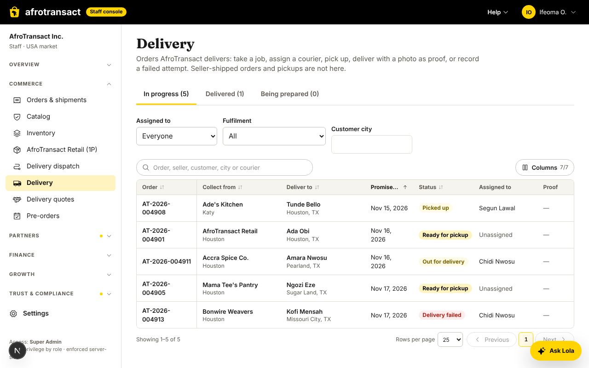
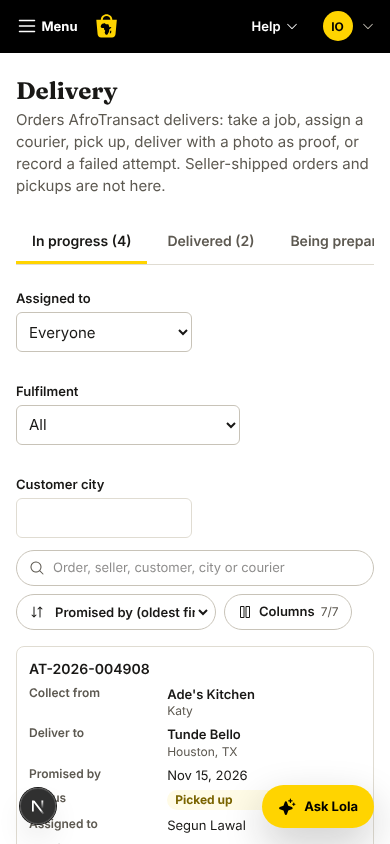
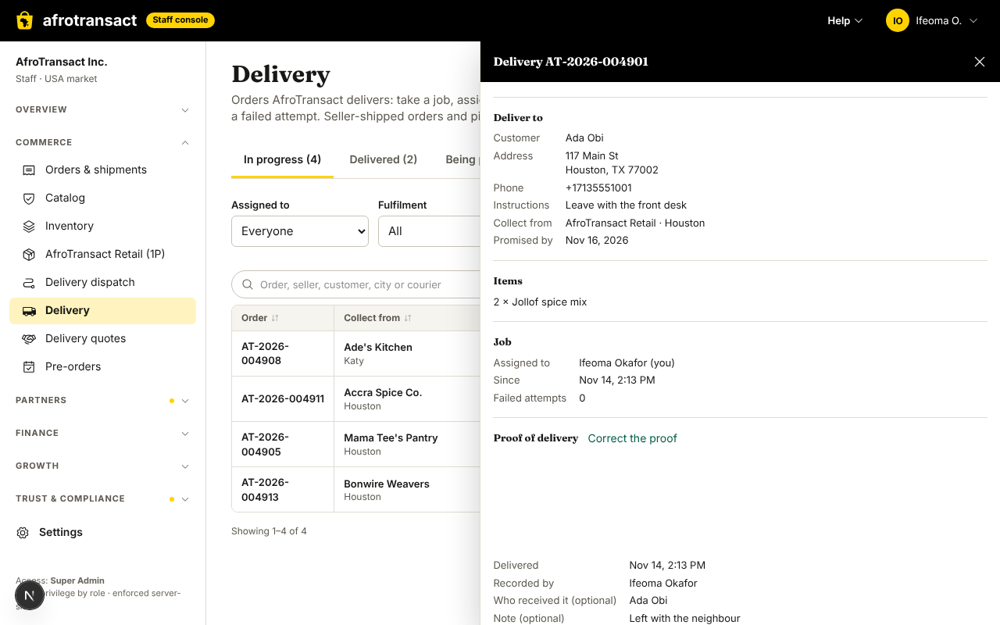
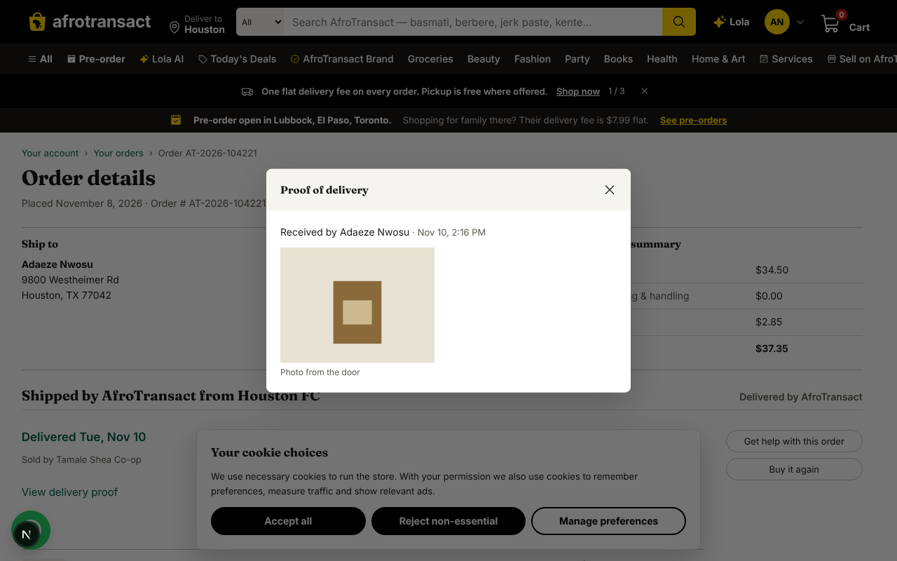
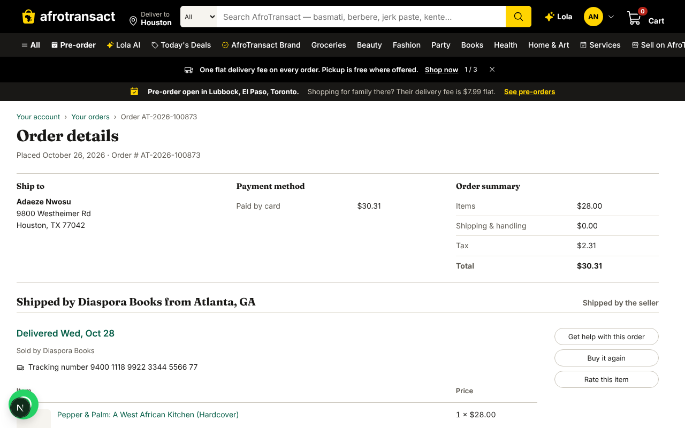

# Delivery and fulfilment modes (Delivery desk)

Plain answer to "who delivers this order, who can mark it delivered, and where is the proof?". The AfroTransact **driver app is dormant**
for now: AfroTransact-delivered orders are handled end to end by staff in the **Delivery** module of the staff console.

## Why an order was stuck "waiting for the driver" (root cause, fixed)

A package the seller packs and ships themselves was labelled `AFROTRANSACT_DELIVERY` at checkout. With seller carrier shipping off (launch
setting) `CheckoutActivitiesImpl.method()` gave that label to every seller-packed package with no explicit choice, not only to sellers who
opted into AfroTransact delivery. Consequences: the seller's state machine stopped at "ready" (no "Mark shipped"), fulfilment created a
delivery job and tried to auto-assign a driver, the staff Orders sheet said "Waiting for the driver", and nobody could finish the order.
Fixes: a real `SELLER_SHIPS` delivery method, a staff delivery desk, the driver queue only behind a flag, and two idempotent data fixes.

## The modes

`FulfilmentMode` is derived (orders `Shipment.fulfilmentMode()`, gateway-bff `domain.FulfilmentModeOf`), never typed in by a person.

| Mode | When | Who moves it | Customer page says | Proof |
|---|---|---|---|---|
| `SELLER_SHIPS` | Seller packs, no AfroTransact opt-in | Seller: confirm, pack, **Mark shipped** (needs a tracking number or a "how you sent it" note), delivered | "Shipped by the seller" and the tracking number. Never a carrier name. | None |
| `AFROTRANSACT_DELIVERY` | Seller opted in (store has a local-delivery snapshot) | Seller: confirm, pack, ready. Then the **Delivery desk** | "Delivered by AfroTransact" | Photo proof |
| `FULFILLED_BY_AFROTRANSACT` | FBA or Retail (1P) | Warehouse until ready. Then the Delivery desk | "Delivered by AfroTransact" | Photo proof |
| `PICKUP` | Customer collects (store or AfroTransact point) | Unchanged, see [store-pickup.md](store-pickup.md) | Pickup wording and handover code | Handover code |
| `PREORDER_RUN` | Community delivery runs | Unchanged (delivery-runs, drivers) | Run wording | Run proof |

A legacy `SELLER_FULFILLED` + `AFROTRANSACT_DELIVERY` shipment with no local-delivery snapshot is a mislabel and counts as `SELLER_SHIPS`.
The wire key `afrotransact_delivery` for seller packages was kept for compatibility.

Rules enforced by the state machine (`DefaultShipmentTransitionPolicy`):
- A seller-shipped shipment **never** enters an AfroTransact delivery queue.
- Delivery staff (`ActorKind.DELIVERY_STAFF`) can only act on AfroTransact-delivered shipments: picked up (from ready), out for delivery
  (from picked up, in transit or delivery failed), delivered (from out for delivery), delivery failed. No cancel or return.
- Honest wording: the storefront, customer app and emails say AfroTransact delivers only when it truly does, and never name a carrier.

## Delivery module (staff console)

Sidebar link **Delivery** (`/delivery`). Server-driven table with search and filters (status, assignee, seller city, customer city),
names instead of ids. Opening a row shows the sheet with the timeline, proof and audit trail.

Actions (each is a `POST /v1/staff/deliveries/{shipmentId}/...` with an `Idempotency-Key` and the job `version`):

| Action | From | Notes |
|---|---|---|
| Take | queued | Assigns the signed-in staff member |
| Assign by name | queued, assigned | Assignee must hold `delivery:manage` (picker lists those people by name) |
| Picked up | ready, assigned | |
| Out for delivery | picked up, failed | Sends the customer "out for delivery" |
| Delivered | out for delivery | **Requires proof**, sends the customer "delivered" |
| Failed (reason required) | picked up, out for delivery | Reason is kept in the audit trail |
| Reattempt | failed | Back to out for delivery |
| Correct proof | delivered | Audited admin correction, see below |

Guarantees: permissions are checked server-side (orders service and gateway-bff, which also checks the module level); a stale `version`
returns 409 (optimistic locking); repeating the same `Idempotency-Key` returns the first result and writes nothing twice; every change is
a row in `delivery_audit`, which is append-only (a database trigger blocks update and delete).

## Permissions

| Permission | Meaning |
|---|---|
| `delivery:read` | See the queue, jobs, proof and audit |
| `delivery:manage` | Everything above, plus all actions. Also the condition to be assignable as a courier |

Granted by migration `identity V49__delivery_permissions.sql` (also the `delivery` access module, position 27):

| Role | Permissions | Module level |
|---|---|---|
| super_admin, fulfilment_ops, dispatcher | read + manage | FULL |
| operations_manager | read + manage | EDIT |
| customer_support, product_owner, auditor, developer | read | VIEW |
| everyone else | none | NONE |

Give someone the ability to deliver: add `delivery:manage` to their role (staff console, Roles) or give them `dispatcher`. See also
[authorisation.md](authorisation.md).

## Delivery proof

- **Photos**: 1 to 5, uploaded to the media service as purpose `proof-photo` (private bucket, short-lived signed URLs, jpeg/png/webp, at most
  10 MB each). gateway-bff re-checks with media that each asset exists, has that purpose, and is not pending or rejected.
- **Optional**: recipient name (120 characters), note (500), coordinates (only as a pair, only when the device gave them).
- **Automatic**: time of delivery and the staff member's name. The staff name is the signed-in person, never typed.
- **Immutable**: a proof row cannot be deleted or edited in place. An admin with `delivery:manage` can **correct** it with a reason; the
  correction is a new audited record (`orders.delivery.proof_corrected`), the earlier values stay in `delivery_audit`.
- **Shown to**: the customer on their order (storefront and customer app) **only for AfroTransact-delivered orders**; the seller read-only
  in Seller Center for those orders; staff in the Delivery sheet. Photos are served through signed URLs only.
- **Events** (`contracts/asyncapi`): `orders.delivery.assigned`, `orders.delivery.proof_attached`, `orders.delivery.proof_corrected`
  (counts and flags only, no photos or names), plus `orders.shipment.status_changed` and `orders.shipment.delivered` which drive the customer
  notifications for out for delivery and delivered.

## Driver app: dormant, how to re-enable

- fulfilment-service flag `at.fulfilment.driver-app.enabled` (env `DRIVER_APP_ENABLED`, default **false**).
- Off: intake creates no `delivery_shipment` rows, nothing is auto-assigned, `/v1/driver/*` returns 404.
- On: driver routes, auto-assign and the driver app work as before. A seller-shipped shipment (not from a fulfilment centre and without a
  pickup point) is **still skipped**. Pre-order runs never depended on the flag.
- To re-enable: set `DRIVER_APP_ENABLED=true` on fulfilment-service (Helm value `env.DRIVER_APP_ENABLED`), decide whether the Delivery desk
  keeps owning AfroTransact-delivered orders or hands them to drivers (today the desk is the only path), then ship the Expo driver app
  (`mobile/apps/driver`) again.

## Runbook: an order is stuck

1. Find the shipment in the staff console: Orders, open the order. The sheet says the mode and, for AfroTransact delivery, links to Delivery.
2. **Seller-shipped and stuck waiting**: this was the bug. Data fixes already shipped: orders `V14__seller_shipped_data_fix.sql` (relabels open
   `SELLER_FULFILLED` + `AFROTRANSACT_DELIVERY` shipments with no local-delivery snapshot to `SELLER_SHIPS`, writes a `DATA_FIX` row in
   `delivery_audit`) and fulfilment `V6__seller_shipped_driver_queue_fix.sql` (cancels the orphan driver job). Both are idempotent: re-running
   changes nothing. The seller then marks it shipped with a tracking number or note.
3. **AfroTransact-delivered, nobody took it**: Delivery, filter status Queued, Take or Assign by name.
4. **Failed delivery**: record the reason, then Reattempt. If it cannot be delivered, handle the refund through Orders and Returns.
5. **Wrong or missing proof**: Delivery sheet, Correct proof (reason required). Never edit the database; the audit is append-only.
6. **409 on an action**: someone else changed the job. Refresh and retry.

Check query (read-only): `select count(*) from shipment where fulfilment_type='SELLER_FULFILLED' and delivery_method='AFROTRANSACT_DELIVERY' and local_delivery is null and status in ('PLACED','CONFIRMED','PACKED','READY');` should be 0 after V14 (adjust column names to the orders schema).

## Screenshots

Delivery queue:  
Delivered with proof:  
Customer order, AfroTransact-delivered (proof):  
Customer order, seller-shipped (tracking number, no proof):  

Regenerate with `E2E_SHOTS=1 E2E_SERVER=dev npx playwright test specs/staff-console.delivery.spec.ts specs/storefront.delivery-proof.spec.ts` in `tests/e2e`.

## Not decided yet (owner)

Who may act as a courier (now: any enabled staff with `delivery:manage`), proof retention period (nothing deletes proof yet), and whether a
recipient signature is wanted (now only an optional name and note).
