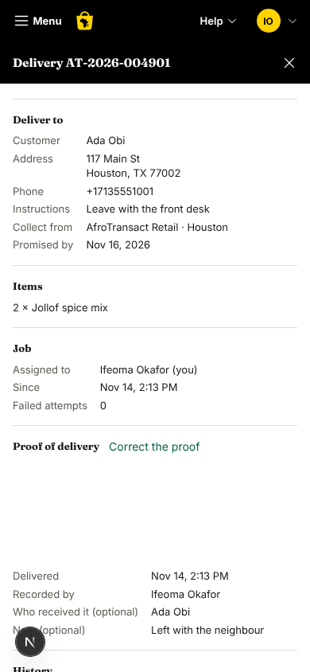
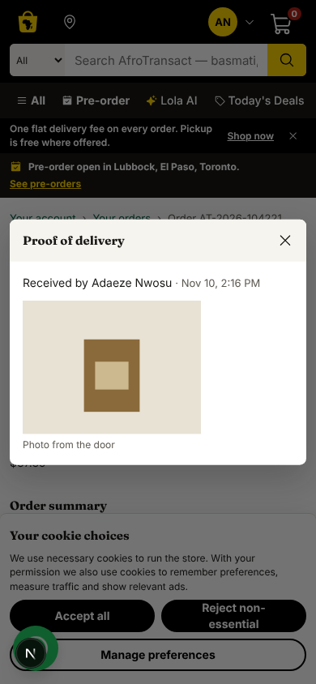
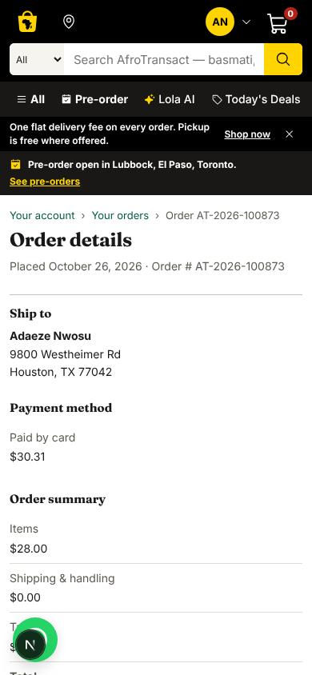

# Delivery and fulfilment modes (Delivery desk)

Plain answer to "who delivers this order, who can mark it delivered, and where is the proof?". The AfroTransact **driver app is dormant**
for now: AfroTransact-delivered orders are handled end to end by staff, from the **Delivery** module and from the **order sheet** of the
staff console (Orders & shipments), which offer the same steps.

## Three ways an order is fulfilled (owner decision)

Every shipment is in exactly one mode, and the mode says who is responsible for moving it. The staff console names the modes in plain words;
shoppers never see the word "FBA".

| Mode (staff console) | What it means | Who moves it | Delivery charge |
|---|---|---|---|
| **Fulfilled by AfroTransact** (`afrotransact_delivery`, `fulfilled_by_afrotransact`) | The seller packs it (or the warehouse does), **AfroTransact picks it up from the seller and delivers it** | Staff holding `delivery:manage`, from the order sheet or the Delivery queue | **AfroTransact revenue** (never part of the seller's payable) |
| **Seller pickup** (`pickup`) | The customer collects it from the seller (or an AfroTransact counter) | The seller, or staff with `orders:manage` | None |
| **Seller ships** (`seller_ships`) | The seller sends it and is **responsible** for it, its status and its tracking | The seller, in Seller Center. Admins can see it; only `orders:override-shipment` can override it | The seller keeps what the customer paid for shipping |

Most sellers are expected to use Fulfilled by AfroTransact for now and AfroTransact does not use drivers: **admins act as the delivery agent**.
The mode is derived (orders `Shipment.fulfilmentMode()`, gateway-bff `domain.FulfilmentModeOf`), never typed in by a person. Which mode an
order gets: the seller's location has AfroTransact pickup switched on (Seller Center, Settings, Shipping and delivery) gives Fulfilled by
AfroTransact; stock held in an AfroTransact warehouse (FBA, Retail) gives Fulfilled by AfroTransact too; the customer chose Pickup gives Seller
pickup; anything else is Seller ships.

### Who moves what (enforced on the server, never only in the console)

Statuses are the shipment states `placed, confirmed, packed, ready, picked_up, in_transit, out_for_delivery, delivered, delivery_failed,
returned, cancelled`. "Staff" below is a person at the staff console; services (fulfilment relay, carriers) keep their own rules.

| Mode | Seller | Staff with the delivery permission | Staff with the order permission | Override permission |
|---|---|---|---|---|
| Fulfilled by AfroTransact | confirmed, packed, ready (read-only after ready, sees "AfroTransact picks this up") | `ready` to `picked_up` (note), then `in_transit` (optional), `out_for_delivery`, `delivered` (**photo proof**), `delivery_failed` (**reason**) then `out_for_delivery` again or `returned` (**reason**) | `cancelled` before pickup; returns of a delivered order through Returns | not applicable |
| Seller pickup | confirmed, packed, **ready**, **collected** (`delivered`, with the customer's 4-digit code) | not applicable | **ready** (from confirmed or packed), **collected** (the code, or a reason), **not collected** (`returned` from ready, **reason**), `cancelled` | not applicable |
| Seller ships | confirmed, packed, ready, shipped (`picked_up`, with a tracking number or how it was sent), delivered | nothing: the menu says "Updated by the seller" | `cancelled` before pickup only | any **later** status, forward only (a delivered one can still be `returned`), `cancelled` only before pickup, **reason required**, audited |

Rules that hold everywhere: a step may not be skipped (in transit is the one optional step); nothing goes backwards; every change is a row in the
shipment history with **who, when and the note**; the customer is told through the existing notification events (`orders.shipment.status_changed`
and `orders.shipment.delivered`: shipped, out for delivery, delivered, delivery failed) in plain words, with no carrier name and no claim that AfroTransact delivers unless it does.
The general status call (`POST /v1/shipments/{id}/transitions`) **refuses** the delivery steps of a Fulfilled by AfroTransact shipment and every
status of a seller-shipped one (except cancelling) for people (403 `orders.use-delivery-steps`, `orders.seller-ships`), so the proof and the
audit cannot be skipped by calling it directly.

### The order sheet and the Delivery queue agree

One implementation: the order sheet's **Set status** menu takes a Fulfilled by AfroTransact step through the same `/v1/staff/deliveries/{shipmentId}/...` calls
the Delivery queue uses (`picked-up`, `in-transit`, `out-for-delivery`, `delivered`, `failed`, `returned`), so the data, actions, audit and customer
notifications are the same. Whoever takes the first step on a shipment nobody has takes the job automatically (audited as a take). The screen sends the status
it saw (`expectedStatus`) and the job `version`: another person's earlier change answers 409 and the screen reloads instead of overruling them. **Delivered** opens
the proof capture inside the sheet (photo through the media service, optional recipient name and note).

The menu says why a step is not on offer, never the generic "Not available from here" for a step that is just not next:

| Reason shown | When |
|---|---|
| You need the delivery permission | A Fulfilled by AfroTransact step, and the role lacks `delivery:manage` (or the Delivery module at Edit) |
| Updated by the seller | Every step of a seller-shipped shipment (an **Override status** link appears only for `orders:override-shipment`) |
| Not available for pickup orders | A delivery step (picked up, in transit, out for delivery, delivery failed) on a pickup order |
| Only the seller does this step | Confirm, pack or ready on a seller-packed shipment |
| Finish earlier steps first | The step would skip one |
| No permission | The role may not change shipments at all |

The Delivery queue lists the Fulfilled by AfroTransact shipments awaiting pickup (ready), awaiting delivery (picked up, in transit, out for delivery) and failed
(delivery failed), plus the delivered tab. **Picked up from the seller** is an explicit step with an optional pickup note (where and from whom); the time and
the staff member's name are recorded.

## Why an order was stuck "waiting for the driver" (root cause, fixed)

A package the seller packs and ships themselves was labelled `AFROTRANSACT_DELIVERY` at checkout. With seller carrier shipping off (launch
setting) `CheckoutActivitiesImpl.method()` gave that label to every seller-packed package with no explicit choice, not only to sellers who
opted into AfroTransact delivery. Consequences: the seller's state machine stopped at "ready" (no "Mark shipped"), fulfilment created a
delivery job and tried to auto-assign a driver, the staff Orders sheet said "Waiting for the driver", and nobody could finish the order.
Fixes: a real `SELLER_SHIPS` delivery method, a staff delivery desk, the driver queue only behind a flag, and two idempotent data fixes.

## Why "Set status" was greyed for an AfroTransact-delivered shipment (root cause, fixed)

The order sheet asked orders-service what a staff member may set. For a seller-packed shipment sent to AfroTransact Delivery the general rules gave platform
admins only the oversight steps (confirm delivery, failure, return, cancel), because the transit steps belonged to a carrier or a driver; the Delivery queue's own
steps (delivery staff) were not offered on the sheet. So picked up, in transit and out for delivery showed greyed with the generic "Not available from here" and only
Cancelled was enabled. Now the sheet offers a Fulfilled by AfroTransact shipment the delivery steps to holders of `delivery:manage`, and says why when it does not.

## The modes in the code

`FulfilmentMode` is derived (orders `Shipment.fulfilmentMode()`, gateway-bff `domain.FulfilmentModeOf`), never typed in by a person.

| Mode | When | Who moves it | Customer page says | Proof |
|---|---|---|---|---|
| `SELLER_SHIPS` | Seller packs, no AfroTransact opt-in | Seller: confirm, pack, **Mark shipped** (needs a tracking number or a "how you sent it" note), delivered | "Shipped by the seller" and the tracking number. Never a carrier name. | None |
| `AFROTRANSACT_DELIVERY` | Seller opted in (store has a local-delivery snapshot) | Seller: confirm, pack, ready. Then the **Delivery desk** | "Delivered by AfroTransact" | Photo proof |
| `FULFILLED_BY_AFROTRANSACT` | FBA or Retail (1P) | Warehouse until ready. Then the Delivery desk | "Delivered by AfroTransact" | Photo proof |
| `PICKUP` | Customer collects (store or AfroTransact point) | Unchanged, see [store-pickup.md](store-pickup.md) | Pickup wording and handover code | Handover code |
| `PREORDER_RUN` | Community delivery runs | Unchanged (delivery-runs, drivers) | Run wording | Run proof |

A legacy `SELLER_FULFILLED` + `AFROTRANSACT_DELIVERY` shipment with no local-delivery snapshot is a mislabel and counts as `SELLER_SHIPS`.
The wire key `afrotransact_delivery` for seller packages was kept for compatibility.

Rules enforced by the state machine (`DefaultShipmentTransitionPolicy`):
- A seller-shipped shipment **never** enters an AfroTransact delivery queue.
- Delivery staff (`ActorKind.DELIVERY_STAFF`) can only act on AfroTransact-delivered shipments: picked up (from ready), out for delivery
  (from picked up, in transit or delivery failed), delivered (from out for delivery), delivery failed. No cancel or return.
- Honest wording: the storefront, customer app and emails say AfroTransact delivers only when it truly does, and never name a carrier.

## Delivery module (staff console)

Sidebar link **Delivery** (`/delivery`). Server-driven table with search and filters (status, assignee, seller city, customer city),
names instead of ids. Opening a row shows the sheet with the timeline, proof and audit trail.

Actions (each is a `POST /v1/staff/deliveries/{shipmentId}/...` with an `Idempotency-Key`, the job `version` and, optionally, the `expectedStatus` the screen saw):

| Action | From | Notes |
|---|---|---|
| Take | ready, picked up, in transit, out for delivery, failed | Assigns the signed-in staff member. **Optional**: any step below takes the job when nobody has it |
| Assign by name | same | Assignee must hold `delivery:manage` (picker lists those people by name) |
| Picked up from the seller | ready | Optional pickup note; time and name recorded |
| In transit | picked up | Optional step |
| Out for delivery | picked up, in transit, failed | Sends the customer "out for delivery" (a failed one is a reattempt) |
| Delivered | out for delivery | **Requires proof**, sends the customer "delivered" |
| Failed (reason required) | picked up, in transit, out for delivery | Reason is kept in the audit trail |
| Returned to the seller (reason required) | failed | The parcel goes back to the seller; refunds go through Returns |
| Correct proof | delivered | Audited admin correction, see below |

Guarantees: permissions are checked server-side (orders service and gateway-bff, which also checks the module level); a stale `version`
returns 409 (optimistic locking); repeating the same `Idempotency-Key` returns the first result and writes nothing twice; every change is
a row in `delivery_audit`, which is append-only (a database trigger blocks update and delete).

## Permissions

| Permission | Meaning |
|---|---|
| `delivery:read` | See the queue, jobs, proof and audit |
| `delivery:manage` | Everything above, plus all actions. Also the condition to be assignable as a courier |
| `orders:override-shipment` | Override the status of a **seller-shipped** shipment: forward only, reason required, audited. **Super Admin only** (identity `V52__orders_override_shipment_permission.sql`; grant it to another role in Roles and permissions, see [add-a-permission-to-a-role](../runbooks/add-a-permission-to-a-role.md)) |

Granted by migration `identity V49__delivery_permissions.sql` (also the `delivery` access module, position 27):

| Role | Permissions | Module level |
|---|---|---|
| super_admin, fulfilment_ops, dispatcher | read + manage | FULL |
| operations_manager | read + manage | EDIT |
| customer_support, product_owner, auditor, developer | read | VIEW |
| everyone else | none | NONE |

Give someone the ability to deliver: add `delivery:manage` to their role (staff console, Roles) or give them `dispatcher`. See also
[authorisation.md](authorisation.md).

## Delivery proof

- **Photos**: 1 to 5, uploaded to the media service as purpose `proof-photo` (private bucket, short-lived signed URLs, jpeg/png/webp, at most
  10 MB each). gateway-bff re-checks with media that each asset exists, has that purpose, and is not pending or rejected.
- **Optional**: recipient name (120 characters), note (500), coordinates (only as a pair, only when the device gave them).
- **Automatic**: time of delivery and the staff member's name. The staff name is the signed-in person, never typed.
- **Immutable**: a proof row cannot be deleted or edited in place. An admin with `delivery:manage` can **correct** it with a reason; the
  correction is a new audited record (`orders.delivery.proof_corrected`), the earlier values stay in `delivery_audit`.
- **Shown to**: the customer on their order (storefront and customer app) **only for AfroTransact-delivered orders**; the seller read-only
  in Seller Center for those orders; staff in the Delivery sheet. Photos are served through signed URLs only.
- **Events** (`contracts/asyncapi`): `orders.delivery.assigned`, `orders.delivery.proof_attached`, `orders.delivery.proof_corrected`
  (counts and flags only, no photos or names), plus `orders.shipment.status_changed` and `orders.shipment.delivered` which drive the customer
  notifications for out for delivery and delivered.

## Money: who earns the delivery charge

`payments` `DefaultPaymentSplitter` books it per mode, pinned by `FulfilmentModeSplitTest` (and the existing worked examples):

| Mode | Payment line | Delivery charge (what the customer paid for shipping) |
|---|---|---|
| Fulfilled by AfroTransact, from a seller's store | `AFROTRANSACT_DELIVERY` | AfroTransact revenue (account 4200); not in the seller's payable. The seller also pays commission and the pickup fee quoted at checkout (4250) |
| Fulfilled by AfroTransact, from a warehouse | `FBA` | AfroTransact revenue (4200); not in the seller's payable (Retail keeps it as its own sale) |
| Seller pickup | `SELF`, shipping 0 | None |
| Seller ships | `SELF` | The seller's, inside their payable |

## Driver app: dormant, how to re-enable

- fulfilment-service flag `at.fulfilment.driver-app.enabled` (env `DRIVER_APP_ENABLED`, default **false**).
- Off: intake creates no `delivery_shipment` rows, nothing is auto-assigned, `/v1/driver/*` returns 404.
- On: driver routes, auto-assign and the driver app work as before. A seller-shipped shipment (not from a fulfilment centre and without a
  pickup point) is **still skipped**. Pre-order runs never depended on the flag.
- The staff console sidebar labels **Delivery dispatch** and **Delivery quotes** "Not in use" while the BFF's `DRIVER_APP_ENABLED` is off (it mirrors the fulfilment flag; default
  false). They stay reachable (pickup points and quotes already asked for live there); nothing was deleted. Staff deliver from **Delivery**.
- To re-enable: set `DRIVER_APP_ENABLED=true` on fulfilment-service and gateway-bff (Helm value `env.DRIVER_APP_ENABLED`), decide whether the Delivery desk
  keeps owning AfroTransact-delivered orders or hands them to drivers (today the desk is the only path), then ship the Expo driver app
  (`mobile/apps/driver`) again.

## Runbook: an order is stuck

1. Find the shipment in the staff console: Orders, open the order. The sheet says the mode and, for AfroTransact delivery, links to Delivery.
2. **Seller-shipped and stuck waiting**: this was the bug. Data fixes already shipped: orders `V14__seller_shipped_data_fix.sql` (relabels open
   `SELLER_FULFILLED` + `AFROTRANSACT_DELIVERY` shipments with no local-delivery snapshot to `SELLER_SHIPS`, writes a `DATA_FIX` row in
   `delivery_audit`) and fulfilment `V6__seller_shipped_driver_queue_fix.sql` (cancels the orphan driver job). Both are idempotent: re-running
   changes nothing. The seller then marks it shipped with a tracking number or note.
3. **AfroTransact-delivered, nobody took it**: Delivery, filter status Queued, Take or Assign by name.
4. **Failed delivery**: record the reason, then Reattempt. If it cannot be delivered, handle the refund through Orders and Returns.
5. **Wrong or missing proof**: Delivery sheet, Correct proof (reason required). Never edit the database; the audit is append-only.
6. **409 on an action**: someone else changed the job. Refresh and retry.

Check query (read-only): `select count(*) from shipment where fulfilment_type='SELLER_FULFILLED' and delivery_method='AFROTRANSACT_DELIVERY' and local_delivery is null and status in ('PLACED','CONFIRMED','PACKED','READY');` should be 0 after V14 (adjust column names to the orders schema).

## Screenshots

Delivery queue:  
Delivered with proof:  
Customer order, AfroTransact-delivered (proof):  
Customer order, seller-shipped (tracking number, no proof):  

Regenerate with `E2E_SHOTS=1 E2E_SERVER=dev npx playwright test specs/staff-console.delivery.spec.ts specs/storefront.delivery-proof.spec.ts` in `tests/e2e`.

## Seller Center

- A seller whose shipment is Fulfilled by AfroTransact sees its status read-only: "AfroTransact picks this up" (with where to find the pickup hours, Settings,
  Shipping and delivery) while it is ready, "AfroTransact has this order" while it is picked up or on its way, and "could not deliver this yet" after a failed attempt. There is no button.
- A seller who ships updates their own status and tracking (mark shipped with a tracking number or how it was sent, then delivered).
- Settings, Shipping and delivery, per location: the AfroTransact pickup switch **is** the choice between Fulfilled by AfroTransact (on, with pickup hours) and shipping it yourself (off).
  Turning it off asks the seller to tick that they are responsible for shipping those orders.

## Not decided yet (owner)

Who may act as a courier (now: any enabled staff with `delivery:manage`), proof retention period (nothing deletes proof yet), and whether a
recipient signature is wanted (now only an optional name and note).

Decided in this change, for the owner to confirm: no skipping steps at all (in transit is the only optional one) instead of "skip with a reason"; "not collected" for a pickup order is
recorded as `returned` with a reason (there is no separate expired status yet); the override list is forward-only and Super Admin only; Delivery dispatch and Delivery quotes are
**labelled** not in use rather than hidden, because pickup points and open quotes still live there; the seller's responsibility confirmation is a tick in Seller Center and is **not yet stored**
server-side, and a new seller is not yet defaulted to Fulfilled by AfroTransact (AfroTransact needs their pickup hours and a located address first, so it stays off until they save them).
