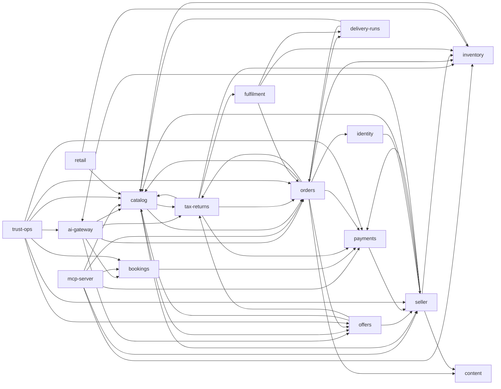

# Release 1 architecture: two deployables, every service a module

Decision and success criteria: [ADR 0011](../adr/0011-modular-monolith-release-1.md). This page is the inventory behind it, the module
design, the risks and the migration order. Everything marked **(config-derived)** was read from `application*.yml`, `@KafkaListener`
and adapter class names, not from running code; it must be re-checked per module in its batch (the checklist is at the end).
Measured numbers are in the Phase 2 section of this page once they exist.

## 1. Shape

```
                       Cloudflare Tunnel -> Envoy Gateway
                                   |
        +--------------------------+---------------------------+
        |                                                      |
 afrotransact-go (one binary)                      afrotransact-core (one JVM, java/apps/core)
   gateway-bff  (edge)                               module: catalog | tax-returns | offers | inventory | seller | content
   search, indexer, cart, geo, media,                        orders | payments | bookings | trust-ops | fulfilment
   notifications, (promise, carrier-gateway,                 identity (last batch) | ai-gateway, mcp-server (optional)
   authz-sync: disabled by default)                          retail, delivery-runs (not in the launch set: disabled)
        |  HTTP between the two deployables (client-credentials tokens, as today)  |
        +--------------------------------------------------------------------------+
                  per-module Postgres databases, Kafka, Valkey, Meilisearch, Temporal (unchanged)
```

Inside a deployable, module-to-module calls are in-process. Between the two deployables they stay HTTP with the same tokens and scopes.

## 2. Java inventory (16 modules, 14 in the launch set)

Ports are the local ones (`infra/local/PORTS.md`); in core they stop being separate listeners (one port, one management port).
`Sched` = number of classes with `@Scheduled`. Group = Kafka consumer group id **(config-derived)**; core keeps these exact ids.

| Module | Local port | Database | Property prefix | Sched | Notable libraries | Launch set |
|---|---|---|---|---|---|---|
| identity | 8100 | `identity` | `at.identity` (+`.local-development`, `.seller-sync`) | 1 | Spring Authorization Server, OAuth client, WebAuthn, session-jdbc, Thymeleaf, BouncyCastle, libphonenumber | yes |
| catalog | 8101 | `catalog` | `at.catalog` | 4 | POI (xlsx), PDFBox, ZXing | yes |
| offers | 8102 | `offers` | `at.offers` | 1 | | yes |
| inventory | 8103 | `inventory` | `at.inventory` | 1 | | yes |
| orders | 8104 | `orders` | `at.orders` | 3 | Temporal starter, Redis, Guava | yes |
| payments | 8105 | `payments` | `at.payments` | 1 | Stripe SDK | yes |
| seller | 8106 | `seller` | `at.seller` | 1 | Stripe SDK, gson, ical4j, libphonenumber | yes |
| retail | 8107 | `retail` | `at.retail` | 1 | PDFBox | no (disabled by default) |
| fulfilment | 8108 | `fulfilment` (PostGIS) | `at.fulfilment` | 1 | | yes |
| bookings | 8109 | `bookings` (btree_gist) | `at.bookings` | 1 | | yes |
| trust-ops | 8110 | `trustops` | `at.trustops` | 1 | | yes |
| tax-returns | 8111 | `taxreturns` | `at.taxreturns` | 2 | Avalara AvaTax SDK (gson, Apache HttpClient 4), Stripe Tax | yes |
| content | 8112 | `content` | `at.content` | 1 | json-schema-validator | yes |
| ai-gateway | 8113 | `ai` | `at.ai` | 0 | Spring AI (OpenAI-compatible), okhttp, okio | yes (optional, detachable) |
| mcp-server | 8114 | none | `at.mcp` | 2 | Spring AI MCP server, Redis | yes (optional, detachable) |
| delivery-runs | 8115 | `deliveryruns` | `at.delivery-runs` | 2 | | no (disabled by default) |

Consumer groups (config-derived): `<module>-service` for every module with consumers (`bookings-service`, `catalog-service`, `content-service`,
`delivery-runs-service`, `fulfilment-service`, `identity-service`, `inventory-service`, `offers-service`, `payments-service`,
`retail-service`, `seller-service`, `tax-returns-service`, `trust-ops-service`); catalog also uses `catalog-service-selling`;
orders sets its group in code/profile, check in its batch. Listener ids are already module-prefixed (`catalog-offer-stock`, `taxreturns-orders`).

### 2.1 Kafka topics (config-derived)

| Topic | Produced by (outbox relay) | Consumed by |
|---|---|---|
| `at.product.events` | catalog | tax-returns, offers, inventory, trust-ops, indexer (Go) |
| `at.taxreturns.events` | tax-returns | catalog, offers |
| `at.offers.events` | offers | catalog, inventory, indexer |
| `at.order.events` | orders | content, delivery-runs, fulfilment, offers, payments, seller, tax-returns, trust-ops |
| `at.payment.events` | payments | bookings, delivery-runs, orders, tax-returns |
| `at.seller-compliance.events` | seller | bookings, catalog, offers, payments |
| `at.identity.events` | identity | fulfilment, payments, seller, trust-ops, notifications/authz-sync (Go) |
| `at.seller-org.events` | seller/identity | identity, indexer, authz-sync (Go) |
| `at.delivery-runs.events` | delivery-runs | fulfilment, orders, notifications |
| `at.inventory.events` / `at.inventory-inbound.events` | inventory | offers, indexer |
| `at.retail.events` | retail | inventory, offers, payments |
| `at.bookings.events` | bookings | payments, trust-ops, notifications |
| `at.carrier-shipment.events` | carrier-gateway (Go) | orders, payments, tax-returns |
| `at.ads.events`, `at.product-review.events`, `at.ai-handoff.events`, `at.seller-subscription.events` | content / catalog / ai / seller | content, search, trust-ops, payments |

Kafka stays the integration path for events inside core too. Replacing it with an in-process event bus is out of scope for Release 1:
it would remove the durability and replay that the outbox gives, and the consumer groups are what makes a detach cheap.

### 2.2 Outbound service-to-service calls (config-derived; scopes from identity's `application-prod.yml` clients)

Each Java module calls others with its own client-credentials token. Scopes held by the token (this is what in-process callers must be granted):

| Caller module | Calls (module) | Client scopes |
|---|---|---|
| catalog | tax-returns (`/v1/tax/classifications/resolve`, `/v1/tax/listing-decisions/status`), offers, orders (purchase check), seller (approvals, catalog scope), media (Go) | `tax:classify`, `offers:read`, `offers:write`, `orders:purchase-check`, `sellers:catalog-scope.read`, `media:import` |
| tax-returns | catalog (`/v1/public/variants/{atin}`, public, no token), payments, inventory, orders, fulfilment, carrier-gateway (Go) | its own client (`ClientCredentialsTokens`), see its batch |
| offers | catalog, seller, tax-returns | `catalog:read`, `sellers:ship-from.read`, `sellers:entitlements.read`, `tax:read`, `tax:classify` |
| inventory | catalog, carrier-gateway (Go) | `catalog:read`, `catalog:write`, `shipping:label` |
| orders | cart (Go), identity, inventory, payments, promise (Go), content, catalog, offers, tax-returns, delivery-runs, geo (Go) | per-client list in identity |
| payments | seller | `orgs:read`, `seller:billing`, `sellers:membership.read` |
| seller | catalog, payments, inventory, content, ai-gateway, media (Go), geo (Go) | per-client list in identity |
| bookings | payments, geo (Go) | per-client list in identity |
| trust-ops | catalog, bookings, orders, payments, seller, offers, ai-gateway | `catalog:moderate`, `payments:service`, `compliance:hold`, `offers:write`, `ai:triage`, `users:read`, `orders:lookup`, `sellers:enforce`, `bookings:reviews:moderate` |
| fulfilment | orders, inventory, delivery-runs, geo (Go) | per-client list |
| delivery-runs | orders, catalog, geo, media, search (Go) | `geo:zones:write`, `orders:on-behalf`, `media:read` |
| retail | catalog, inventory, media (Go) | `catalog:read`, `inventory:receive`, `inventory:read`, `media:write` |
| ai-gateway | search, promise, cart (Go); catalog, offers, orders, bookings, tax-returns | OpenRouter key + user token relay |
| mcp-server | search, cart, promise, geo (Go); catalog, inventory, orders, seller, payments, bookings | relays the caller's token (`mcp:shopper`, `mcp:seller`) |
| identity | seller (`HttpSellerOrgSource`) | `at.identity.seller-sync` |

**What the checks really are (finding).** The controllers only require an authenticated JWT (`PlatformSecurityAutoConfiguration`:
`anyRequest().authenticated()`). The scope is folded into the actor's permissions (`JwtActorResolver`) and enforced inside the
application services (`Access.staffAny(TAX_CLASSIFY, ...)` and `PermissionChecker`). So an in-process call that skips the controller but
calls the application service still has to supply an actor: without one the service would throw or, with the local resolver, run as
`LOCAL_SUPER_ADMIN` and silently pass every check. The in-process design below makes the actor explicit.

### 2.3 Call graph (Java to Java; arrows are "calls over HTTP today")



Cycles (all through ports, so wiring must be lazy): catalog<->tax-returns, catalog<->offers, catalog<->seller<->payments,
catalog->orders->catalog, orders<->payments (via events and HTTP), seller<->ai-gateway<->catalog. Consequence: in-process adapters must
resolve the target API through `ObjectProvider` at call time, never in the constructor (a constructor dependency would be a circular
bean reference and the context would not start).

## 3. Collisions and hazards in one JVM (what was found, with the fix)

| # | Hazard | Evidence | Fix |
|---|---|---|---|
| 1 | One `application.yml` on the classpath per jar; profile files too | every service has `application{,-local,-dev,-uat,-prod}.yml` | Module jars carry their config under `modules/<m>/application*.yml`; a core `EnvironmentPostProcessor` loads only `at.<m>.**` (and an allow-list) from it, at lowest precedence |
| 2 | Global keys inside module config: `spring.datasource`, `spring.kafka.consumer.group-id`, `management.metrics.tags.service`, `server.port`, `spring.application.name`, `spring.flyway.locations`, `at.consumers.enabled`, `at.events.relay-enabled` | catalog `application.yml` lines 1-60 | Ignored by the loader (core owns them) or mapped to `at.modules.<m>.*`; DB URL/user/password come from per-module env vars (`CATALOG_DB_URL`...) because `DB_URL` is the same name in every service |
| 3 | Same Flyway path `db/migration` in every service jar | all services | pom resource entry copies `db/migration` to `modules/<m>/db/migration` (source tree untouched); core runs Flyway per module on that location plus `db/platform` |
| 4 | Several `DataSource`/`JdbcClient`/`TransactionManager` beans: by-type injection is ambiguous, Boot auto-config backs off | 26 catalog files inject `JdbcClient`, 9 inject `PlatformTransactionManager`, 30 use `@Transactional` | Module-aware autowire candidate resolver (a module-owned bean is injectable only into classes of that module's package) and a routing `@Primary` transaction manager that picks the module by the `@Transactional` method's package |
| 5 | `platform-events` autoconfig builds ONE outbox store, publisher, inbox deduplicator, relay, retention job | `PlatformEventsAutoConfiguration` | Core builds these per module over the module's `JdbcClient`; auto-config backs off through `@ConditionalOnMissingBean` |
| 6 | Single `spring.kafka.consumer.group-id` | listeners say `groupId = "${spring.kafka.consumer.group-id:catalog-service}"` | Core does not set the global property, so every listener keeps its own default (the old group id). A test asserts the effective group of every listener |
| 7 | One shared `@Scheduled` pool (Boot default: 1 thread) | catalog, tax-returns, orders, payments... | Routing `TaskScheduler`: one `ThreadPoolTaskScheduler` per module (`at.modules.<m>.scheduler.pool-size`, default 2), thread names `sched-<m>-n` |
| 8 | `@RestControllerAdvice` is global; `TaxReturnsErrorAdvice` (order HIGHEST_PRECEDENCE) handles `IllegalArgumentException`, `IllegalStateException`, `MissingRequestHeaderException` for EVERY controller | `TaxReturnsErrorAdvice` | Every module advice gets `basePackages`; an ArchUnit rule enforces it |
| 9 | Bean-name collisions (same class simple name in two modules, e.g. `ClientCredentialsTokens`, `Access`, `Upstream`) and `@Bean` method names | catalog and tax-returns both have `ClientCredentialsTokens` | Component scan per module with a name generator that prefixes the module; `@Bean` collisions are found by a context test |
| 10 | `SecurityFilterChain`: platform chain is `@ConditionalOnMissingBean`; identity, seller, content, mcp-server define their own | `SecurityConfiguration`, `SellerSecurityConfiguration`, `ContentSecurityConfiguration`, `McpSecurityConfiguration` | Per module chain with a `securityMatcher` for its paths, ordered before the shared default chain. Public paths are the union of the modules' `at.security.public-paths`. Identity goes last because it is the Authorization Server (own chains, JWKS, sessions) |
| 11 | Actuator, Micrometer common tag `service` is global | `management.metrics.tags.service: catalog-service` | Common tag `service=afrotransact-core` (process-level metrics); module meters get `module=<m>` and `service=<short name>` from a `MeterFilter` and an MVC observation convention (handler's package) |
| 12 | OTLP `service.name` is one per process | `spring.application.name` | Resource `service.name=afrotransact-core`; every span gets `module` (handler/listener package), every log line gets MDC `module` (the structured logs already carry the service name; core's encoder takes it from MDC) |
| 13 | springdoc: one `/v3/api-docs`, operation id collisions across modules | each service documents itself | `GroupedOpenApi` per module (`/v3/api-docs/<m>`), Scalar/Redoc pages per module; the contract route diff (S4) runs per group |
| 14 | `ActingAsActorResolver` and `LocalActorResolver` read the current HTTP request header | `libs/platform-security` | The in-process caller actor is resolved first and cannot be changed by the request's headers |
| 15 | Static singletons | 1-17 `static final X = new ...` per module, mostly codecs and formatters | Reviewed in each batch; stateless ones are fine. None found so far holds per-module mutable state, but `retail` (17) and `catalog` (13) are checked first |
| 16 | `@EnableScheduling` in `platform-events` plus module configs | autoconfig class | One `@EnableScheduling`, one routing scheduler |
| 17 | Multipart limits (`spring.servlet.multipart`: catalog 25 MB) are global | catalog yaml | Core takes the maximum (25 MB); the per-endpoint 10 MB limit is already checked in the controller (`ImportLimits`) |
| 18 | Temporal worker/starter autoconfig (orders) assumes one `WorkflowClient` per app | `temporal-spring-boot-starter` | Only orders uses it; kept as is. Task queue names are unchanged |
| 19 | Shared `RestClient.Builder` bean: modules use `builder.clone()` per adapter | `HttpTaxResolver` | One shared builder and one JDK `HttpClient` pool for the HTTP adapters, timeouts stay per adapter |

### 3.1 Dependency version conflicts

All services already use one platform parent, so most versions agree. The ones to watch in one classpath:

| Library | Pulled by | Risk | Handling |
|---|---|---|---|
| gson | Avalara SDK (tax-returns), Stripe SDK (payments, seller), seller's own gson | Boot 4 uses Jackson 3; gson is separate and not auto-configured, so no clash, only size | keep; versions are managed in `platform-parent` |
| Apache HttpClient 4.5 (`org.apache.http`) | Avalara SDK | Spring uses JDK HttpClient and (if present) HttpClient 5 (`org.apache.hc`): different packages | keep 4.5.14 pinned as today; verify no module has HttpClient 5 on the classpath that Boot would auto-select |
| Jackson 2 (`com.fasterxml`) and 3 (`tools.jackson`) | Spring AI, swagger annotations, Jackson 2 BOM pinned | Both are present today in several services | unchanged |
| commons-io (POI vs commons-compress) | catalog | pinned to 2.22.0 in the catalog pom | the pin must move to platform-parent for core |
| okhttp/okio | ai-gateway | Kotlin stdlib on the classpath | ai-gateway is detachable; its dependencies stay in an optional Maven profile of core |
| Spring Authorization Server, OAuth2 client, WebAuthn, session-jdbc | identity | adds filter chains and a `SessionRepository` (jdbc) to the whole app | identity joins last; session repository scoped to its chain |
| Spring AI MCP server | mcp-server | registers its own servlet endpoints and `McpServerProperties` | optional module |

## 4. Module design (Java)

- **Maven**: `java/libs/module-api/<m>-api` (published API interfaces and records, package `com.afrotransact.<m>.api`, no Spring);
  `java/libs/module-core` (module infrastructure: caller principal, per-module DataSource, Flyway, transaction routing, scheduler,
  config loader, health, metrics); `java/apps/core` (the app; depends on each service's `plain` jar). Each service pom gains a `plain`
  jar execution and the resource copies; its own executable jar and image are unchanged.
- **Module enable**: `at.modules.<m>.enabled` (default true for launch modules, false for the others). A disabled module's beans are
  never created (conditional import), its DataSource is never opened, its health contributor is absent.
- **Mode switch**: `at.<m>.mode=in-process|http`. In core the default is `in-process`; a module in `http` mode uses today's adapter and
  needs the same URL and client credentials as now. In-process mode with the target module disabled fails at start with
  `module 'catalog' is configured at.catalog.mode=in-process but module 'tax-returns' is disabled; enable it or set at.catalog.mode=http`.
- **Caller principal**: `CallerPrincipal(module, clientId, scopes)` from a registry in config
  (`at.modules.<m>.caller-scopes`, defaults copied from identity's client list). The consuming adapter calls
  `InProcessCalls.as(callers.principalFor("catalog"), () -> api.resolve(...))`; this binds a `ScopedValue` that the actor resolver
  consults first. The actor is `SERVICE`, `sub` = the client id, permissions = scopes, so `Access.staffAny(...)` and `PermissionChecker`
  work unchanged. Missing scope -> `ForbiddenActionException` -> 403 exactly as over HTTP.
- **Errors**: API methods throw the same exception types the HTTP adapter maps (`TaxProfileNotFound`, `Unavailable`) so the consumer's
  behaviour does not depend on the mode.
- **Transactions**: a call into another module is its own transaction on its own database, as over HTTP (no distributed transaction,
  none is wanted). A module calling back into itself through another module can hold two connections of the same pool: pool sizes
  per module leave headroom (see S1 and the pool table in the Phase 2 section).
- **ArchUnit** (`java/apps/core` `ModuleBoundaryTest` plus a rule in every module's `ArchitectureTest` via `platform-test`):
  (a) classes of module A depend on classes of module B only inside `com.afrotransact.B.api..`; (b) only `adapter.out.module..`
  may use another module's `api`; (c) `@RestControllerAdvice` has `basePackages`; (d) no class outside a module's own packages is
  injected with that module's `DataSource`/`JdbcClient` (resolver test); (e) `domain` still imports no Spring (existing rule).

## 5. Recommended grouping and order

All modules run in `afrotransact-core`; "batch" is the order in which they are moved from their own Deployment into core, each batch
shipped to production on its own with the old Deployments scaled to 0 (not deleted).

| Batch | Modules | Why together / why here | Gate to proceed |
|---|---|---|---|
| 1 (spike) | catalog, tax-returns | chattiest pair (publish gate, tax facts); proves module infra, principal, health, metrics | Phase 1 and 2 results |
| 2 | offers, inventory, content, seller | catalog's neighbours: offers/inventory/seller call catalog and each other; content has no outbound calls | route diff clean, Phase 2 memory target met |
| 3 | orders, payments, bookings, fulfilment, trust-ops | the money path; orders brings Temporal and Redis; payments brings Stripe; moved after the pattern is proven | checkout SLO unchanged for one week |
| 4 | ai-gateway, mcp-server | optional and heavy; stay detachable, own pools and limits; their dependencies sit in a Maven profile | detach test: core boots without them |
| 5 | identity | Authorization Server: own filter chains, JWKS, sessions; every other module validates its tokens | last, because a mistake here logs everyone out |
| later | retail, delivery-runs | not in the launch set; module present, `enabled=false` | when the business enables them |

Go: see the Go plan below.

## 6. Risks and mitigations

| Risk | Likelihood / impact | Mitigation |
|---|---|---|
| One slow module starves others (scheduler, DB pool, threads) | medium / high | per-module scheduler pools, Hikari pools, Kafka containers; virtual threads for requests; an HTTP bulkhead per module is a Phase 3 item if measurements show contention |
| One crash or OOM takes everything | medium / high | `-XX:+ExitOnOutOfMemoryError` stays; readiness per module; two replicas when the node count allows; rollback by scaling the old Deployments up |
| In-process call skips authorization | medium / critical | the call path goes through the application service with an explicit actor; one test per API method asserts 403 without the scope (S6) |
| Circular bean wiring between modules | certain / medium | `ObjectProvider` in in-process adapters; a context test starts the pair |
| Silent behaviour change from global advice/config/interceptors | medium / high | `basePackages` rule, loader allow-list, route diff (S4), context test of every module pair |
| Connection explosion: 14 modules x `DB_POOL_SIZE=10` = 140 connections to one Layerbase server | high / medium | per-module pool size (default 4, orders/payments/catalog 8), `minimum-idle=0`; total budget stated in values |
| Flyway failure hides which module | medium / medium | Flyway runs per module in `module-core` and wraps failures: `Module 'catalog' failed to migrate database 'catalog' at <version>: <cause>`; start aborts |
| Startup time grows with N modules | certain / medium | lazy initialisation for module infrastructure that is not on the readiness path, AppCDS archive, parallel Flyway per module (separate databases), measured in Phase 2 |
| `main` keeps changing while release-1 diverges | certain / medium | additive module changes, regular merges with `tools/release/sync-main.sh`, release-1-only code in new directories |
| Dependency conflict only shows at runtime | low / high | `maven-enforcer` convergence on core, a context test with all modules enabled |
| Monitoring labels change under existing alerts | medium / high | keep `service` values (short names); `honor_labels: true` on the core scrape job; list of changed queries below |

### 6.1 Monitoring parity (what changes and what does not)

- `http_server_requests_*`: tagged `module=<m>`, `service=<m>` (short name, as the existing rules use `service=~"orders|payments"`).
  Alerts `HighErrorRate`, `HighLatency` and the SLO rules keep working unchanged.
- `hikaricp_*`: pool name = module, so `DatabasePoolSaturation` keeps its per-service meaning.
- JVM and process metrics (`jvm_*`, `process_*`): one process, so `service=afrotransact-core`. The JVM dashboard's `service` variable lists
  `afrotransact-core`; **the one dashboard/alert change** is anything that expects `jvm_*{service="catalog"}`. The generator
  (`infra/observability/scripts/generate_dashboards.py`) gets a `--core` mode only for the JVM and platform-overview boards.
- Prometheus/ServiceMonitor for core needs `honor_labels: true` so the app's `service` tag wins over the scrape label; otherwise the
  app's value moves to `exported_service`.
- `ServiceDown`: `up{service="afrotransact-core"}` replaces 14 `up` series; per-module availability comes from
  `/actuator/health/readiness` groups and a new `at_module_up{module=}` gauge (1 when the module's readiness is UP).
- Kafka lag metrics come from kafka-exporter by consumer group: unchanged, because group ids are unchanged.
- Traces: `service.name=afrotransact-core`, span attribute `module`. Logs: field `module`; Loki queries on `service_name` get a `module` filter.

## 7. Go inventory and plan

| Service (config-derived, verify in its batch) | Port | Store | Kafka | Calls out | Notes |
|---|---|---|---|---|---|
| gateway-bff | 8200 | Redis | none | every Java and Go service (screen APIs, token relay) | 405 source files; stays the edge |
| search | 8201 | Meilisearch/ES | produces `at.search.events`; ads events | ai-gateway, content (ads) | |
| indexer | 8202 | Meilisearch/ES | consumes product, offers, inventory, seller-org (`indexer-service`) | catalog, seller | also a `reindex` command |
| cart | 8203 | Redis + `cart` | none | delivery-runs, catalog, promise | |
| promise | 8204 | Redis | none | none | not in launch set |
| geo | 8205 | `geo` (PostGIS) | none | none | |
| media | 8207 | `media` | none | ai-gateway; S3/R2/UploadThing | image processing, ClamAV: optional heavy part |
| notifications | 8208 | `notifications` | consumes bookings, content, delivery-runs, identity, ... | delivery-runs, Resend/Twilio | also a `template-gallery` command |
| carrier-gateway | 8209 | `carriers` | produces `at.carrier-shipment.events` | USPS/UPS/FedEx/DHL | not in launch set |
| authz-sync | 8210 | OpenFGA | consumes identity, seller-org | OpenFGA | not in launch set (`FGA_ENABLED=false`) |

Findings that decide the Go design:
- Each service already has a root package that exports `Files` (embedded config and OpenAPI); Go `internal/` cannot be imported from
  another module, so each root package also exports `New(Deps) (Module, error)` returning
  `Module{Name, Handler http.Handler, Checks []ReadinessCheck, Start(ctx) error, Close(ctx) error}`. `cmd/<svc>/main.go` becomes a thin
  caller of the same constructor, so the standalone build keeps working and tests do not fork.
- Global state to remove or tame: `slog.SetDefault` in every `main` (the last one would win: pass a logger with a `module` attribute
  instead), `otel.SetTracerProvider` in `pkg/telemetry` (set once in `afrotransact-go`; module name added by a span processor),
  Prometheus default registry (one registry per module, merged on `/metrics` with a `module` label; `service` label keeps the old value).
- Config: `pkg/config.NewLoaderFor(fs, env, lookup)` already takes a lookup function; the entry package passes a lookup that tries
  `<MODULE>_<NAME>` first (for example `CART_DB_URL`), then `<NAME>`, because `DB_URL`, `REDIS_URL`, `KAFKA_GROUP`, `PORT` are the same
  names in several services.
- Routing: modules register on one mux under their existing paths (paths are already distinct per service; a startup check fails on a
  duplicate pattern naming both modules). `/healthz`, `/readyz` and `/metrics` stay per module at `/modules/<m>/healthz` etc. and an
  aggregate at `/healthz` and `/readyz` that names every module.
- In-process calls between Go modules and from gateway-bff: an `http.RoundTripper` that serves the request through the module's
  `Handler` (no socket), still sending the bearer token, so the same auth middleware runs. This needs no per-call adapter code.
- Kafka: each module keeps its consumer group; one franz-go/segmentio client per module.
- Go tests: `go test ./...` per module stays; a new `afrotransact-go` test boots all modules with fakes.
- Order: cart, promise, geo (small, Redis/Postgres), then search + indexer, notifications, media, carrier-gateway, authz-sync,
  and gateway-bff last (it is the biggest consumer of the others).

## 8. Keeping `main` in release-1

1. `tools/release/sync-main.sh --check` weekly; `tools/release/sync-main.sh` to merge. It refuses to run on a branch that does not track
   release-1, never pushes, and prints `git push origin HEAD:release-1`.
2. A new migration on `main` merges cleanly (new file). Never edit or renumber an applied migration to resolve a conflict; if two sides
   added the same `V<n>`, the not-yet-deployed one is renumbered.
3. A new `@Bean`, adapter or port in a service on `main`: if it calls another module over HTTP, add the in-process adapter in the same
   merge or leave `mode=http` for that port (the mode switch is per module, and the checklist below catches it).
4. A new service on `main` is added to release-1 as a module in its batch, not by default.
5. Conflict hot spots: service poms (`resources`, `plain` jar), `application*.yml` of the two spike modules, `*Configuration.java` where an
   adapter is chosen. Keep both sides; the release-1 side is always the small switch.

## 9. Per-module batch checklist

1. Add the `<m>-api` jar (only what other modules call), provider adapter in `adapter/in/module`, consumer in-process adapters.
2. `plain` jar and `modules/<m>/` resource copies in the pom.
3. Scope the `@RestControllerAdvice` and check every `static` singleton.
4. Caller scopes in the registry, copied from identity's client entry for that service.
5. Core config: module env vars (`<M>_DB_URL`...), pool size, scheduler pool size.
6. Tests: the module's own suite, ArchUnit, the in-process 403 test, route diff.
7. Dashboards: only what the label rules in 6.1 change.
