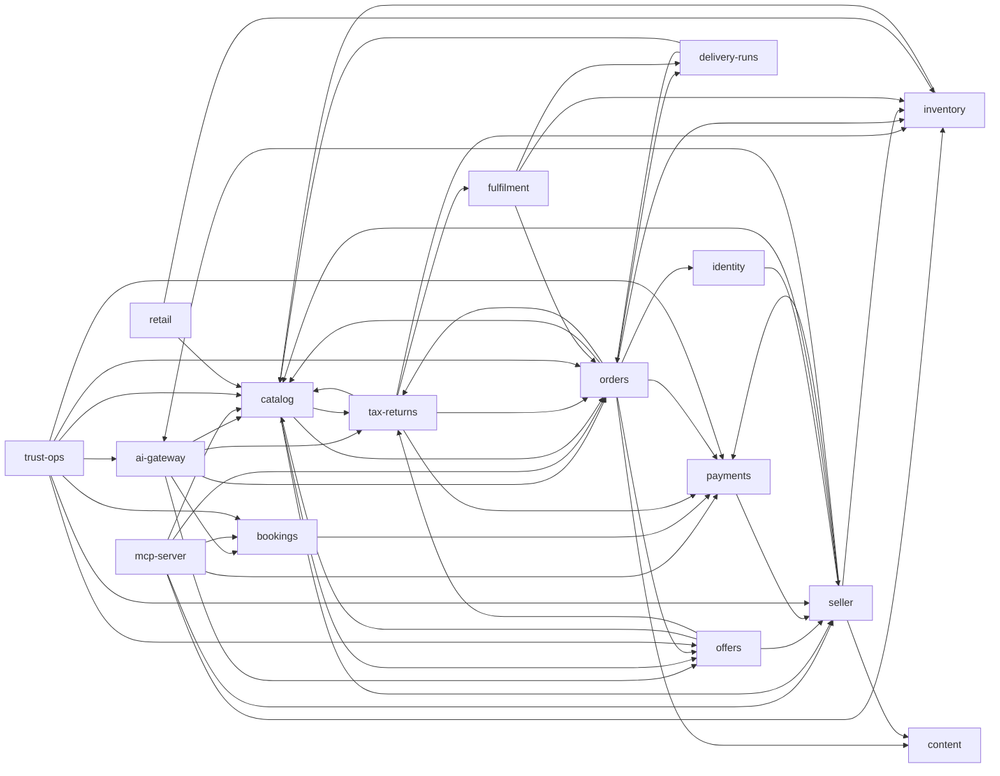

# Release 1 architecture: two deployables, every service a module

Decision and success criteria: [ADR 0011](../adr/0011-modular-monolith-release-1.md). This page is the inventory behind it, the module
design, the risks and the migration order. Everything marked **(config-derived)** was read from `application*.yml`, `@KafkaListener`
and adapter class names, not from running code; it must be re-checked per module in its batch (the checklist is at the end).
Measured numbers are in the Phase 2 section of this page once they exist.

## 1. Shape

```
                       Cloudflare Tunnel -> Envoy Gateway
                                   |
        +--------------------------+---------------------------+
        |                                                      |
 afrotransact-go (one binary)                      afrotransact-core (one JVM, java/apps/core)
   gateway-bff  (edge)                               module: catalog | tax-returns | offers | inventory | seller | content
   search, indexer, cart, geo, media,                        orders | payments | bookings | trust-ops | fulfilment
   notifications, (promise, carrier-gateway,                 identity (last batch) | ai-gateway, mcp-server (optional)
   authz-sync: disabled by default)                          retail, delivery-runs (not in the launch set: disabled)
        |  HTTP between the two deployables (client-credentials tokens, as today)  |
        +--------------------------------------------------------------------------+
                  per-module Postgres databases, Kafka, Valkey, Meilisearch, Temporal (unchanged)
```

Inside a deployable, module-to-module calls are in-process. Between the two deployables they stay HTTP with the same tokens and scopes.

## 2. Java inventory (16 modules, 14 in the launch set)

Ports are the local ones (`infra/local/PORTS.md`); in core they stop being separate listeners (one port, one management port).
`Sched` = number of classes with `@Scheduled`. Group = Kafka consumer group id **(config-derived)**; core keeps these exact ids.

| Module | Local port | Database | Property prefix | Sched | Notable libraries | Launch set |
|---|---|---|---|---|---|---|
| identity | 8100 | `identity` | `at.identity` (+`.local-development`, `.seller-sync`) | 1 | Spring Authorization Server, OAuth client, WebAuthn, session-jdbc, Thymeleaf, BouncyCastle, libphonenumber | yes |
| catalog | 8101 | `catalog` | `at.catalog` | 4 | POI (xlsx), PDFBox, ZXing | yes |
| offers | 8102 | `offers` | `at.offers` | 1 | | yes |
| inventory | 8103 | `inventory` | `at.inventory` | 1 | | yes |
| orders | 8104 | `orders` | `at.orders` | 3 | Temporal starter, Redis, Guava | yes |
| payments | 8105 | `payments` | `at.payments` | 1 | Stripe SDK | yes |
| seller | 8106 | `seller` | `at.seller` | 1 | Stripe SDK, gson, ical4j, libphonenumber | yes |
| retail | 8107 | `retail` | `at.retail` | 1 | PDFBox | no (disabled by default) |
| fulfilment | 8108 | `fulfilment` (PostGIS) | `at.fulfilment` | 1 | | yes |
| bookings | 8109 | `bookings` (btree_gist) | `at.bookings` | 1 | | yes |
| trust-ops | 8110 | `trustops` | `at.trustops` | 1 | | yes |
| tax-returns | 8111 | `taxreturns` | `at.taxreturns` | 2 | Avalara AvaTax SDK (gson, Apache HttpClient 4), Stripe Tax | yes |
| content | 8112 | `content` | `at.content` | 1 | json-schema-validator | yes |
| ai-gateway | 8113 | `ai` | `at.ai` | 0 | Spring AI (OpenAI-compatible), okhttp, okio | yes (optional, detachable) |
| mcp-server | 8114 | none | `at.mcp` | 2 | Spring AI MCP server, Redis | yes (optional, detachable) |
| delivery-runs | 8115 | `deliveryruns` | `at.delivery-runs` | 2 | | no (disabled by default) |

Consumer groups (config-derived): `<module>-service` for every module with consumers (`bookings-service`, `catalog-service`, `content-service`,
`delivery-runs-service`, `fulfilment-service`, `identity-service`, `inventory-service`, `offers-service`, `payments-service`,
`retail-service`, `seller-service`, `tax-returns-service`, `trust-ops-service`); catalog also uses `catalog-service-selling`;
orders sets its group in code/profile, check in its batch. Listener ids are already module-prefixed (`catalog-offer-stock`, `taxreturns-orders`).

### 2.1 Kafka topics (config-derived)

| Topic | Produced by (outbox relay) | Consumed by |
|---|---|---|
| `at.product.events` | catalog | tax-returns, offers, inventory, trust-ops, indexer (Go) |
| `at.taxreturns.events` | tax-returns | catalog, offers |
| `at.offers.events` | offers | catalog, inventory, indexer |
| `at.order.events` | orders | content, delivery-runs, fulfilment, offers, payments, seller, tax-returns, trust-ops |
| `at.payment.events` | payments | bookings, delivery-runs, orders, tax-returns |
| `at.seller-compliance.events` | seller | bookings, catalog, offers, payments |
| `at.identity.events` | identity | fulfilment, payments, seller, trust-ops, notifications/authz-sync (Go) |
| `at.seller-org.events` | seller/identity | identity, indexer, authz-sync (Go) |
| `at.delivery-runs.events` | delivery-runs | fulfilment, orders, notifications |
| `at.inventory.events` / `at.inventory-inbound.events` | inventory | offers, indexer |
| `at.retail.events` | retail | inventory, offers, payments |
| `at.bookings.events` | bookings | payments, trust-ops, notifications |
| `at.carrier-shipment.events` | carrier-gateway (Go) | orders, payments, tax-returns |
| `at.ads.events`, `at.product-review.events`, `at.ai-handoff.events`, `at.seller-subscription.events` | content / catalog / ai / seller | content, search, trust-ops, payments |

Kafka stays the integration path for events inside core too. Replacing it with an in-process event bus is out of scope for Release 1:
it would remove the durability and replay that the outbox gives, and the consumer groups are what makes a detach cheap.

### 2.2 Outbound service-to-service calls (config-derived; scopes from identity's `application-prod.yml` clients)

Each Java module calls others with its own client-credentials token. Scopes held by the token (this is what in-process callers must be granted):

| Caller module | Calls (module) | Client scopes |
|---|---|---|
| catalog | tax-returns (`/v1/tax/classifications/resolve`, `/v1/tax/listing-decisions/status`), offers, orders (purchase check), seller (approvals, catalog scope), media (Go) | `tax:classify`, `offers:read`, `offers:write`, `orders:purchase-check`, `sellers:catalog-scope.read`, `media:import` |
| tax-returns | catalog (`/v1/public/variants/{atin}`, public, no token), payments, inventory, orders, fulfilment, carrier-gateway (Go) | its own client (`ClientCredentialsTokens`), see its batch |
| offers | catalog, seller, tax-returns | `catalog:read`, `sellers:ship-from.read`, `sellers:entitlements.read`, `tax:read`, `tax:classify` |
| inventory | catalog, carrier-gateway (Go) | `catalog:read`, `catalog:write`, `shipping:label` |
| orders | cart (Go), identity, inventory, payments, promise (Go), content, catalog, offers, tax-returns, delivery-runs, geo (Go) | per-client list in identity |
| payments | seller | `orgs:read`, `seller:billing`, `sellers:membership.read` |
| seller | catalog, payments, inventory, content, ai-gateway, media (Go), geo (Go) | per-client list in identity |
| bookings | payments, geo (Go) | per-client list in identity |
| trust-ops | catalog, bookings, orders, payments, seller, offers, ai-gateway | `catalog:moderate`, `payments:service`, `compliance:hold`, `offers:write`, `ai:triage`, `users:read`, `orders:lookup`, `sellers:enforce`, `bookings:reviews:moderate` |
| fulfilment | orders, inventory, delivery-runs, geo (Go) | per-client list |
| delivery-runs | orders, catalog, geo, media, search (Go) | `geo:zones:write`, `orders:on-behalf`, `media:read` |
| retail | catalog, inventory, media (Go) | `catalog:read`, `inventory:receive`, `inventory:read`, `media:write` |
| ai-gateway | search, promise, cart (Go); catalog, offers, orders, bookings, tax-returns | OpenRouter key + user token relay |
| mcp-server | search, cart, promise, geo (Go); catalog, inventory, orders, seller, payments, bookings | relays the caller's token (`mcp:shopper`, `mcp:seller`) |
| identity | seller (`HttpSellerOrgSource`) | `at.identity.seller-sync` |

Status of each edge (converted, or still HTTP and why): sections 12.7 and 12.8.

**What the checks really are (finding).** The controllers only require an authenticated JWT (`PlatformSecurityAutoConfiguration`:
`anyRequest().authenticated()`). The scope is folded into the actor's permissions (`JwtActorResolver`) and enforced inside the
application services (`Access.staffAny(TAX_CLASSIFY, ...)` and `PermissionChecker`). So an in-process call that skips the controller but
calls the application service still has to supply an actor: without one the service would throw or, with the local resolver, run as
`LOCAL_SUPER_ADMIN` and silently pass every check. The in-process design below makes the actor explicit.

### 2.3 Call graph (Java to Java; arrows are "calls over HTTP today")



Cycles (all through ports, so wiring must be lazy): catalog<->tax-returns, catalog<->offers, catalog<->seller<->payments,
catalog->orders->catalog, orders<->payments (via events and HTTP), seller<->ai-gateway<->catalog. Consequence: in-process adapters must
resolve the target API through `ObjectProvider` at call time, never in the constructor (a constructor dependency would be a circular
bean reference and the context would not start).

## 3. Collisions and hazards in one JVM (what was found, with the fix)

| # | Hazard | Evidence | Fix |
|---|---|---|---|
| 1 | One `application.yml` on the classpath per jar; profile files too | every service has `application{,-local,-dev,-uat,-prod}.yml` | Module jars carry their config under `modules/<m>/application*.yml`; a core `EnvironmentPostProcessor` loads only `at.<m>.**` (and an allow-list) from it, at lowest precedence |
| 2 | Global keys inside module config: `spring.datasource`, `spring.kafka.consumer.group-id`, `management.metrics.tags.service`, `server.port`, `spring.application.name`, `spring.flyway.locations`, `at.consumers.enabled`, `at.events.relay-enabled` | catalog `application.yml` lines 1-60 | Ignored by the loader (core owns them) or mapped to `at.modules.<m>.*`; DB URL/user/password come from per-module env vars (`CATALOG_DB_URL`...) because `DB_URL` is the same name in every service |
| 3 | Same Flyway path `db/migration` in every service jar | all services | pom resource entry copies `db/migration` to `modules/<m>/db/migration` (source tree untouched); core runs Flyway per module on that location plus `db/platform` |
| 4 | Several `DataSource`/`JdbcClient`/`TransactionManager` beans: by-type injection is ambiguous, Boot auto-config backs off | 26 catalog files inject `JdbcClient`, 9 inject `PlatformTransactionManager`, 30 use `@Transactional` | Module-aware autowire candidate resolver (a module-owned bean is injectable only into classes of that module's package) and a routing `@Primary` transaction manager that picks the module by the `@Transactional` method's package |
| 5 | `platform-events` autoconfig builds ONE outbox store, publisher, inbox deduplicator, relay, retention job | `PlatformEventsAutoConfiguration` | Core builds these per module over the module's `JdbcClient`; auto-config backs off through `@ConditionalOnMissingBean` |
| 6 | Single `spring.kafka.consumer.group-id` | listeners say `groupId = "${spring.kafka.consumer.group-id:catalog-service}"` | Core does not set the global property, so every listener keeps its own default (the old group id). A test asserts the effective group of every listener |
| 7 | One shared `@Scheduled` pool (Boot default: 1 thread) | catalog, tax-returns, orders, payments... | Routing `TaskScheduler`: one `ThreadPoolTaskScheduler` per module (`at.modules.<m>.scheduler.pool-size`, default 2), thread names `sched-<m>-n` |
| 8 | `@RestControllerAdvice` is global; `TaxReturnsErrorAdvice` (order HIGHEST_PRECEDENCE) handles `IllegalArgumentException`, `IllegalStateException`, `MissingRequestHeaderException` for EVERY controller | `TaxReturnsErrorAdvice` | Every module advice gets `basePackages`; an ArchUnit rule enforces it |
| 9 | Bean-name collisions (same class simple name in two modules, e.g. `ClientCredentialsTokens`, `Access`, `Upstream`) and `@Bean` method names | catalog and tax-returns both have `ClientCredentialsTokens` | Component scan per module with a name generator that prefixes the module; `@Bean` collisions are found by a context test |
| 10 | `SecurityFilterChain`: platform chain is `@ConditionalOnMissingBean`; identity, seller, content, mcp-server define their own | `SecurityConfiguration`, `SellerSecurityConfiguration`, `ContentSecurityConfiguration`, `McpSecurityConfiguration` | Per module chain with a `securityMatcher` for its paths, ordered before the shared default chain. Public paths are the union of the modules' `at.security.public-paths`. Identity goes last because it is the Authorization Server (own chains, JWKS, sessions) |
| 11 | Actuator, Micrometer common tag `service` is global | `management.metrics.tags.service: catalog-service` | Common tag `service=afrotransact-core` (process-level metrics); module meters get `module=<m>` and `service=<short name>` from a `MeterFilter` and an MVC observation convention (handler's package) |
| 12 | OTLP `service.name` is one per process | `spring.application.name` | Resource `service.name=afrotransact-core`; every span gets `module` (handler/listener package), every log line gets MDC `module` (the structured logs already carry the service name; core's encoder takes it from MDC) |
| 13 | springdoc: one `/v3/api-docs`, operation id collisions across modules | each service documents itself | `GroupedOpenApi` per module (`/v3/api-docs/<m>`), Scalar/Redoc pages per module; the contract route diff (S4) runs per group |
| 14 | `ActingAsActorResolver` and `LocalActorResolver` read the current HTTP request header | `libs/platform-security` | The in-process caller actor is resolved first and cannot be changed by the request's headers |
| 15 | Static singletons | 1-17 `static final X = new ...` per module, mostly codecs and formatters | Reviewed in each batch; stateless ones are fine. None found so far holds per-module mutable state, but `retail` (17) and `catalog` (13) are checked first |
| 16 | `@EnableScheduling` in `platform-events` plus module configs | autoconfig class | One `@EnableScheduling`, one routing scheduler |
| 17 | Multipart limits (`spring.servlet.multipart`: catalog 25 MB) are global | catalog yaml | Core takes the maximum (25 MB); the per-endpoint 10 MB limit is already checked in the controller (`ImportLimits`) |
| 18 | Temporal worker/starter autoconfig (orders) assumes one `WorkflowClient` per app | `temporal-spring-boot-starter` | Only orders uses it; kept as is. Task queue names are unchanged |
| 19 | Shared `RestClient.Builder` bean: modules use `builder.clone()` per adapter | `HttpTaxResolver` | One shared builder and one JDK `HttpClient` pool for the HTTP adapters, timeouts stay per adapter |

### 3.1 Dependency version conflicts

All services already use one platform parent, so most versions agree. The ones to watch in one classpath:

| Library | Pulled by | Risk | Handling |
|---|---|---|---|
| gson | Avalara SDK (tax-returns), Stripe SDK (payments, seller), seller's own gson | Boot 4 uses Jackson 3; gson is separate and not auto-configured, so no clash, only size | keep; versions are managed in `platform-parent` |
| Apache HttpClient 4.5 (`org.apache.http`) | Avalara SDK | Spring uses JDK HttpClient and (if present) HttpClient 5 (`org.apache.hc`): different packages | keep 4.5.14 pinned as today; verify no module has HttpClient 5 on the classpath that Boot would auto-select |
| Jackson 2 (`com.fasterxml`) and 3 (`tools.jackson`) | Spring AI, swagger annotations, Jackson 2 BOM pinned | Both are present today in several services | unchanged |
| commons-io (POI vs commons-compress) | catalog | pinned to 2.22.0 in the catalog pom | the pin must move to platform-parent for core |
| okhttp/okio | ai-gateway | Kotlin stdlib on the classpath | ai-gateway is detachable; its dependencies stay in an optional Maven profile of core |
| Spring Authorization Server, OAuth2 client, WebAuthn, session-jdbc | identity | adds filter chains and a `SessionRepository` (jdbc) to the whole app | identity joins last; session repository scoped to its chain |
| Spring AI MCP server | mcp-server | registers its own servlet endpoints and `McpServerProperties` | optional module |

## 4. Module design (Java)

- **Maven**: `java/libs/module-api/<m>-api` (published API interfaces and records, package `com.afrotransact.<m>.api`, no Spring);
  `java/libs/module-core` (module infrastructure: caller principal, per-module DataSource, Flyway, transaction routing, scheduler,
  config loader, health, metrics); `java/apps/core` (the app; depends on each service's `plain` jar). Each service pom gains a `plain`
  jar execution and the resource copies; its own executable jar and image are unchanged.
- **Module enable**: `at.modules.<m>.enabled` (default true for launch modules, false for the others). A disabled module's beans are
  never created (conditional import), its DataSource is never opened, its health contributor is absent.
- **Mode switch**: `at.<m>.mode=in-process|http`. In core the default is `in-process`; a module in `http` mode uses today's adapter and
  needs the same URL and client credentials as now. In-process mode with the target module disabled fails at start with
  `module 'catalog' is configured at.catalog.mode=in-process but module 'tax-returns' is disabled; enable it or set at.catalog.mode=http`.
- **Caller principal**: `CallerPrincipal(module, clientId, scopes)` from a registry in config
  (`at.modules.<m>.caller-scopes`, defaults copied from identity's client list). The consuming adapter calls
  `InProcessCalls.as(callers.principalFor("catalog"), () -> api.resolve(...))`; this binds a `ScopedValue` that the actor resolver
  consults first. The actor is `SERVICE`, `sub` = the client id, permissions = scopes, so `Access.staffAny(...)` and `PermissionChecker`
  work unchanged. Missing scope -> `ForbiddenActionException` -> 403 exactly as over HTTP.
- **Errors**: API methods throw the same exception types the HTTP adapter maps (`TaxProfileNotFound`, `Unavailable`) so the consumer's
  behaviour does not depend on the mode.
- **Transactions**: a call into another module is its own transaction on its own database, as over HTTP (no distributed transaction,
  none is wanted). A module calling back into itself through another module can hold two connections of the same pool: pool sizes
  per module leave headroom (see S1 and the pool table in the Phase 2 section).
- **ArchUnit** (`java/apps/core` `ModuleBoundaryTest` plus a rule in every module's `ArchitectureTest` via `platform-test`):
  (a) classes of module A depend on classes of module B only inside `com.afrotransact.B.api..`; (b) only `adapter.out.module..`
  may use another module's `api`; (c) `@RestControllerAdvice` has `basePackages`; (d) no class outside a module's own packages is
  injected with that module's `DataSource`/`JdbcClient` (resolver test); (e) `domain` still imports no Spring (existing rule).

## 5. Recommended grouping and order

All modules run in `afrotransact-core`; "batch" is the order in which they are moved from their own Deployment into core, each batch
shipped to production on its own with the old Deployments scaled to 0 (not deleted).

| Batch | Modules | Why together / why here | Gate to proceed |
|---|---|---|---|
| 1 (spike) | catalog, tax-returns | chattiest pair (publish gate, tax facts); proves module infra, principal, health, metrics | Phase 1 and 2 results |
| 2 | offers, inventory, content, seller | catalog's neighbours: offers/inventory/seller call catalog and each other; content has no outbound calls | route diff clean, Phase 2 memory target met |
| 3 | orders, payments, bookings, fulfilment, trust-ops | the money path; orders brings Temporal and Redis; payments brings Stripe; moved after the pattern is proven | checkout SLO unchanged for one week |
| 4 | ai-gateway, mcp-server | optional and heavy; stay detachable, own pools and limits; their dependencies sit in a Maven profile | detach test: core boots without them |
| 5 | identity | Authorization Server: own filter chains, JWKS, sessions; every other module validates its tokens | last, because a mistake here logs everyone out |
| later | retail, delivery-runs | not in the launch set; module present, `enabled=false` | when the business enables them |

Go: see the Go plan below.

## 6. Risks and mitigations

| Risk | Likelihood / impact | Mitigation |
|---|---|---|
| One slow module starves others (scheduler, DB pool, threads) | medium / high | per-module scheduler pools, Hikari pools, Kafka containers; virtual threads for requests; an HTTP bulkhead per module is a Phase 3 item if measurements show contention |
| One crash or OOM takes everything | medium / high | `-XX:+ExitOnOutOfMemoryError` stays; readiness per module; two replicas when the node count allows; rollback by scaling the old Deployments up |
| In-process call skips authorization | medium / critical | the call path goes through the application service with an explicit actor; one test per API method asserts 403 without the scope (S6) |
| Circular bean wiring between modules | certain / medium | `ObjectProvider` in in-process adapters; a context test starts the pair |
| Silent behaviour change from global advice/config/interceptors | medium / high | `basePackages` rule, loader allow-list, route diff (S4), context test of every module pair |
| Connection explosion: 14 modules x `DB_POOL_SIZE=10` = 140 connections to one Layerbase server | high / medium | per-module pool size (default 4, orders/payments/catalog 8), `minimum-idle=0`; total budget stated in values |
| Flyway failure hides which module | medium / medium | Flyway runs per module in `module-core` and wraps failures: `Module 'catalog' failed to migrate database 'catalog' at <version>: <cause>`; start aborts |
| Startup time grows with N modules | certain / medium | lazy initialisation for module infrastructure that is not on the readiness path, AppCDS archive, parallel Flyway per module (separate databases), measured in Phase 2 |
| `main` keeps changing while release-1 diverges | certain / medium | additive module changes, regular merges with `tools/release/sync-main.sh`, release-1-only code in new directories |
| Dependency conflict only shows at runtime | low / high | `maven-enforcer` convergence on core, a context test with all modules enabled |
| Monitoring labels change under existing alerts | medium / high | keep `service` values (short names); `honor_labels: true` on the core scrape job; list of changed queries below |

### 6.1 Monitoring parity (what changes and what does not)

- `http_server_requests_*`: tagged `module=<m>`, `service=<m>` (short name, as the existing rules use `service=~"orders|payments"`).
  Alerts `HighErrorRate`, `HighLatency` and the SLO rules keep working unchanged.
- `hikaricp_*`: pool name = module, so `DatabasePoolSaturation` keeps its per-service meaning.
- JVM and process metrics (`jvm_*`, `process_*`): one process, so `service=afrotransact-core`. The JVM dashboard's `service` variable lists
  `afrotransact-core`; **the one dashboard/alert change** is anything that expects `jvm_*{service="catalog"}`. The generator
  (`infra/observability/scripts/generate_dashboards.py`) gets a `--core` mode only for the JVM and platform-overview boards.
- Prometheus/ServiceMonitor for core needs `honor_labels: true` so the app's `service` tag wins over the scrape label; otherwise the
  app's value moves to `exported_service`.
- `ServiceDown`: `up{service="afrotransact-core"}` replaces 14 `up` series; per-module availability comes from
  `/actuator/health/readiness` groups and a new `at_module_up{module=}` gauge (1 when the module's readiness is UP).
- Kafka lag metrics come from kafka-exporter by consumer group: unchanged, because group ids are unchanged.
- Traces: `service.name=afrotransact-core`, span attribute `module`. Logs: field `module`; Loki queries on `service_name` get a `module` filter.

## 7. Go inventory and plan

| Service (config-derived, verify in its batch) | Port | Store | Kafka | Calls out | Notes |
|---|---|---|---|---|---|
| gateway-bff | 8200 | Redis | none | every Java and Go service (screen APIs, token relay) | 405 source files; stays the edge |
| search | 8201 | Meilisearch/ES | produces `at.search.events`; ads events | ai-gateway, content (ads) | |
| indexer | 8202 | Meilisearch/ES | consumes product, offers, inventory, seller-org (`indexer-service`) | catalog, seller | also a `reindex` command |
| cart | 8203 | Redis + `cart` | none | delivery-runs, catalog, promise | |
| promise | 8204 | Redis | none | none | not in launch set |
| geo | 8205 | `geo` (PostGIS) | none | none | |
| media | 8207 | `media` | none | ai-gateway; S3/R2/UploadThing | image processing, ClamAV: optional heavy part |
| notifications | 8208 | `notifications` | consumes bookings, content, delivery-runs, identity, ... | delivery-runs, Resend/Twilio | also a `template-gallery` command |
| carrier-gateway | 8209 | `carriers` | produces `at.carrier-shipment.events` | USPS/UPS/FedEx/DHL | not in launch set |
| authz-sync | 8210 | OpenFGA | consumes identity, seller-org | OpenFGA | not in launch set (`FGA_ENABLED=false`) |

Findings that decide the Go design:
- Each service already has a root package that exports `Files` (embedded config and OpenAPI); Go `internal/` cannot be imported from
  another module, so each root package also exports `New(Deps) (Module, error)` returning
  `Module{Name, Handler http.Handler, Checks []ReadinessCheck, Start(ctx) error, Close(ctx) error}`. `cmd/<svc>/main.go` becomes a thin
  caller of the same constructor, so the standalone build keeps working and tests do not fork.
- Global state to remove or tame: `slog.SetDefault` in every `main` (the last one would win: pass a logger with a `module` attribute
  instead), `otel.SetTracerProvider` in `pkg/telemetry` (set once in `afrotransact-go`; module name added by a span processor),
  Prometheus default registry (one registry per module, merged on `/metrics` with a `module` label; `service` label keeps the old value).
- Config: `pkg/config.NewLoaderFor(fs, env, lookup)` already takes a lookup function; the entry package passes a lookup that tries
  `<MODULE>_<NAME>` first (for example `CART_DB_URL`), then `<NAME>`, because `DB_URL`, `REDIS_URL`, `KAFKA_GROUP`, `PORT` are the same
  names in several services.
- Routing: modules register on one mux under their existing paths (paths are already distinct per service; a startup check fails on a
  duplicate pattern naming both modules). `/healthz`, `/readyz` and `/metrics` stay per module at `/modules/<m>/healthz` etc. and an
  aggregate at `/healthz` and `/readyz` that names every module.
- In-process calls between Go modules and from gateway-bff: an `http.RoundTripper` that serves the request through the module's
  `Handler` (no socket), still sending the bearer token, so the same auth middleware runs. This needs no per-call adapter code.
- Kafka: each module keeps its consumer group; one franz-go/segmentio client per module.
- Go tests: `go test ./...` per module stays; a new `afrotransact-go` test boots all modules with fakes.
- Order: cart, promise, geo (small, Redis/Postgres), then search + indexer, notifications, media, carrier-gateway, authz-sync,
  and gateway-bff last (it is the biggest consumer of the others).

### 7.1 Implemented (afrotransact-go) and where it differs from the plan

- `go/pkg/module`: `Deps`, `Module`, `Main` (the whole body of a `cmd/<svc>/main.go`), `Background` (long-lived work; a failure is fatal for the host), `Closers`.
  `New(Deps)` of every service builds without touching `slog`, the tracer provider, a listener or a goroutine; `Start` launches background work, `Close` releases.
  Module carries `Router`, `Specs` (OpenAPI) and `Gatherer` as well, because the host routes and checks with them.
- Services: `New` is in the root package (`cart`, `promise`, `geo`, `search`, `indexer`, `notifications`, `media`, `carrier-gateway`, `authz-sync`). **gateway-bff's is
  `bffmodule.New`**: `internal/app`'s in-package test imports the root package for `Files`, so a root-package `New` would be an import cycle. The `shopper.go`/`staff.go`
  wiring moved with it. Indexer's `reindex` command keeps its flags and tests in `cmd/indexer` and shares `internal/wiring`; notifications' `providers.go` (and its test, package clause
  only) moved to the root package.
- **The plan said paths are already distinct per service. They are not**: cart and search document the same paths as gateway-bff's facade (`/v1/cart`, `/v1/search`, `/v1/search/clicks`,
  `PUT /v1/cart/preorder-fulfilment`), carrier-gateway shares `POST /v1/addresses/validate` with geo and `/v1/webhooks/*` with notifications. Resolution: those three modules are mounted
  `prefixed` (only under `/modules/<name>/`, reached by gateway-bff in-process); the startup check refuses any other overlap and names both modules. It replays every operation of every
  module's OpenAPI documents against the other modules' muxes (a `ServeMux` cannot list its patterns), so it covers documented routes; `registry_test.go` runs the same comparison on the real documents.
- Tracing: the tracer provider is set once (`telemetry.SetupWith`); a span processor tags spans with the module that the host put on the request or in-process call context.
- Database: schema per module needs no code change (idempotent SQL on unqualified names): `<MODULE>_DB_URL` with `search_path=<schema>`, or `AT_GO_DB_URL` for all. Not run against a real PostgreSQL.

## 8. Keeping `main` in release-1

1. `tools/release/sync-main.sh --check` weekly; `tools/release/sync-main.sh` to merge. It refuses to run on a branch that does not track
   release-1, never pushes, and prints `git push origin HEAD:release-1`.
2. A new migration on `main` merges cleanly (new file). Never edit or renumber an applied migration to resolve a conflict; if two sides
   added the same `V<n>`, the not-yet-deployed one is renumbered.
3. A new `@Bean`, adapter or port in a service on `main`: if it calls another module over HTTP, add the in-process adapter in the same
   merge or leave `mode=http` for that port (the mode switch is per module, and the checklist below catches it).
4. A new service on `main` is added to release-1 as a module in its batch, not by default.
5. Conflict hot spots: service poms (`resources`, `plain` jar), `application*.yml` of the two spike modules, `*Configuration.java` where an
   adapter is chosen. Keep both sides; the release-1 side is always the small switch.

## 9. Per-module batch checklist

1. Add the `<m>-api` jar (only what other modules call), provider adapter in `adapter/in/module`, consumer in-process adapters.
2. `plain` jar and `modules/<m>/` resource copies in the pom.
3. Scope the `@RestControllerAdvice` and check every `static` singleton.
4. Caller scopes in the registry, copied from identity's client entry for that service.
5. Core config: module env vars (`<M>_DB_URL`...), pool size, scheduler pool size.
6. Tests: the module's own suite, ArchUnit, the in-process 403 test, route diff.
7. Dashboards: only what the label rules in 6.1 change.

## 10. Re-check after merging main (2026-11-15, main at 72ae69796)

Merged into release-1 (d1368b31b): seller storefront (`seller` V92, `StorePage*`, `PublicStorefrontController`), gateway-bff storefront/staff-access/seller store-page work (Go), sitemap stores. One conflict, `docs/backlog/backlog.csv` (both sides appended), resolved by taking main's file and re-appending the release-1 epic E37 and stories S491-S499 (renumbered; renumbered again to S495-S503 when main took S491-S494).

- **No consolidated module was touched** (catalog and tax-returns have no changes from main in this merge), so nothing needed adapting. `tools/release/sync-main.sh` now lists, after every merge, any change main made to the outbound adapters, config or pom of a mounted module under "ADAPT", and `--require-current` fails when release-1 is behind main.
- **seller (batch 2)**: the new public storefront endpoints are permitted in `SellerSecurityConfiguration` itself (`GET /v1/public/storefronts[/*]`), not in `at.security.public-paths`. This confirms hazard 10: when seller mounts, its custom chain must become a `securityMatcher` chain ahead of the shared one, and its permit list must be carried over, or the storefront returns 401. V92 is a new migration in seller's own history (no renumbering).
- No new `@Scheduled`, `@KafkaListener`, `@RestControllerAdvice`, static singleton or pom dependency appeared in the merged Java code.
- **Not re-verifiable yet**: the coordinator also names orders V13/V14, fulfilment V6, identity V49 (admin delivery and proof), staff Settings roles, Avalara shadow mode and in-flight identity/ai-gateway work. Those are not on `origin/main` as of this merge; they come in with the next `sync-main.sh` run and the per-batch checklist (section 9) covers them. Orders, fulfilment, identity and ai-gateway collisions in section 3 were derived from the code at 26d74f64f and must be re-read at their batch.

## 11. Phase 1 and 2 results: catalog + tax-returns in `afrotransact-core` (2026-11-15)

### 11.1 What was built and proved

| Claim | Evidence |
|---|---|
| Both modules start in one JVM, each on its own database, Flyway history and Hikari pool | `CoreModulesTest` (12 tests) on a real PostgreSQL 17.5, plus a reflection test that every `JdbcClient` held by a catalog or tax-returns class is that module's own (more than 20 classes) |
| In-process calls with an explicit principal; scope enforced | `catalogCallsTaxReturnsInProcess...`, `aModuleWithoutTheScopeIsRefusedExactlyAsOverHttp` (the call fails like the HTTP 403), `thePublishedApiFailsClosedWithoutACallerAndForTheWrongPrincipal`, `InProcessCallsTest` (7) |
| `at.<module>.mode=http` keeps the HTTP adapters | `httpModeKeepsTheHttpAdapters...`; standalone default stays `http` |
| Target module off: start fails naming both modules; off module is not in readiness, opens no pool | `inProcessModeWithTheTargetModuleOff...`, `aSwitchedOffModuleIsNotInReadiness`, `aDisabledModuleOpensNoPool...` |
| A failed migration stops the start and names the module | `aFailedMigrationStopsTheStartAndNamesTheModule`; `ModuleStartupFailureAnalyzer` prints it without a stack trace |
| Readiness lists each module; each module has its own health group; no database check in readiness | `readinessListsBothModules...` |
| Every meter has `module` and `service`; per-module Hikari pools; per-module scheduler pools | `everyMeterCarriesModuleAndServiceAnd...`, `ModuleMeterFilterTest`, `ModuleSchedulerTest` |
| ArchUnit boundaries with teeth | `ModuleBoundaryRulesTest` (violating fixtures must fail); rules run in every service's `ArchitectureTest`; both spike modules pass |
| Old per-service apps still build and their tests pass | catalog 953 and tax-returns 387 surefire tests, 0 failures, 70 s with the libraries (`./mvnw -pl services/catalog,services/tax-returns -am test`) |

**Not verified**: Docker is not available, so every Testcontainers integration test (`*IT`) of catalog and tax-returns was NOT run; Kafka was not running (listeners and relays were off, so consumer group ids, the outbox relay and retention job are covered by construction and unit tests only, not by a live broker); no OAuth/JWT run (the context tests use the `local` profile, security off, so the JWT path of the in-process actor is covered by `InProcessCallsTest` against the real `Actor` and permission model, not by a signed token); no load test; no image was built.

### 11.2 Measurements (this sandbox: 4 vCPU, JDK 25.0.5, real PostgreSQL 17.5 on localhost, no Kafka, consumers off)

Production JVM flags (`java/Dockerfile`): serial GC, C1 only, `-Xss512k`, `-XX:-UsePerfData`, 64 MB code cache, heap capped at 448 MB (70 % of the 640 Mi limit). RSS is `VmRSS` after readiness + 300 health and 300 api-docs requests + 15 s idle.

| Measure | catalog alone | tax-returns alone | Sum of the two | One JVM, both modules | Change |
|---|---|---|---|---|---|
| RSS after ready | 276 MB | 257 MB | 533 MB | 287 MB | -46 % |
| RSS warm (hwm) | 321 MB | 296 MB | **617 MB** | **334-337 MB** (3 runs) | **-45 %** |
| Time to readiness (cold) | 9.3 s | 8.4 s | 17.7 s sequential | 9.7-10.5 s | -45 % of total start work |
| Time to readiness with AppCDS (92 MB archive, JDK 25 auto-archive) | not measured | not measured | | 9.1 s | -10 % (class loading is not the bottleneck: Flyway, bean creation and the first Hikari connections are) |
| Threads | 43 | 42 | 85 | 55-57 | |
| Executable jar | 92.2 MB | 72.6 MB | 164.8 MB | 95.6 MB | -42 %; 157 library jars vs 290 |
| Image (jlinked JRE + distroless) | not built | not built | | | the jar numbers are the estimate; each image would also carry a JRE copy (about 60 MB per image), so 2 images save about 60 MB more |
| Build, 2 modules + libraries (`package -DskipTests`, checkstyle on) | 55 s (both together) | | | 12 s for core when the modules are already built | the cost is compiling the modules once either way |
| Unit and slice tests | | | 70 s (1,340 tests) | core context tests 12 in 34 s (real DB) | |

What this extrapolates to, honestly: the JVM floor (class metadata of Spring, Tomcat, Hibernate-free Spring JDBC, Kafka, Micrometer, OTel) is paid once instead of per module. Adding a module costs about 40-50 MB RSS here (core 335 MB vs 290 MB for catalog + tax-returns' own state), against about 300 MB for a separate JVM. For the 14 launch modules that points at roughly 14 x 300 = 4.2 GB separate (the cloud-cost table budgets 14 x 384 Mi requests = 5.25 GiB) versus about 300 + 13 x 45 = 0.9 GB to 1.2 GB for one JVM, before real traffic. **This is an extrapolation from two modules; the S1 target (core at most 55 % of the sum, hard cap 2.0 GiB) is met for the pair (54 %) and must be re-measured per batch.** The ports/containers/charts/workflows/Argo apps in S8 change only at cutover: today 14 Java services = 14 ports, 14 containers, 14 charts, 14 workflows, 14 Argo apps; target 1 each.

### 11.3 Problems hit (all fixed unless marked open)

1. **tax-returns-service does not start on `main` (and so not on release-1 as branched):** `AvalaraTaxCalculator` has two constructors and no `@Autowired`; Spring finds no default constructor. Introduced with the Avalara SDK commit (8fa787653). Fixed in release-1 with `@Autowired` on the production constructor. Main still has the bug: **a production-blocking fix that should also land on `main`.**
2. Java 21 is the default `JAVA_HOME` in the sandbox; the enforcer requires 25 (`JAVA_HOME=/usr/lib/jvm/java-25-openjdk-amd64`).
3. Spring Boot 4 / Spring 7 API differences: `org.springframework.boot.EnvironmentPostProcessor`, health classes in `org.springframework.boot.health.contributor`, Flyway `Flyway.configure(ClassLoader)`, `DependencyDescriptor` has no containing-class accessor.
4. **Spring 7 wraps every `@Scheduled` runnable** in a private `Task$OutcomeTrackingRunnable`; routing by the method owner silently sent every job to the core pool until the wrapper was opened. Caught only by the context test (thread names). Covered by `ModuleSchedulerTest`.
5. **Boot refuses to start when a health group names a contributor that does not exist**, so a static `readiness.include` list breaks "switch a module off". Groups are now generated per mounted module.
6. **Repeated command-line options are joined with a comma by Spring** (a test harness detail that hid as a Flyway "driver" error).
7. `platform-events`' retention job, outbox relay and inbox beans are single-instance and package-private in places: added the public `EventRetentionServices.jdbc(...)` factory (additive) and per-module relay, publisher (the platform class's `@Transactional(MANDATORY)` cannot tell which module's transaction manager it belongs to) and retention wrappers.
8. `@Qualifier("productWriterImpl")` in catalog means bean names must stay as in the standalone service; the module bean-name generator keeps default names and prefixes only on a collision.
9. The module's own `local` profile carries process-wide settings that matter (`at.security.enabled=false`, DB passwords, log level); core has its own `application-local.yml`. A module's `at.security.*` is ignored, so security on/off is one switch for the whole JVM.
10. `ModuleConfigPostProcessor` mimics Boot's profile semantics for lists (a profile list replaces the base list); verified by test.
11. **Open: autoconfiguration ordering.** Beans a module defines to override Boot defaults (`corsConfigurationSource`, `SecurityFilterChain`) are registered in the second configuration-parse round, after Boot's `@ConditionalOnMissingBean` auto-configurations were evaluated. Not an issue for catalog and tax-returns; it will bite seller, content, identity and mcp-server (they define their own filter chains). Mitigation planned in batch 2: modules declare such overrides in a `ModuleSecurity` hook that module-core registers in the first round.
12. **Open: per-module meters of platform classes** (`events.consumer.*`) are not module-tagged (they carry a `consumer` tag holding the listener id; the filter attributes by the module's Kafka-id prefix, which works for `catalog-` and `taxreturns-`).
13. **Open: Kafka and logging context.** Listener threads and scheduler threads do not set the MDC `module`; only HTTP requests do. Span attribute `module` exists for HTTP server spans only.
14. **Open: one JVM, one `at.security.enabled`, one multipart limit, one set of JWT validation settings**; fine for the launch set, flagged for identity (batch 5).
15. Disk: each module's `target/` is 80-100 MB; `~/.m2` was updated by an `install` early on (platform libraries only, additive); no other agent's artifacts were touched.

### 11.4 Recommendation: **GO-WITH-CHANGES** for the remaining Java modules

Go, because the design held up on the hardest pair (two-way cycle, shared Kafka topics, own Flyway histories, scope checks kept), the saving is real (-45 % RSS, -45 % start work for two modules), the old builds are untouched and their tests pass, and every failure that surfaced was caught by a test, not in production. With these changes before batch 2:

1. Land the `AvalaraTaxCalculator` constructor fix on `main`.
2. Add the `ModuleSecurity` hook (problem 11) before seller, content, identity, mcp-server join.
3. Add the Kafka/scheduler MDC `module` (problem 13) and a per-module Kafka-container concurrency setting.
4. Add a Postgres service container to CI so `CoreModulesTest` and the services' `*IT` run (this sandbox cannot).
5. Re-measure after each batch against S1/S2; stop and re-plan if a batch adds more than 80 MB RSS per module or core startup passes 60 s.

Batches as in section 5: batch 2 offers, inventory, content, seller; batch 3 orders, payments, bookings, fulfilment, trust-ops; batch 4 ai-gateway and mcp-server (detachable); batch 5 identity. **NO-GO today for identity and for the money path**: not because of the pattern, but because their risks (token issuance, Temporal, Stripe) need the CI Postgres/Kafka environment first.

### 11.5 Go plan (not built; only analysed)

Per service, in `go/services/<svc>` root package (which already exports `Files`):
`func New(ctx context.Context, d Deps) (*Module, error)`; `type Module struct{ Name string; Handler http.Handler; Checks []httpserver.ReadinessCheck; Run func(context.Context) error; Close func(context.Context) error }`. `cmd/<svc>/main.go` shrinks to `config -> New -> httpserver.New(Handler) -> Run`, so the standalone binary and the combined one share the code. `Deps` carries the shared things (logger with `module` attr, tracer provider, `prometheus.Registerer`, `auth.Verifier`, HTTP client, `ModuleCaller` for in-process calls) and the module's own env lookup (`<MODULE>_DB_URL` first, then `DB_URL`).

Shared `go/pkg` changes (all additive): `pkg/config` prefixed lookup helper; `pkg/httpserver` mount mode (register a module on a parent mux under its paths and expose `/modules/<m>/healthz|readyz`, aggregate `/healthz`, `/readyz`, `/metrics` merged from per-module registries with `module` and the old `service` label); `pkg/telemetry` single provider with a `module` span processor; `pkg/logging` returns a logger with `module`; `pkg/auth` gains an in-process transport: an `http.RoundTripper` that serves the request through the called module's `Handler` and still carries the bearer token, so the same middleware and scopes run (no per-call adapter code, the Go analogue of the Java principal rule). `cmd/afrotransact-go/main.go`: explicit wiring list with enable flags, duplicate-route check at start naming both modules, aggregate readiness. Order: cart, promise, geo; search + indexer; notifications, media; carrier-gateway, authz-sync; gateway-bff last. A tiny proof was NOT built (disk is the constraint: the Go build cache of 11 modules is the largest item in this sandbox).

## 12. Batches 2 to 5 and later: status on `release-1` (2026-11-15)

Owner decisions applied: schema-per-module Postgres, the module grouping above, "each deployable" wording in CLAUDE.md, a Postgres service
container in CI (the CI agent owns `.github`, Helm and Argo). **Every module is mounted in `afrotransact-core`**; cross-module calls
are in-process only where marked below, everywhere else the module keeps its HTTP adapter and calls the other module on its old
port, which core serves itself (`at.core.module-ports`, local profile) or at `/modules/<name>/` (see 12.3).

### 12.1 Schema-per-module (`at.modules.<m>.database.mode=schema|database`)

One Postgres database `core` for the Java modules, one schema and one login role per module (`tax-returns` -> schema/role `tax_returns`),
`search_path` pinned twice (role setting and `SET search_path TO "<schema>", public` on every pooled connection; `public` only so
extensions resolve), Flyway per module with `schemas`/`defaultSchema` = the module's schema (so `flyway_schema_history` lives in that
schema) and `createSchemas=false`, migrations unchanged. `database` keeps today's behaviour (own database via `<M>_DB_URL`), per module,
so standalone, the spike and mixed set-ups work. Temporal stays on its own databases. Provisioning: `infra/local/postgres/provision-core.sql`
(`make core-db`; production: the database owner runs the same statements once with real passwords) or, in the local profile only,
core creates roles and schemas itself through `at.modules.schema-admin.*`. Extensions (`postgis`, `btree_gist`, `pg_trgm`) must exist in
the database before start: migrations say `create extension if not exists`, which a non-superuser role passes only when it already exists.

Verified on a real Postgres 16 (module-core `ModuleSchemaPostgresTest`, and a full boot of the modules): two modules migrate into their own
schemas, each has its own history table, the role of one cannot read the other's table (`permission denied`), a second run is idempotent.

### 12.2 Connection budget (stated in the Helm values by the CI agent's chart; here is the arithmetic)

Per-module Hikari maximum, minimum idle 0 (`<M>_DB_POOL_SIZE` overrides). Hikari opens connections only when used.

| Module | max | | Module | max |
|---|---|---|---|---|
| catalog | 8 | | identity | 4 |
| orders | 8 | | offers, inventory, content, seller | 4 each |
| payments | 8 | | fulfilment, bookings, trust-ops, tax-returns | 4 each |
| ai-gateway | 4 | | mcp-server (no database) | 0 |
| retail, delivery-runs (disabled) | 2 each | | **Total enabled (13 modules with a database)** | **64** |

Worst case 64 plus Flyway at start (one connection per module at a time) and the platform Kafka/outbox jobs, which use the module pools.
Well under 100 for the core JVM and well under Layerbase's 500 (also with two replicas: 128). Observed idle after start with all
modules up: 26 connections (section 12.6).

### 12.3 What it took to put 16 modules in one Spring context (new findings, all fixed)

| # | Finding | Fix |
|---|---|---|
| 1 | Module configuration classes were registered after Spring Boot's auto-configuration was parsed, so `@ConditionalOnMissingBean` auto-configured beans (`authorizationServerSettings`, Clock...) won or collided | `ModuleMounts` is now a first `BeanDefinitionRegistryPostProcessor` (installed through `spring.factories`), module scanning runs before any configuration class is parsed |
| 2 | Three routes exist in two modules: `POST /v1/returns` (inventory, tax-returns), `POST /v1/receipts` (inventory, retail), `POST /v1/reconciliation/runs` (inventory, payments); one MVC mapping table refuses duplicates | every handler method carries a `ModuleRouteCondition` (its module). A request prefers the module it was addressed to: the module's old port (`at.core.module-ports`) or the `/modules/<name>/...` path prefix (stripped by a filter before security and MVC); otherwise the module mounted first. Both modules stay reachable. Retail is disabled by default, so the retail/inventory collision is dormant |
| 3 | `@Bean` name collisions between modules (`reconciler`, `serviceTokenProvider`, `catalogClient`, `geoClient`, `mediaClient`) | explicit unique bean names in payments, retail, delivery-runs (`paymentsReconciler`, ...); found by a static scan and by the boot of all 16 modules |
| 4 | A module's own `TransactionTemplate`/`DataSource` bean was visible to every other module (ambiguity) and core's per-module infra bean duplicated the module's own | beans of persistence types (`javax.sql`, `org.springframework.transaction`, `org.springframework.jdbc`, Spring Data JDBC) declared by a module's `@Bean` method are private to the module; core's infrastructure beans are `fallback` so a module's own bean of the same type wins |
| 5 | **orders' Kafka listeners used `${spring.application.name}` as group id**: in core that is `afrotransact-core`, which would have moved all three orders consumers to a new group and lost their committed offsets | `${at.orders.kafka-group:orders-service}` (the standalone value). Every other listener already defaulted to `<module>-service`; observed groups at start: `orders-service`, `bookings-service`, `seller-service`, ... |
| 6 | Security: seller, content, identity and mcp-server define their own `SecurityFilterChain`; two "any request" chains fail the start, and a module chain would shadow the others' public paths | one shared chain in core applies the union of `at.security.public-paths`/`public-post-paths` and every module's `SecurityPermits` bean (module-contract): seller storefront reads (`/v1/public/storefronts[/*]`, `/v1/public/business-pages/*`), Stripe webhooks and the launch list, content visitor forms, identity sign-up/password-reset/invitation endpoints and `/v1/identity-providers`. The modules' own chains are switched off in core (seller, content, identity `/v1`) or scoped with a `securityMatcher` (identity authorization server and hosted pages, mcp `/mcp` and its RFC 9728 metadata) and ordered before the shared chain. Checked with security on: storefront permits answer 200/404/400, `/v1/offers` and `/v1/seller/applications` 401 |
| 7 | Spring Session JDBC (identity) injects the single `DataSource` | core-only `CoreSessionConfiguration` names identity's DataSource and transaction manager (`@SpringSessionDataSource`, `@SpringSessionTransactionManager`) |
| 8 | Library settings that are not `at.*` (`spring.temporal.*`, `spring.data.redis.*`, `spring.ai.*`, `spring.session.*`) were dropped by the config loader | allow-listed in the loader; `spring.mvc.problemdetails` and the 30 min async timeout set once in core |
| 9 | Static health groups named modules that may be off | generated per mounted module (readiness lists each module's start state; `/actuator/health/<module>` adds its database) |
| 10 | Dependency convergence in one classpath (guava, errorprone, okio, okhttp, swagger annotations, victools, json-schema-validator 3.0.1/3.0.6/3.0.8) | pins in `apps/core/pom.xml` copied from orders and ai-gateway, plus `json-schema-validator` 3.0.8 (content's version; Spring AI and the MCP SDK ask for lower ones). **Not exercised at run time by ai-gateway/mcp-server** |
| 11 | Orders' Temporal worker fails the start without a Temporal server | not a core issue (same as standalone); `TEMPORAL_START_WORKERS=false` to run without |
| 12 | `tenant-isolation-matrix` of identity lacked the staff-invitation controllers (main merge); the test failed | two class entries added (`StaffInvitationController` staff-only, `StaffInvitationPublicController` public) |

`ai-gateway` and `mcp-server` sit in the Maven profile `ai-modules` of `apps/core` (active unless `-DnoAi`); with the jars absent the module is
skipped with a warning, with them present `MODULE_AI_GATEWAY_ENABLED=false` / `MODULE_MCP_SERVER_ENABLED=false` switch them off.
Retail and delivery-runs are mounted with `enabled=false`.

### 12.4 Per-batch status

| Batch | Modules | Mounted in core | Boots on Postgres | Unit + ArchUnit | In-process edges | Gate (SLO, route diff, detach) |
|---|---|---|---|---|---|---|
| 1 | catalog, tax-returns | yes | yes | yes | catalog <-> tax-returns, and the edges of 12.8 | not run |
| 2 | offers, inventory, content, seller | yes | yes | yes (all pass) | the outbound edges of offers, inventory and seller (12.8); content has none | not run |
| 3 | orders, payments, bookings, fulfilment, trust-ops | yes | orders, payments, bookings, trust-ops yes; **fulfilment not booted here (needs PostGIS, not installed in the sandbox)** | see 12.5 | the edges of 12.7 (orders -> inventory, payments, catalog, tax-returns, offers, content, seller; payments -> seller; bookings -> payments; fulfilment -> orders, inventory; trust-ops -> payments, bookings, offers, seller) | checkout failure paths and error parity tested, route diff run (12.9); SLO not run |
| 4 | ai-gateway, mcp-server | yes, profile `ai-modules` | yes (no provider key; MCP and AI paths not exercised) | see 12.5 | none | not run |
| 5 | identity | yes | yes: `/login`, `/oauth2/jwks`, `/.well-known/openid-configuration` answer 200 in core | see 12.5 | identity -> seller (organisation mirror) | token issue/refresh and signed-JWT validation across modules **not verified** |
| later | retail, delivery-runs | mounted, `enabled=false`; both booted once enabled to prove no bean or route collision | yes | see 12.5 | none | n/a |

In-process adapters (pattern of catalog and tax-returns, `<m>-api` jar, provider adapter in `adapter/in/module`, consumer in `adapter/out/module`,
explicit caller principal): catalog <-> tax-returns (spike) and **payments -> seller `OrgMembershipApi`** (scope `sellers:membership.read`,
`at.payments.mode=in-process`, fails the start naming both modules when seller is disabled). **The Java-to-Java HTTP adapters of section 2.2 are being
converted in two passes, listed edge by edge in 12.7 (orders, payments, fulfilment, trust-ops, bookings, identity) and 12.8 (catalog, offers,
inventory, seller, content, tax-returns)**: 43 port adapters are converted (19 in 12.7, 24 in 12.8 with the 3 of the spike). 19 Java-to-Java HTTP
adapters are not (ai-gateway's 5 readers, mcp-server's 8 tool clients, trust-ops' 4 clients to catalog, orders and ai-gateway, orders -> identity's
address book and staff directory) and 4 more point at delivery-runs, which is off in core; together with the 43 that is the ~65 of section 2.2. What stays
HTTP is listed with the reason in 12.7 and 12.8 and in `apps/core/src/test/resources/http-edges.txt`, and `ModuleEdgeGuardTest` keeps that list honest.
The principal registry (`at.modules.<m>.caller-scopes`, copied from identity's client list) holds every module's scopes.

### 12.5 What was and was not verified

Verified here: module-core unit tests and the real-Postgres schema test; unit and ArchUnit tests of offers, inventory, content, seller (and,
per the test log of this session, the other modules, see the commit message of the batch); full boot of all modules but fulfilment against a
throw-away Postgres 16 with Valkey, security off and on (public permits and 401s), route disambiguation by port and prefix, consumer group ids in the log.

**Not verified**: Docker/Testcontainers ITs (none run), Kafka (no broker: consumers retried), signed JWTs end to end (identity issuing, other modules
validating through core's issuer), Temporal workflows and the checkout saga, Stripe, OpenRouter/Spring AI and MCP at run time, fulfilment/PostGIS,
the route diff against `contracts/` (only the static duplicate scan of the OpenAPI paths, 3 collisions), the in-process 403 test per API method
(unit-level only for payments -> seller), load, checkout SLO, the detach procedure of the runbook (written, not rehearsed), the identity hosted-page chain
under a real browser flow, Helm/Argo (other agent).

### 12.7 Module-to-module edges from orders, payments, fulfilment, trust-ops, bookings and identity (in-process conversion)

Owner requirement: a monolith makes no HTTP call to itself. Each converted edge follows the pattern of 4 above: a published interface in
`java/libs/module-api/<callee>-api`, a provider adapter in the callee's `adapter/in/module` (uses the shared `ModuleEntry` guard of
`platform-security`: refuses to run without an in-process caller or when the actor in force is not that caller, then runs the callee's
application service, whose own permission check decides; the callee's error types leave as `ModuleApiException` with the status and code
its `@RestControllerAdvice` gives), and a consumer adapter behind the existing `port/` interface in the caller's `adapter/out/module`,
which maps `ModuleApiException` back to the failure type the HTTP adapter raised (`UpstreamFailure`, `UpstreamException`,
`PaymentsClientException`), so the caller's behaviour does not depend on the mode. Switch: `@ConditionalOnModuleMode(caller, callee, mode)` (module names without dashes in the property: `at.<caller>.<callee>.mode`, falling back to
`at.<caller>.mode`, default `http` standalone and `in-process` in core: `at.orders.mode`, `at.bookings.mode`, `at.fulfilment.mode`, `at.trustops.mode`,
`at.identity.mode`, `at.payments.mode`; a caller-level default gives way to `http` when the callee is switched off). The HTTP adapter is kept with the
opposite mode. Each in-process adapter checks at start that the callee's API bean exists and fails naming both modules. Two adapters read two callees
(`PickupLocations`: offers and seller; `ShipFromAddresses`: inventory and seller): they follow the first edge named, the second API must be running.

| Caller -> callee | Port (HTTP adapter kept) | Published API | Scope the callee checks | State |
|---|---|---|---|---|
| orders -> inventory | `InventoryClient` | `inventory-api` `ReservationApi` | `inventory:reserve` | in-process |
| orders -> payments | `PaymentsClient`, `MemberBenefits` | `payments-api` `OrderPaymentsApi`, `MembershipBenefitsApi` | `payments:service` | in-process |
| orders -> catalog | `ProductFactsClient` | `catalog-api` `ProductListingApi` | none (public read) | in-process |
| orders -> tax-returns | `TaxQuoteClient` | `tax-returns-api` `TaxQuoteApi` | `tax:quote` | in-process |
| orders -> offers | `CouponsClient`, `OfferInventory` | `offers-api` `CheckoutOffersApi` | coupons: service principal; offer read `offers:read` | in-process |
| orders -> offers + seller | `PickupLocations` | `CheckoutOffersApi`, `seller-api` `ShipFromAddressApi` | `sellers:ship-from.read` | in-process when both edges are |
| orders -> content | `MarketEligibility` | `content-api` `MarketEligibilityApi` | none (public read) | in-process |
| orders -> inventory + seller | `ShipFromAddresses` | `inventory-api` `NodeAddressApi`, `ShipFromAddressApi` | `inventory:read`, `sellers:ship-from.read` | in-process when both edges are |
| payments -> seller (plan) | `SellerPlanDirectory` | `seller-api` `BillingPlanApi` | `seller:billing` | in-process |
| bookings -> payments | `PaymentsClient` | `payments-api` `BookingPaymentsApi` | `payments:service` | in-process |
| fulfilment -> orders | `OrdersClient` | `orders-api` `ShipmentApi` | `delivery:relay`, step rules of `ShipmentService` | in-process |
| fulfilment -> inventory | `InventoryClient` | `ReservationApi.find` | `inventory:reserve` (a service) or staff `inventory:read` | in-process |
| trust-ops -> payments | `PaymentsClient` | `payments-api` `ClaimRefundApi` | `payments:service` | in-process |
| trust-ops -> bookings | `BookingsReviewClient` | `bookings-api` `ReviewModerationApi` | `bookings:reviews:moderate` | in-process |
| trust-ops -> offers | `OffersClient` | `offers-api` `SellerStandingApi` | `offers:write` | in-process |
| trust-ops -> seller | `SellerEnforcementClient` | `seller-api` `SellerEnforcementApi` | `sellers:enforce` | in-process |
| identity -> seller | `SellerOrgSource` | `seller-api` `OrgMirrorApi` | `sellers:directory` (added to identity's caller scopes) | in-process (a plain data call; identity's token validation, JWKS and login chains are untouched) |

Still HTTP in core, and why:

| Caller -> callee | Why |
|---|---|
| orders -> cart, promise, geo, carrier-gateway | Go callees stay HTTP (afrotransact-go is its own deployable) |
| orders -> delivery-runs (`HttpDeliveryRunSlots`, `HttpPreorderEligibility`, `HttpDeliveryFeeRules`), fulfilment -> delivery-runs | delivery-runs is `enabled=false` in core by default; an in-process default would fail the start naming it. Convert when delivery-runs is enabled in core |
| orders -> identity (`HttpStaffDirectory`, `HttpAddressBook`) | not converted yet (no provider on release-1 when this was written; `StaffDirectoryApi` is the other agent's); `HttpAddressBook` reads the signed-in customer's own addresses, so it needs the end-user actor rather than a service principal |
| fulfilment -> geo, bookings -> geo | Go callee |
| trust-ops -> catalog (product moderation, review moderation), orders (lookup; `OrderLookupApi` is the other agent's), ai-gateway (triage) | not converted yet in this pass |
| ai-gateway -> catalog, offers, orders, bookings, tax-returns readers and search/promise/cart | not converted yet; the Go ones stay HTTP |
| mcp-server -> catalog, inventory, orders, seller, payments, bookings | not converted yet: the tools relay the end user's token, so an in-process version must run the callee as that user (the actor already on the request thread), not as a service principal, and keep the AI/MCP spend cap path unchanged |
| retail -> catalog, inventory; delivery-runs -> orders, catalog | retail and delivery-runs are disabled in core by default; the callers are converted when they are enabled |

Tests per converted edge: a consumer test (principal passed, failure mapping, defaults of the HTTP adapter kept); a provider test per API method in the
callee (a stand-in for the application service that requires the permission through the real `DefaultPermissionChecker`, `InProcessKit` in `platform-test`:
it proves the guard, the actor and the 403 mapping, not the production service's permission string); `ArchitectureTest` of each module; and, on the
real application services of a running core, `InProcessScopesInCoreTest` (41 cases: every method refuses a caller without the scope its HTTP endpoint
needs with 403 and does not refuse one that has it), `ModuleEdgesInCoreTest` and `ModuleEdgeGuardTest` (the chosen adapter per edge; no unlisted HTTP
adapter in core; `http-edges.txt` lists what stays HTTP) and `CoreBootTest`, run here on a throw-away Postgres 16. Orders and fulfilment are off in those
runs (Valkey, Temporal and PostGIS are not available here), so the orders and fulfilment adapters are proved by their consumer tests, the bean-choice check
(none are beans while their module is off) and the compile, not by a boot, and `ShipmentApi` has no real-service 403 case.

Not covered by a 403 case on the real service: `CheckoutOffersApi` (coupons check no scope; the offer read looks the offer up first, so an unknown id is 404 as
over HTTP) and the public reads `ProductListingApi` and `MarketEligibilityApi`.

### 12.8 Module-to-module edges from catalog, offers, inventory, seller, content and tax-returns (in-process conversion)

Same pattern as 12.7 (published `<callee>-api` interface, provider adapter in the callee's `adapter/in/module` behind the shared `ModuleEntry`
guard, consumer adapter in the caller's `adapter/out/module` behind the existing `port/` interface that maps `ModuleApiException` back to the
failure the HTTP adapter raised, HTTP adapter kept). Differences and additions of this pass:

* **One annotation selects the adapter**: `@ConditionalOnModuleMode(caller, callee, IN_PROCESS|HTTP)` (`platform-web`). The mode of an edge is
  `at.<caller>.<callee>.mode`, else `at.<caller>.mode`, else `http` (module names without dashes: `at.taxreturns.aigateway.mode`). A mode that
  comes only from the caller-level default gives way to `http` when the callee is switched off (`at.modules.<callee>.enabled=false`), so a start that
  left a module out on purpose (as `CoreBootTest` leaves out orders, fulfilment and ai-gateway) still starts; an edge set explicitly to in-process
  with the callee off fails the start naming both modules (each in-process adapter checks `InProcessCalls.requireRunning`, unit-tested).
* Core defaults (`application.yml`): `at.catalog.mode`, `at.taxreturns.mode`, `at.offers.mode`, `at.inventory.mode`, `at.seller.mode` are `in-process`
  (`AT_<CALLER>_<CALLEE>_MODE=http` detaches one edge). Tax-returns' caller scopes in the registry gained `users:read`, `inventory:returns`,
  `orders:lookup`, `delivery:returns` (identity's client has them; the spike's list was incomplete for the edges converted here).
* Provider adapters answer "not found" as an empty result where the HTTP caller treated a 404 as "none" (live variant, ship-from location, payment of an
  order, order lookup), and everything else as `ModuleApiException` with the endpoint's status and code.

| Caller -> callee | Port (HTTP adapter kept) | Published API | Scope the callee checks | State |
|---|---|---|---|---|
| catalog -> tax-returns | `TaxResolver`, `TaxDecisionAuthority` | `TaxClassificationApi` | `tax:classify` | in-process (spike) |
| tax-returns -> catalog | `ProductFacts` | `VariantFactsApi` | none (public read) | in-process (spike) |
| catalog -> offers | `OfferWriter`, `SellerOffers` | `offers-api` `OffersApi` | `offers:write` (batch, prices and stock); `offers:read` (presence) | in-process |
| catalog -> seller | `SellingApprovals` | `seller-api` `SellerLookupApi.sellingStatus` | `sellers:catalog-scope.read` | in-process (no 10 s cache: nothing to save) |
| catalog -> orders | `PurchaseVerifier` | `orders-api` `OrderLookupApi.purchase` | `orders:purchase-check` | in-process |
| offers -> catalog | `CatalogClient` | `catalog-api` `CatalogLookupApi` (`liveVariant`, `liveVariantByGtin`, `offerEligibility`) | none (live variant); `catalog:read` or `catalog:write` | in-process |
| offers -> seller | `ListingEntitlementsClient`, `PickupLocationClient` | `SellerLookupApi.listingEntitlements`, `.shipFromLocation` | `sellers:entitlements.read`; `sellers:ship-from.read` | in-process (no 60 s cache) |
| offers -> tax-returns | `TaxDecisions` | `tax-returns-api` `ListingDecisionApi` | `tax:read` (find); `tax:classify` (request) | in-process |
| inventory -> catalog | `UnitLabelClient` | `catalog-api` `LabelApi` | `catalog:read` or `catalog:write` | in-process |
| seller -> catalog | `DepartmentDirectory`, `BakeryClaims` | `CatalogLookupApi.departments`, `.bakeryClaimOrganisations` | none (public tree); `catalog:bakery-claims.read` | in-process |
| seller -> identity | `StaffDirectory` | `identity-api` `StaffDirectoryApi` | `users:read` (service principal) | in-process |
| seller -> content | `AdSpendSource` | `content-api` `AdSpendApi` | `ads:spend.read` | in-process |
| seller -> ai-gateway | `AiUsageSource` | `ai-gateway-api` `AiUsageApi` | `ai:usage.read` | in-process when ai-gateway runs; HTTP when it is switched off (a `-DnoAi` build also needs `MODULE_AI_GATEWAY_ENABLED=false`) |
| seller -> inventory | `StorageUsageSource` | `inventory-api` `StorageUsageApi` | `inventory:storage.read` | in-process |
| seller -> payments | `ConnectedAccountRegistry`, `EarningsWithholdingGateway` | `payments-api` `SellerBillingApi` | `payments:connected-accounts`; `payments:plan-fees` | in-process (the collection kill switch `at.seller.billing.collect-from-earnings` is unchanged) |
| tax-returns -> inventory | `InventoryGateway` | `inventory-api` `ReturnsApi` | `inventory:adjust` (or a service with `inventory:returns`) | in-process |
| tax-returns -> orders | `OrderLookup` | `orders-api` `OrderLookupApi.lookup` | `orders:lookup` | in-process |
| tax-returns -> payments | `PaymentsGateway` | `payments-api` `ReturnRefundApi` | `payments:service` | in-process |
| tax-returns -> fulfilment | `ReturnPickupScheduler` | `fulfilment-api` `ReturnPickupApi` | none beyond "staff or service" (the HTTP controller's `@StaffOrServiceOnly`; the service checks nothing more) | in-process |

Count: 21 port adapters in 14 API interfaces (30 methods) converted in this pass, plus the 3 edges of the spike. Content calls no other Java module.

Still HTTP in core, and why:

| Caller -> callee | Why |
|---|---|
| catalog -> media (`HttpImageImporter`, `HttpImageVerifier`, `HttpImageLibraryLookup`), catalog -> search (`HttpCandidateRecall`) | Go callees (afrotransact-go is its own deployable) |
| catalog -> GS1 and Open Food Facts | external services |
| seller -> media, seller -> geo; inventory -> carrier-gateway; tax-returns -> carrier-gateway (`HttpCarrierLabels`) | Go callees |
| seller -> ai-gateway while ai-gateway is switched off | the default gives way to http; the HTTP call then fails at run time as it did before |

Tests: a consumer test per module (principal passed, mapping of 404 / refusal / failure to the port's own result, start check naming both modules);
`OnModuleModeConditionTest` (the mode rules above); `ModuleEdgeGuardTest` (no database: every HTTP adapter component switched by mode has an
in-process partner for its edge, and every other always-on `Http*` adapter is in `apps/core/src/test/resources/http-edges.txt` with its reason, so a
new module-to-module HTTP adapter or a stale line fails the build); `ModuleEdgesInCoreTest` (real PostgreSQL, same environment as `CoreBootTest`:
in a running core every in-process adapter of a running callee is the bean and no HTTP adapter outside the list is, and **one parametrised case per
API method** proves a caller without the scope gets 403 and one with it does not; 23 of 26 cases ran, the three that need orders or ai-gateway are
skipped without `AT_TEST_CORE_FULL=true`); the unit and ArchUnit suites of catalog (958), offers, seller, tax-returns (392) and inventory (145).
The one existing test touched: `TaxGateArchitectureTest` in catalog allow-listed `HttpOfferWriter` as the only class besides the bulk job that may
depend on `OfferWriter`; the in-process writer is the same role, so its name is added (one `doNotHaveSimpleName` line). **Not verified**: Docker ITs,
Kafka, Temporal, Stripe, a signed JWT (the in-process actor is the real `Actor` model, not a token), orders / fulfilment / ai-gateway booted in core
with these edges (their providers are covered by the unit tests only; `OrderLookupApi`, `AiUsageApi` and `ReturnPickupApi` were not called in a
running context), the detached (`mode=http`) run of an edge against a live second process, and the `*IT` tests of these modules.

### 12.6 Measurement (this sandbox, 2026-11-15; one run, not comparable to the Phase 2 table)

Core with 13 modules enabled (identity, catalog, tax-returns, offers, inventory, content, seller, orders, payments, bookings, trust-ops, ai-gateway,
mcp-server; **fulfilment off: no PostGIS here**; retail and delivery-runs off), local profile, security off, Postgres 16 and Valkey on the same
machine, no Kafka broker, Temporal workers off, `java -Xmx1g -XX:+UseSerialGC -XX:TieredStopAtLevel=1`, classes from the build directory (not the
container image):

| Metric | Value |
|---|---|
| Startup to "Started CoreApplication" (migrations of 13 schemas already applied) | 21.7 s (first start with migrations: about 16 to 22 s in earlier runs) |
| RSS after 30 s idle and after 80 requests | 622 MB and 623 MB |
| Threads | 379 |
| Database connections (13 module pools plus the admin connection of the local profile) | 26 idle: 2 per module, 3 for orders; unchanged after the requests |

Not measured: image size, build time, the same modules as separate JVMs on this machine, load, fulfilment, steady state under Kafka consumers,
RSS with Temporal workers and Spring AI warm. The Phase 2 memory target (S2) is therefore **not** re-confirmed for the full set.

### 12.7 Tests run in this session

module-core unit tests (including `ModuleSchemaModeTest` and, against Postgres 16, `ModuleSchemaPostgresTest`); the unit and ArchUnit suites of every Java
service (ai-gateway, bookings, delivery-runs, fulfilment, identity 378, mcp-server, orders, payments, retail, seller, trust-ops, offers, inventory, content,
tax-returns and catalog from the spike) all green after the changes (the ITs, which need Docker, were not run); `KafkaGroupIdsTest` (every
`@KafkaListener` keeps its `<module>-service` group) and `CoreBootTest` (core boots on Postgres with security on, orders, fulfilment, ai-gateway and mcp-server off
because they need Valkey/Temporal, PostGIS and provider keys; readiness UP, anonymous storefront and webhook permits, 401 elsewhere). `CoreBootTest`
and `ModuleSchemaPostgresTest` need `AT_TEST_PG_ADMIN_URL`, `AT_TEST_PG_ADMIN_USER`, `AT_TEST_PG_ADMIN_PASSWORD` (a throw-away database; CI's Postgres service
container) and are skipped without them; `AT_TEST_CORE_FULL=true` also enables the four modules above.

### 12.9 Verification of the in-process conversion and of checkout (2026-11-16)

Full account, owner checklist and the list of behaviour differences: `docs/runbooks/release-1-verification.md`. Summary:

* **Checkout is a Temporal saga, not a database transaction, by design** (modules commit in separate schemas). Its compensation path was proven for every step through the real
  in-process adapters of orders: `InProcessCheckoutSagaFailureTest` (22 tests: real `CheckoutWorkflowImpl` and `CheckoutActivitiesImpl` on the in-JVM Temporal test environment, stateful
  stand-ins for the called modules' published APIs) asserts stock restored, no order left active, PaymentIntent cancelled or never created, coupon and run slot released, and the failure code.
* **Error parity**: `InProcessVersusHttpFailureParityTest` runs 14 callee failure classes through 28 operations of the HTTP and the in-process adapter of orders' checkout path and requires equal
  outcomes (393 cases). It found and fixed two divergences: a callee 404 was thrown instead of read as "none" (payment of an order, offer inventory SKU, pickup location; and fulfilment's
  reservation lookup), and a callee's unexpected exception text reached the shopper (orders, fulfilment, trust-ops, tax-returns `ModuleUpstream`).
* **Route diff** (`tools/release/route_scan.py`, `route_probe.py`): every contract route of the 13 modules probed live on a booted core answers on its old port, the core port and `/modules/<name>`;
  the only gaps are 3 seller routes that no build implements. The three duplicate routes route correctly by port and prefix; **without a prefix `POST /v1/reconciliation/runs` and `/v1/receipts`
  go to inventory**, so the staff payments reconciliation needs `PAYMENTS_URL=.../modules/payments`.
* **Found, not fixed (deployment)**: outside the local profile nothing serves the old ports and the charts set no upstream URLs, so the remaining HTTP edges (notably checkout's address lookup,
  orders -> identity) and gateway-bff -> Java need URLs or alias Services (runbook section 5).
* Local-only checkout fault injection (`LocalCheckoutFaults`, profile `local`, default off) lets the owner fail any saga step by hand.
* Not verified: Docker ITs, Kafka, a real Temporal server, Stripe, signed JWTs, fulfilment (PostGIS), ai-gateway and mcp-server live, Playwright (see the runbook).
