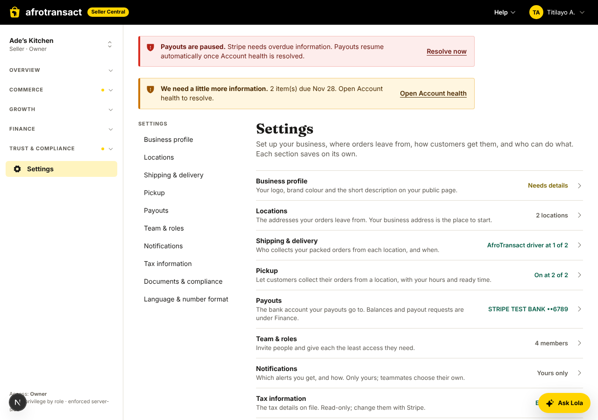
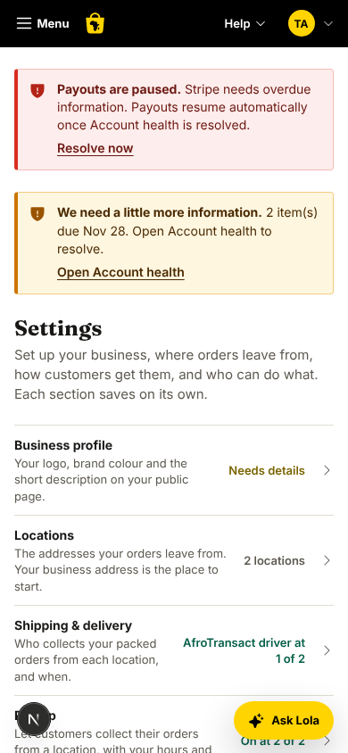
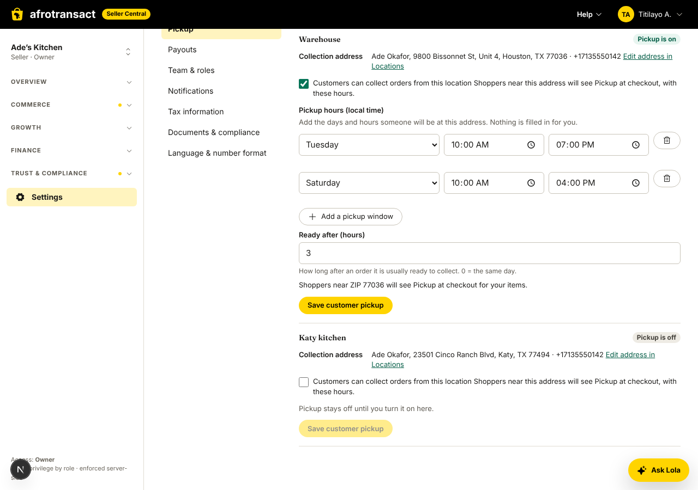
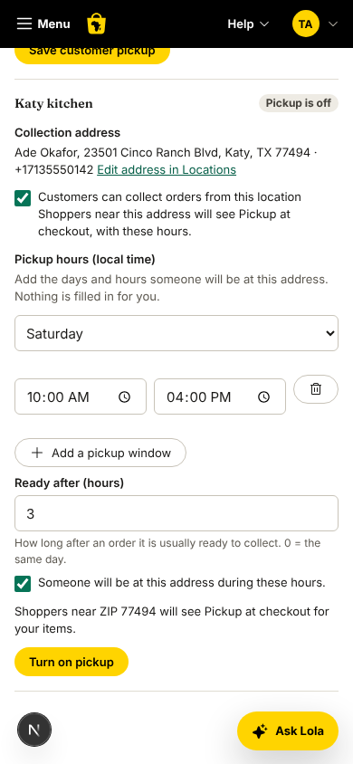
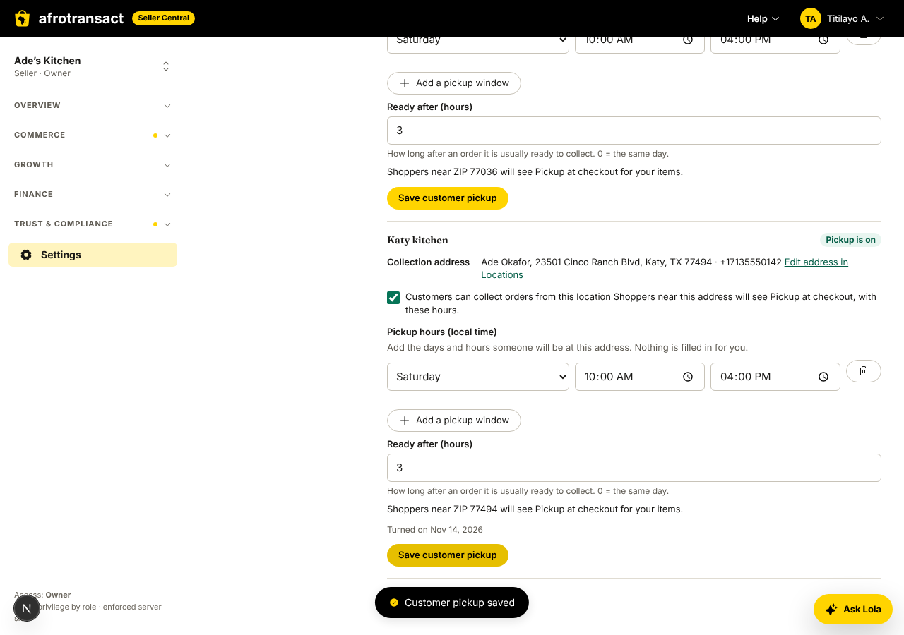
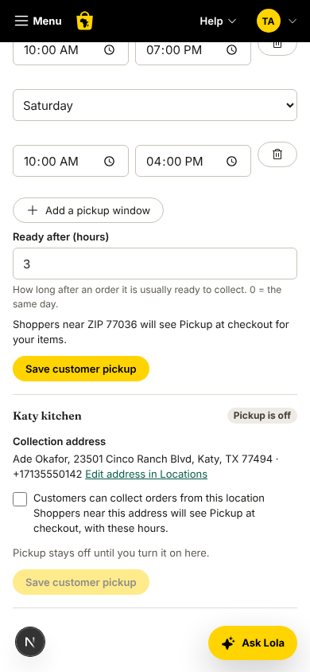
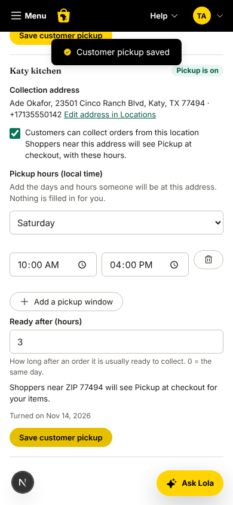

# Seller Center settings

Settings are their own area (`/settings`), apart from Orders. Each section is **its own page with its own Save and its own
permission**, and each setting lives in exactly one section. The area was introduced when the owner found that the pickup
form lived under Orders > Ship-from & pickup ("we need to really isolate settings properly").

## The sections

The Settings home (`/settings`) is a flat list, Amazon Seller Central style (no cards): a name, one line about it and a status.
Desktop also has a left sub-nav; on a phone a "Settings" link sits above the section. Statuses come from saved state only.

| Section (route) | What it holds (single source of truth) | Permission (module in the access matrix) | Status shown | Provider Hub |
|---|---|---|---|---|
| Business profile `/settings/business` | logo, brand colour, public description (`/v1/seller/business-page`); "Offer services" application | Team (owner, admin) | Complete / Needs details | yes |
| Locations `/settings/locations` | ship-from addresses, default, where geo placed them; "Use my business address" for the first one | Orders | "2 locations" / None yet | no |
| Shipping & delivery `/settings/shipping` | per location: AfroTransact driver pickup on/off and its hours (who collects packed orders) | Orders | "AfroTransact driver at 1 of 2" / You ship | no |
| Pickup `/settings/pickup` | per location: customers collect orders (enable, hours, ready time, "someone will be there"); address read-only with a link to Locations | Orders | "On at 1 of 2" / Off | no |
| Payouts `/settings/payouts` | the bank account payouts go to (held by Stripe, changed in Stripe's secure forms); balances stay in Finance > Payouts | Payouts (owner, finance) | bank name and last 4 / Paused / No bank account | yes |
| Team & roles `/settings/team` | members, invitations, roles | Team | "4 members" | yes |
| Notifications `/settings/notifications` | this member's alert topics and quiet hours (personal) | none: any member | "Yours only" | yes |
| Tax information `/settings/tax` | read-only: legal name, tax ID type and last 4, business address, formation; links to Stripe (change) and the sales tax statement | Payouts | "EIN ••1234" / Not on file | yes |
| Documents & compliance `/settings/documents` | what Stripe still needs from the business, with "Resolve with Stripe" | Account health (owner, admin, finance) | Nothing needed / "3 items needed" | yes |
| Language & number format `/settings/language` | language, time zone, date and number display, table density (personal) | none: any member | the language | yes |

The access matrix (identity seed) is unchanged. A section opens with at least View on its module and saves with Edit; a role
without the module does not see the section in the list or the sub-nav, and a direct visit shows "You don't have access". Roles
with View only get the "Read-only." note and no save buttons. (A dedicated `settings` permission per section would need an
identity migration: see the owner decisions in the story.)

## Where each setting lived before, and where it went

| Before | Now |
|---|---|
| Orders > Ship-from & pickup (`/orders/ship-from`): addresses, driver pickup, customer pickup, the pickup card | Locations, Shipping & delivery, Pickup (three pages). `/orders/ship-from` redirects to Locations |
| Team & roles in the sidebar (`/team`) | Settings > Team & roles. The sidebar has one **Settings** entry; `/team` redirects |
| Business page (`/team/business-page`) | Settings > Business profile; redirect |
| My account > Notifications, Preferences | Settings > Notifications, Language & number format; `/account/notifications` and `/account/preferences` redirect. My account keeps Profile and Sign-in & security (personal identity, not the business). The account menu in the header links to the new pages |
| "Offer services" button on Preferences | Business profile (it is about the business) |
| Account health "Update with Stripe" | the same panel (`StripeUpdatePanel`), used by Account health, Settings > Payouts and Settings > Documents; Account health stays in the sidebar as the status page |
| Staff console | unchanged. Staff has no way to turn a seller's pickup on (no endpoint, no control); the seller's explicit confirmation is the only path |

Orders keeps orders only: the table, the order sheet and "Delivery run pick lists". The only pickup element left is the
one-line nudge ("Customers can't collect orders from you yet", link "Set up pickup" to Settings > Pickup) and, on Home, the
prompt card that links there (Not now / Don't ask again are server-side per organisation).

## Pickup rules (unchanged, see `store-pickup.md`)

carrier-gateway refuses off to on without `hoursConfirmed` and a valid window; gateway-bff checks first (422
`PICKUP_HOURS_NOT_CONFIRMED`); who and when are recorded server side; pickup is never on by default. The Pickup page only sends
a turn-on when hours are typed, a ready time is typed and the box is ticked (`lib/pickup-settings.ts`), and always with
`hoursConfirmed: true`. Editing a place that stays on keeps the first record.

## Code map

- `web/apps/seller-center/src/lib/settings-sections.ts`: the section list, visibility and edit rules, status wording (pure, tested).
- `src/components/settings/`: `SettingsShell` (sub-nav, `SettingsPage`, access hooks), `SettingsLanding`, `LocationsView`,
  `ShippingView`, `PickupView`, `MoneySettingsViews` (payouts, tax, documents), `PersonalSettingsViews`, `BusinessAddressStart`.
- `src/app/(portal)/settings/<section>/page.tsx`: one route per section, under `settings/layout.tsx`.
- `next.config.ts`: the redirects from the old routes.
- No BFF or contract change: every setting uses the endpoints it already had. The landing's statuses are composed in the browser
  from the existing queries (ship-from list, compliance, onboarding form, team, business page).
- Tours: `settings` and `pickup-setup` chapters, `shipping-setup` now starts at Locations (`docs/engineering/guided-tours.md`).

## Writing rules

Plain wording; the English copy never uses the word "offer" for sellers' own items (the Business profile field is "What you sell
or do"); names, not ids; tokens only; strings in all five locales (en, fr, es, ar, yo; Arabic is right to left, so the list uses
logical alignment and the chevrons flip with `rtl:`). The four non-English catalogues for the new keys are machine translations
marked for review.

## Pictures (mock BFF, `NEXT_PUBLIC_API_MOCKS=1`)

## The crash that started this

Typing in the address form under Settings > Locations (before: Orders > Ship-from & pickup) threw
`TypeError: Cannot read properties of null (reading 'value')` inside `useState`, and the app error boundary replaced the page.
Cause: the field handler read `e.currentTarget.value` inside the `setForm((f) => ...)` updater. React runs an updater later
(during render, when other updates are queued) and by then has cleared `currentTarget`. The fix reads the value first
(`const value = e.currentTarget.value; setForm((f) => ({ ...f, [k]: value }))`). The same shape existed in the Billing card
number, Coupons, and two staff console editors (fixed). `test/form-null-value.test.tsx` types into every field of the location,
pickup and driver pickup forms behind an error boundary and fails on any console error, and scans `apps/` and `packages/` for
`currentTarget` inside a state updater. The route error boundary now reports to telemetry with the route, the component that threw
(`componentFromStack`) and the top of the stack (`@afrotransact/telemetry/react`, `useReportError`); telemetry is off unless
`NEXT_PUBLIC_SENTRY_DSN` is set for the environment, which is why nothing was reported from a local run.
