# Seller Center settings

Settings are their own area (`/settings`), apart from Orders. Each section is **its own page with its own Save and its own
permission**, and each setting lives in exactly one section. The area was introduced when the owner found that the pickup
form lived under Orders > Ship-from & pickup ("we need to really isolate settings properly").

## The sections

The Settings home (`/settings`) is a flat list, Amazon Seller Central style (no cards): a name, one line about it and a status.
Settings is **one content column**: there is no sub-nav column (the app sidebar is the only navigation beside it). A section page
has a "Settings" link above it to go back; each section stays its own route with its own permission. Statuses come from saved
state only.

| Section (route) | What it holds (single source of truth) | Permission (module in the access matrix) | Status shown | Provider Hub |
|---|---|---|---|---|
| Business profile `/settings/business` | logo, brand colour, public description (`/v1/seller/business-page`); "Offer services" application | Team (owner, admin) | Complete / Needs details | yes |
| Locations `/settings/locations` | ship-from addresses, default, where geo placed them; "Use my business address" for the first one | Orders | "2 locations" / None yet | no |
| Shipping & delivery `/settings/shipping` | per location: AfroTransact driver pickup on/off and its hours, the same weekly list as Pickup (who collects packed orders) | Orders | "AfroTransact driver at 1 of 2" / You ship | no |
| Pickup `/settings/pickup` | per location: customers collect orders (one switch, the week's hours, ready time); address read-only with a link to Locations | Orders | "On at 1 of 2" / Off | no |
| Payouts `/settings/payouts` | the bank account payouts go to (held by Stripe, changed in Stripe's secure forms); balances stay in Finance > Payouts | Payouts (owner, finance) | bank name and last 4 / Paused / No bank account | yes |
| Team & roles `/settings/team` | members, invitations, roles | Team | "4 members" | yes |
| Notifications `/settings/notifications` | this member's alert topics and quiet hours (personal) | none: any member | "Yours only" | yes |
| Tax information `/settings/tax` | read-only: legal name, tax ID type and last 4, business address, formation; links to Stripe (change) and the sales tax statement | Payouts | "EIN ••1234" / Not on file | yes |
| Documents & compliance `/settings/documents` | what Stripe still needs from the business, with "Resolve with Stripe" | Account health (owner, admin, finance) | Nothing needed / "3 items needed" | yes |
| Language & number format `/settings/language` | language, time zone, date and number display, table density (personal) | none: any member | the language | yes |

The access matrix (identity seed) is unchanged. A section opens with at least View on its module and saves with Edit; a role
without the module does not see the section in the list, and a direct visit shows "You don't have access". Roles
with View only get the "Read-only." note and no save buttons. (A dedicated `settings` permission per section would need an
identity migration: see the owner decisions in the story.)

## Where each setting lived before, and where it went

| Before | Now |
|---|---|
| Orders > Ship-from & pickup (`/orders/ship-from`): addresses, driver pickup, customer pickup, the pickup card | Locations, Shipping & delivery, Pickup (three pages). `/orders/ship-from` redirects to Locations |
| Team & roles in the sidebar (`/team`) | Settings > Team & roles. The sidebar has one **Settings** entry; `/team` redirects |
| Business page (`/team/business-page`) | Settings > Business profile; redirect |
| My account > Notifications, Preferences | Settings > Notifications, Language & number format; `/account/notifications` and `/account/preferences` redirect. My account keeps Profile and Sign-in & security (personal identity, not the business). The account menu in the header links to the new pages |
| "Offer services" button on Preferences | Business profile (it is about the business) |
| Account health "Update with Stripe" | the same panel (`StripeUpdatePanel`), used by Account health, Settings > Payouts and Settings > Documents; Account health stays in the sidebar as the status page |
| Staff console | unchanged. Staff has no way to turn a seller's pickup on (no endpoint, no control); the seller's explicit confirmation is the only path |

Orders keeps orders only: the table, the order sheet and "Delivery run pick lists". The only pickup element left is the
one-line nudge ("Customers can't collect orders from you yet", link "Set up pickup" to Settings > Pickup) and, on Home, the
prompt card that links there (Not now / Don't ask again are server-side per organisation).

## Pickup rules (unchanged, see `store-pickup.md`)

carrier-gateway refuses off to on without `hoursConfirmed` and a valid window; gateway-bff checks first (422
`PICKUP_HOURS_NOT_CONFIRMED`); who and when are recorded server side; pickup is never on by default. The Pickup page only sends
a turn-on when at least one day is open with a valid from and to, and a ready time is chosen (`lib/pickup-settings.ts`), and always
with `hoursConfirmed: true`. The confirmation is the one switch: turning "Let customers collect orders" on says, in one line under it,
that someone will be at the address during the open hours; there is no separate checkbox. Editing a place that stays on keeps the first record.

## The Pickup page (one switch, one week)

Per location, top to bottom: the name, the address as one read-only line with "Change in Locations", the switch, one line under it
(the confirmation; once on, "On since ..."), and only when the switch is on: the week, the ready time and **Save**.

- **The week** is seven rows, Mon to Sun. Each row has an open/closed switch, the day, and one "From" and one "To" on the same row
  (native selects in 30-minute steps, "9:00 AM"; no clock inputs). A closed day shows "Closed". All seven start closed: nothing is
  prefilled. "Copy to weekdays" copies the first open day's hours to Mon-Fri; "Same every day" copies them to all seven (both wait
  until a day has valid hours).
- **Mapping to the API** (unchanged): one window per open day, in week order; closed days send no window; shared hours still save
  per-day windows. A second window on a day that already exists on the server is kept (not shown, not dropped).
- **Ready time** is a select: Same day (0), 1 hour, 2 hours, 4 hours, Next day (24). A saved value that is not one of these
  (for example 3) is shown as "3 hours" so editing never changes it silently. It starts empty ("Choose") and is required.
- **Save** is enabled when there is a change and it is valid. Why not is one plain line beside the button ("Open at least one day.",
  "Choose from and to for each open day.", "To must be later than from.", "Choose when orders are ready to collect.") and the
  offending selects are marked invalid.
- The driver pickup form on Shipping & delivery uses the same `WeeklyHours` list (switch, week, Save); it no longer prefills 09:00-17:00.

### Alignment rule

Every control in a row has the same height (`--at-size-control`: 40px, 44px on touch) and the same vertical centre. The list uses bare
`<select>`s (the form `Field` wrapper adds a label and a message line, which is what pushed the old row out of line) and a 40px-tall
switch hit area. `tests/e2e/specs/seller-center.settings-alignment.spec.ts` measures it in the browser at 1280 and 390: in each row
(closed and open, Pickup and driver pickup, the ready row, the Save row) the centres are within 1px and the heights equal; from and
to stay on one line at 390; no sideways scroll; the save payload has one window per open day.

## Code map

- `web/apps/seller-center/src/lib/settings-sections.ts`: the section list, visibility and edit rules, status wording (pure, tested).
- `src/lib/weekly-hours.ts` (week rows <-> windows, copy, validation, time choices) and `src/lib/pickup-settings.ts` (the Pickup draft, `pickupCanSave`, `pickupSave`): pure, tested in `test/weekly-hours.test.ts` and `test/settings-sections.test.ts`.
- `src/components/settings/`: `SettingsShell` (one column and the back link, `SettingsPage`, access hooks), `SettingsLanding`, `LocationsView`,
  `ShippingView`, `PickupView`, `WeeklyHours` (shared by both), (`src/components/ui/Switch.tsx` is the switch), `MoneySettingsViews` (payouts, tax, documents), `PersonalSettingsViews`, `BusinessAddressStart`.
- `src/app/(portal)/settings/<section>/page.tsx`: one route per section, under `settings/layout.tsx`.
- `next.config.ts`: the redirects from the old routes.
- No BFF or contract change: every setting uses the endpoints it already had. The landing's statuses are composed in the browser
  from the existing queries (ship-from list, compliance, onboarding form, team, business page).
- Tours: `settings` and `pickup-setup` chapters, `shipping-setup` now starts at Locations (`docs/engineering/guided-tours.md`).

## Writing rules

Plain wording; the English copy never uses the word "offer" for sellers' own items (the Business profile field is "What you sell
or do"); names, not ids; tokens only; strings in all five locales (en, fr, es, ar, yo; Arabic is right to left, so the list uses
logical alignment and the chevrons flip with `rtl:`). The four non-English catalogues for the new keys are machine translations
marked for review (`$meta.needsReview`); this includes the short and full day names, "Copy to weekdays", "Same every day" and the ready-time choices.

## Pictures (mock BFF, `NEXT_PUBLIC_API_MOCKS=1`)

Before (the three-column page with stacked controls and native clock inputs) and after, at 1280 and 390:

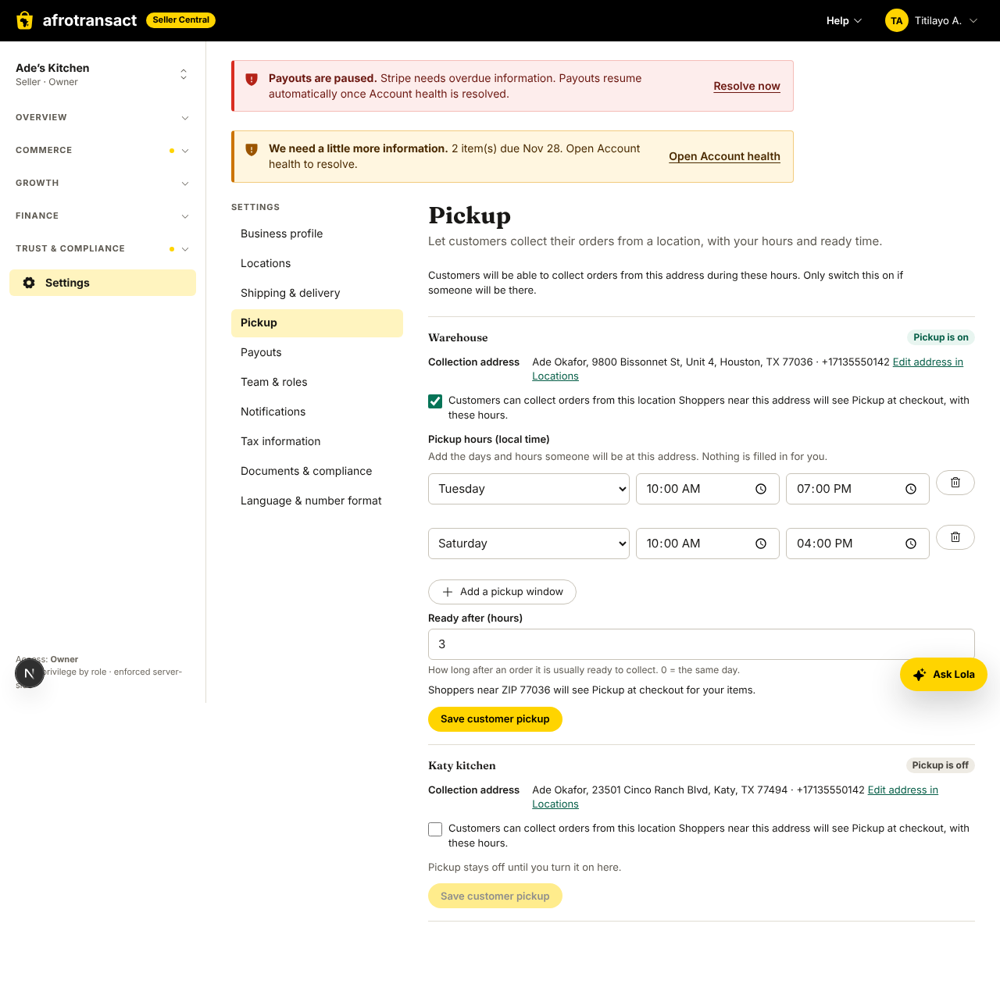
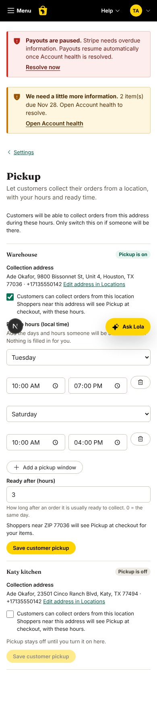
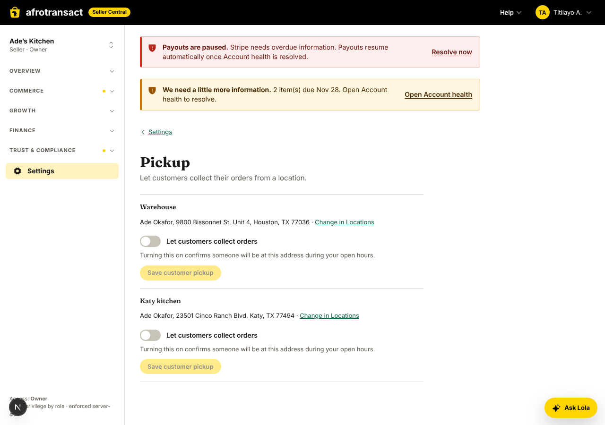
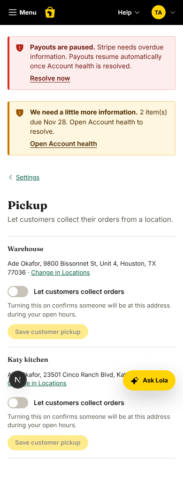
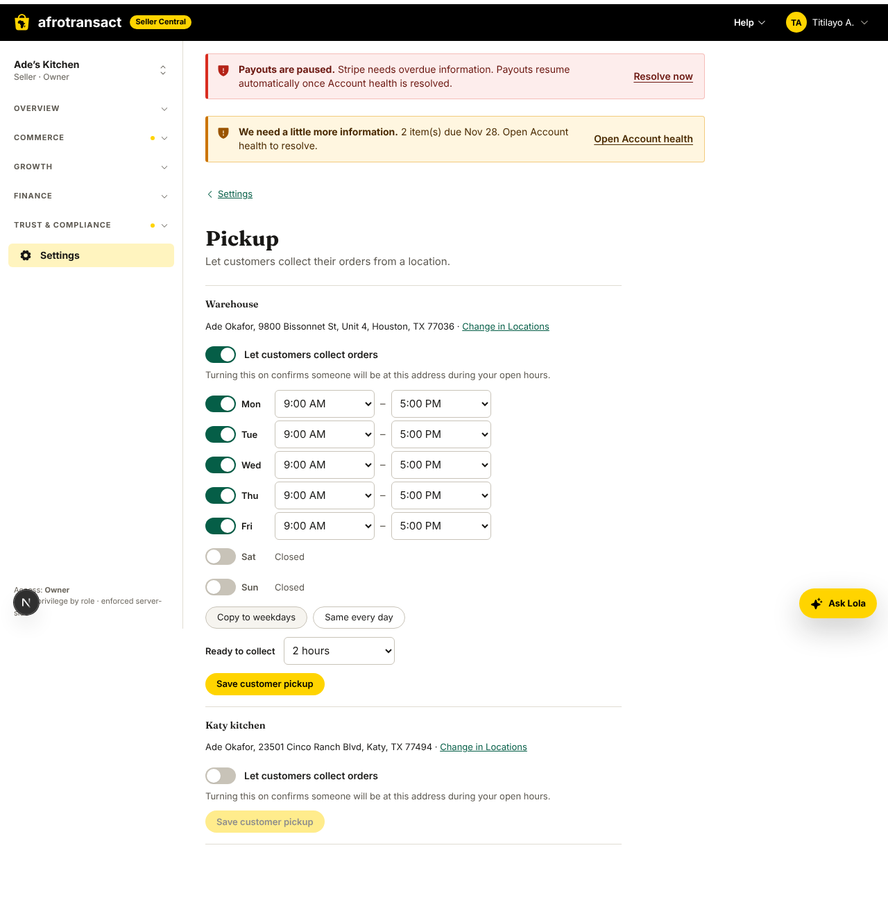
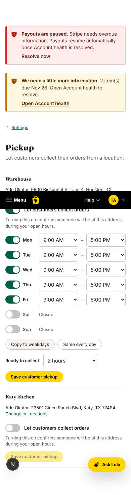
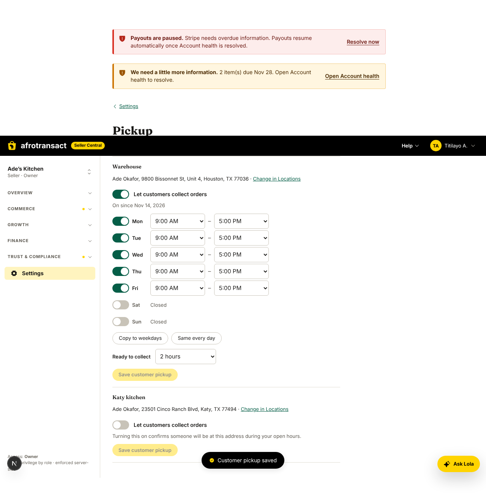
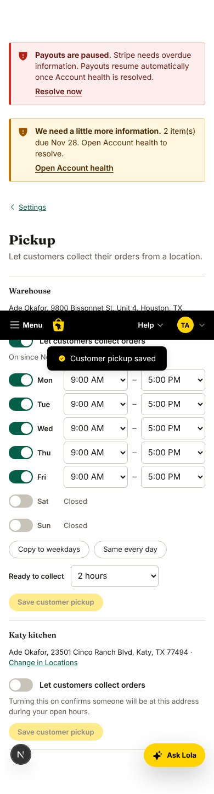
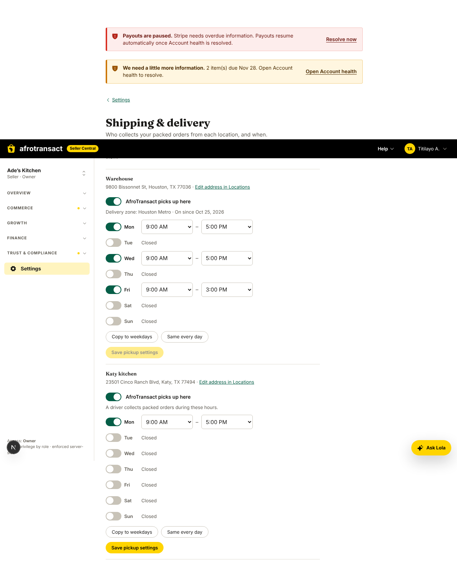
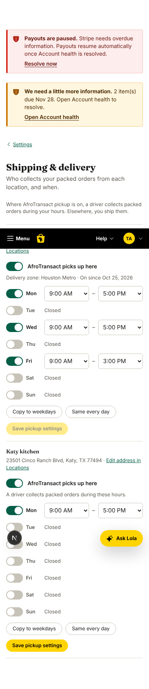
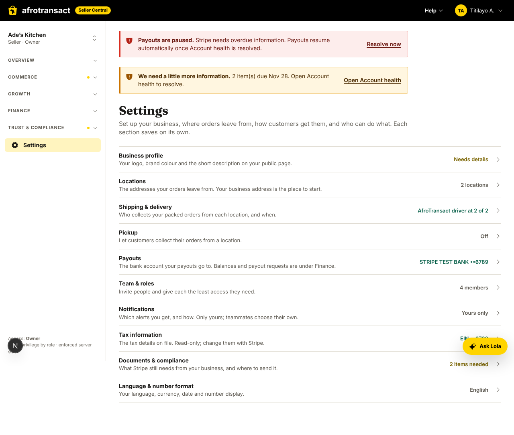
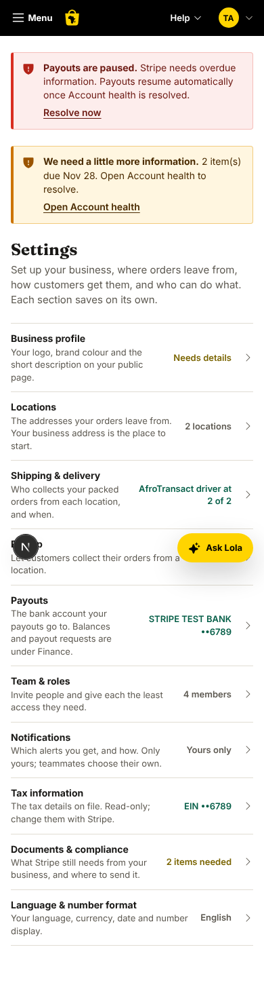

## The crash that started this

Typing in the address form under Settings > Locations (before: Orders > Ship-from & pickup) threw
`TypeError: Cannot read properties of null (reading 'value')` inside `useState`, and the app error boundary replaced the page.
Cause: the field handler read `e.currentTarget.value` inside the `setForm((f) => ...)` updater. React runs an updater later
(during render, when other updates are queued) and by then has cleared `currentTarget`. The fix reads the value first
(`const value = e.currentTarget.value; setForm((f) => ({ ...f, [k]: value }))`). The same shape existed in the Billing card
number, Coupons, and two staff console editors (fixed). `test/form-null-value.test.tsx` types into every field of the location,
pickup and driver pickup forms behind an error boundary and fails on any console error, and scans `apps/` and `packages/` for
`currentTarget` inside a state updater. The route error boundary now reports to telemetry with the route, the component that threw
(`componentFromStack`) and the top of the stack (`@afrotransact/telemetry/react`, `useReportError`); telemetry is off unless
`NEXT_PUBLIC_SENTRY_DSN` is set for the environment, which is why nothing was reported from a local run.
