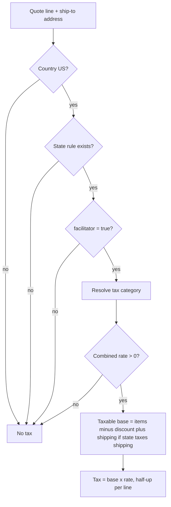

# Shipping and sales tax — providers, data points, and rules

This note answers three questions for product and engineering:

1. **Is a line taxable?** (what we look at first)
2. **What tax rate applies?**
3. **How is shipping priced?** (at launch: by us, one flat fee; see "Shipping at launch (v1)")

Checkout **estimates** are described in [checkout-tax-estimate.md](./checkout-tax-estimate.md). **Authoritative** tax and shipping for a placed order are computed in the **orders** checkout saga (`prepare`), using the same services and shapes as the BFF estimate where possible.

---

## Sales tax — managed in-house today (not Stripe Tax / TaxJar yet)

| Layer | Role |
|--------|------|
| **tax-returns-service** (Java, port 8111) | Owns quotes, rate tables, ledger, returns/refunds tax reversal |
| **`DefaultTaxRules`** | Rules engine: table × category × address → tax per line |
| **`tax_state_rule` / `tax_local_rate`** (PostgreSQL) | Rates staff maintain via `PUT /v1/tax/rates/**` |
| **Config** `at.taxreturns.tax.provider` | Default **`RULES`** (no external API). **`STRIPE_TAX`** is available (calculation only, rules fallback; see the tax-returns README). `TAXJAR`, `AVALARA` are reserved for a future adapter |

**Who calls quotes**

| Caller | Token | When |
|--------|--------|------|
| **orders-service** | `orders-service` client, scope `tax:quote` | Checkout saga **prepare** (authoritative line tax on the order) |
| **gateway-bff** | `gateway-bff` client, scope `tax:quote` | Checkout **summary** (shopper estimate before place) |

Shoppers never call tax-returns directly.

---

## 1) Is a product / line taxable? (decision order)

Tax is **not** a single catalog flag like `taxable: true`. A line is taxed only when **all** of the following hold; otherwise tax is **zero** and `collectedBy` is **`NOT_COLLECTED`**.

### Data points that drive “taxable or not”

| Data point | Source | Used for |
|------------|--------|----------|
| **Ship-to country, state, postal code, city** | Customer address book (checkout / order) | US-only; state must exist in `tax_state_rule` |
| **`facilitator` on state rule** | `tax_state_rule` (seed + staff API) | Marketplace facilitator: AfroTransact collects only where `facilitator=true` |
| **Tax code** | `tax_classification_rule` from the product type and the seller's `tax_class` answer ([tax-classification-design.md](./tax-classification-design.md)); default general taxable | Decides the category; callers normally send only `atin` and `productType` |
| **`taxCategory` on quote line** (optional) | Caller (`GENERAL`, `GROCERY`, `PREPARED_FOOD`) | Overrides the classification when set |
| **`productType` on quote line** | **Catalog** on the variant/product (cart/checkout line; orders enriches from catalog if missing on events) | Mapped to category when `taxCategory` absent |
| **Category → rate** | State + local tables | **`GROCERY`** may be **reduced or 0%** (exempt) in a state; **`PREPARED_FOOD`** often general rate; unknown types → **`GENERAL`** |
| **Line money** | Cart/order | `unitPriceMinor`, `quantity`, `discountMinor` — zero base ⇒ zero tax even if rate > 0 |
| **Shipping on line** | Checkout allocation | Each line carries **its share** of its package’s **shipping** in the quote (allocated by item value, [checkout-tax-estimate.md](./checkout-tax-estimate.md); the mixed-basket method is open legal decision 5); shipping is added to the taxable base only if **`shippingTaxable`** on the state rule **and** the line’s combined rate > 0 |

### How we know **product type** (feeds category)

| Source | Field | Notes |
|--------|--------|--------|
| **Catalog service** | `productType` (seller listing / product type code, e.g. `pantry`, `dresses`, `perishable`) | Canonical for new quotes |
| **tax-returns config** | `at.taxreturns.tax.category-by-product-type` | Maps type → `GROCERY` / `PREPARED_FOOD` / default **`GENERAL`** (see `java/services/tax-returns/src/main/resources/application.yml`) |
| **Order events** | `productType`, `perishable` on lines | Snapshotted on `order_line_snapshot` for returns/ledger; tax-returns can call catalog when type was missing at intake |

**`perishable`** affects **returns** (report-a-problem, no ship-back), **not** whether sales tax applies.

**Examples (config, not legal advice)**

- `fresh-produce`, `pantry`, `spices` → **GROCERY** (often lower or exempt state rate).
- `prepared-meals`, `hot-food` → **PREPARED_FOOD** (often full rate).
- `dresses`, electronics, etc. → **GENERAL** unless staff map the type.

Finance must confirm seeded rates and mappings before production. **Texas:** see [texas-sales-tax-rates.md](./texas-sales-tax-rates.md) and migration `V4__texas_comptroller_tax_rates.sql`.

---

## 2) What is the tax **rate**?

For a **taxable** US facilitator state line:

1. **Category** — from `taxCategory` or `category-by-product-type` + `productType` (see above).
2. **State rate** — `StateTaxRule.rateFor(category)` (`generalRate`, `groceryRate`, `preparedFoodRate`).
3. **Local rate** — optional row in `tax_local_rate` for ship-to ZIP (exact **5-digit** wins over **3-digit** prefix). Local grocery may use `appliesToGrocery`.
4. **Combined rate** = state + local (decimal fraction, e.g. `0.0825` = 8.25%).
5. **Tax amount** = `taxableMinor × rate`, rounded **half up once per line** (never per unit, never once per invoice).

Quote response fields shoppers/indirectly see via BFF:

- `totalTaxMinor`, per-line `taxMinor`, `rate`, `jurisdiction`, `localJurisdiction`, `shippingTaxMinor`.

Staff maintain rates: `GET/PUT /v1/tax/rates` (permissions `tax:read`, `tax:configure`). Deep reference: [tax-returns README](../../java/services/tax-returns/README.md) § Marketplace-facilitator sales tax (S116).

---

## Shipping at launch (v1): AfroTransact sets all shipping

Listing rules D16 to D22 (`docs/engineering/listing-rules.md`, section 3 "Launch shipping (v1)") are final. **AfroTransact sets all shipping at launch.** Sellers do not set shipping, there are **no carrier rates at checkout**, and **no carrier is named anywhere a shopper reads** (cart, product page, checkout, email, customer app). There is **no express** option.

| Situation | Option (shopper label, key) | Fee |
|---|---|---|
| Fulfilled by AfroTransact item | **Delivery by AfroTransact** (`afrotransact_delivery`) | **One flat fee set by staff** (default **$5.99** = 599 minor), optional free-above threshold (default none) |
| Fulfilled by AfroTransact item | **Pickup at an AfroTransact point** (`pickup`) | $0 |
| Item sold from a seller store | **AfroTransact collects from the store and delivers** (`afrotransact_delivery`) | **The same flat fee** |
| Item sold from a seller store | **Collect from the store** (`pickup`) | $0, address and hours shown |
| Pre-order item | The window date and the **run's own delivery fee**, in **its own package** | As set on the window or run (delivery-runs) |
| Address outside every geo delivery zone | **Too far for standard delivery. Ask us for a quote** (`quote_required`) | Agreed by customer care (D20); disabled for payment, pickup stays |
| Seller-shipped carrier option (`carrier`) | Hidden behind the staff setting `sellerCarrierShippingEnabled` | **OFF at launch** |

A seller-shipped package (not a store item) is offered the same flat AfroTransact delivery while the carrier switch is off (open decision below).

### One source of the fee

The fee is **one staff-edited record owned by orders** (`shipping_settings`, one row per currency, migration V11) and **nothing else**:

- **Fields:** `flatFeeMinor` (0 to 10,000), `freeAboveMinor` (null = never free), `sellerCarrierShippingEnabled` (default false), `version`. The formula is `freeAboveMinor != null && itemsMinor >= freeAboveMinor ? 0 : flatFeeMinor`, per package, on the package's items (Java `ShippingSettings.deliveryFee`, Go `domain.ShippingSettings.DeliveryFee`, web and customer-app mocks).
- **History and audit:** every change is a new version in `shipping_settings_change` with who, when, the record before and after, and a **required reason** (10 to 500 characters). A save that changes nothing makes no version. The launch default (v1, $5.99) is seeded by the migration, so a value always exists.
- **Permissions:** `orders:shipping.view` (history) and `orders:shipping.edit` (change); super admin and finance edit, operations, customer support, auditor and product owner view (identity V41). The staff screen is **Settings > Flat delivery fee** (Fees & commissions module, resource `shipping-settings`); the history shows names, not ids.
- **Who reads it:** gateway-bff reads `GET /v1/public/shipping-settings` (no sign-in) every 15 seconds for the estimate; **orders reads the same row for every charge** (`DefaultShippingPolicy`), including AfroTransact collecting from a store (the distance quote only keeps the route and the seller's pickup fee, never the shopper's price).
- **Proof:** [`tools/checkout/shipping-fee-vectors.json`](../../tools/checkout/shipping-fee-vectors.json) lists, for four settings and ten cart values, what each option costs. Orders (`ShippingFeeContractTest`, which charges every option through checkout), gateway-bff (`TestShippingFeeContractEstimateEqualsWhatOrdersCharges`), the web mock and the customer app each assert the same numbers. Add a case there when the rule changes.

### When the settings cannot be read

- **Estimate (gateway-bff):** keeps the **last known value** (a 15 second poll is the short cache) and logs it plainly (`shipping settings unavailable; keeping the last known delivery fee`, with the version and age). If **no value was ever read**, the option carries `feeUnknown: true` ("Delivery fee shown at checkout", never $0 or FREE) and the summary has `canPlaceOrder = false` with `deliveryBlockedReason`; the storefront and the app disable Place order until it is known. Pickup needs no fee and stays available.
- **Placement (orders):** reads its own database row for every charge; if it cannot, the checkout step fails and is retried. Nothing is ever charged from a guess.

### Address outside the delivery zones (D21)

The BFF asks geo `GET /v1/zones/covering?type=DELIVERY` for the address's position. **Inside any active DELIVERY zone the flat fee applies. Outside every zone** each non-pre-order package offers a single delivery option, `quote_required` (plus free pickup when a point is near), the summary has `canPlaceOrder = false`, and orders refuses a `quote_required` selection in plain words. If geo cannot be read, or the address has no position, the shopper is not turned away: the flat fee applies (logged). Staff add or widen zones in geo; **zones must be seeded before launch**, or every address is "too far". The quote request flow behind the key (case, agreed amount, 48 hour pay link) is a separate change; the storefront and the app call a stub `onRequestQuote`.

### Pre-orders (D22)

A pre-order line and an in-stock line in one cart are **separate packages**: the pre-order package pays the **fee of its own window or run** (door or pickup), the in-stock package the flat fee, each once. The estimate now adds the pre-order package's fee (`preorder.feeMinor` from the cart) to `shippingMinor`; before this change the BFF estimate left it out while orders charged it. Tax on shipping follows the item through the existing proportional allocation ([checkout-tax-estimate.md](./checkout-tax-estimate.md), **open legal decision 5, unchanged**).

### Weight mode and tiers (D18)

Launch uses the one flat fee. The weight mode is the existing flat or per-weight switch in the staff fee editor (payments delivery pricing); orders and the cart carry **no package weights yet**, so the checkout does not use it. When data shows heavy or oversize items lose money, switch the weight mode on (base plus per pound) in the settings record, with a reason, then size tiers. **No size tiers are built.**

### Carriers: labels and tracking only (D17)

**carrier-gateway** stays for our own outbound and return **labels and tracking** (`POST /v1/rates`, `/v1/labels`, tracking webhooks) and for seller back-office label screens, which are not shopper-facing. Revisit live carrier rates, and direct carriers versus an aggregator, only when sellers start shipping themselves or the flat fee loses money. When a real carrier shipment is tracked the carrier name is data on that shipment, never copy in a template.

### Guard against carrier names

`TestNoShopperFacingTextNamesACarrierWhileTheSellerCarrierSwitchIsOff` (gateway-bff) and `carrier-names.test.ts` (web, scanning the storefront, shared shopper UI, customer app and the mock BFF's shopper content) fail when a shopper-facing string names USPS, UPS, FedEx, DHL, "Ground Advantage", "Next Day Air" or similar while the switch is off. Known exceptions outside shopper copy: the published legal documents (privacy notice sub-processors, seller fees), which counsel owns, still name carriers.

**Promise** (Go, port 8204) does **not** price shipping; it computes **delivery/pickup dates** from FC cutoffs, ZIP3 transit tables, seller handling days, and driver zones (`POST /v1/promises`), and only dates an option, never removes it.

---

## Shipping-related data points (by stage)

### Cart & checkout (shopper-facing)

| Data point | Source | Affects |
|------------|--------|---------|
| **Fulfilment type** | Offer / cart package (`FulfilledByAfroTransact`, `AfroTransactDelivery`, seller) | Which options and fee rules apply |
| **Package subtotal** | Cart | Free-above threshold of the flat delivery fee |
| **Delivery option key** | Shopper choice (`afrotransact_delivery`, `pickup`; `quote_required` is not payable; `carrier` only behind the staff switch) | Fee and tax shipping allocation |
| **Ship-to address** | Identity address book | Promise dates, ATD eligibility, **tax** ship-to |
| **Address lat/lng or geocoded street** | Identity / geo | ATD distance and zone checks |
| **Ship-from location** | Seller `ship-from-locations` (offers) | ATD origin, promise origin |
| **Road distance (miles)** | geo `POST /v1/distance` | Whether a seller store can be served (radius) and the route; **not** the shopper's price |
| **Seller org id** | Package seller | Seller's pickup-delivery fee (payments delivery pricing); never the shopper's price |
| **Destination ZIP** | Address | promise batches, FC transit |
| **FC id** (platform fulfilment) | Derived from ship-to ZIP (BFF) | promise origin, ATD zone (FC-owned) |
| **`packageDelivery` query** | Storefront → BFF | Re-sync **shipping + estimated tax** when options change |

BFF wiring: `shopper_checkout.Summary` (delivery facts, delivery zones, local delivery, tax quote); the fee comes from `ShippingSettingsSync` (orders' shipping settings), not from configuration.

### Place order (authoritative)

| Data point | Source |
|------------|--------|
| **Delivery selections** | `PlaceOrderRequest.deliverySelections` |
| **Shipping per shipment** | orders `ShippingPolicy.fee(method, serviceLevel, itemsMinor)` reading the shipping settings; a pre-order package pays its window or run fee; the store-delivery snapshot keeps the route and the seller fee |
| **Promised dates** | promise (or fallback estimates) |
| **Tax lines** | tax-returns quote (same line shape: each line carries its allocated share of the shipment’s shipping) |

### Post-checkout (operations)

| Data point | Source |
|------------|--------|
| **Shipment weight/dimensions, origin, service level** | Fulfilment / seller |
| **Carrier quotes & label cost** | carrier-gateway `POST /v1/rates` / `POST /v1/labels` |
| **Tracking** | carrier-gateway + webhooks; BFF adds scans to order timeline (`shipping:rate` token) |

---

## Quick reference — services and ports

| Concern | Service | Local port (see `infra/local/PORTS.md`) |
|---------|---------|----------------------------------------|
| Tax quotes & rates | tax-returns | 8111 |
| Checkout saga | orders | 8104 |
| Shopper API aggregation | gateway-bff | (see PORTS) |
| Delivery **dates** | promise | 8204 |
| **Carrier** rates/labels/tracking | carrier-gateway | 8209 |
| Road distance / zones | geo | (see PORTS) |
| Seller pickup-delivery fee (not the shopper's price) | payments | (see PORTS) |
| **Shipping settings** (the flat fee) | orders | 8104 |
| Product type / perishable | catalog | (see PORTS) |
| Ship-from / seller pickup | seller | (see PORTS) |

---

## Related docs

- [checkout-tax-estimate.md](./checkout-tax-estimate.md) — BFF estimate flow and UI refetch
- [tax-returns README](../../java/services/tax-returns/README.md) — ledger, returns, rate API
- [carrier-gateway README](../../go/services/carrier-gateway/README.md) — carriers, label billing
- [promise README](../../go/services/promise/README.md) — promise computation
- [orders README](../../java/services/orders/README.md) — checkout saga prepare step
