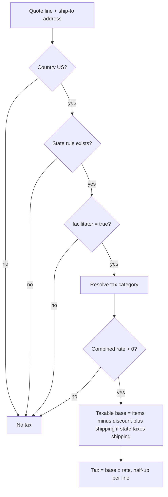

# Shipping and sales tax — providers, data points, and rules

This note answers three questions for product and engineering:

1. **Is a line taxable?** (what we look at first)
2. **What tax rate applies?**
3. **How is shipping priced — us or a carrier provider?**

Checkout **estimates** are described in [checkout-tax-estimate.md](./checkout-tax-estimate.md). **Authoritative** tax and shipping for a placed order are computed in the **orders** checkout saga (`prepare`), using the same services and shapes as the BFF estimate where possible.

---

## Sales tax — managed in-house today (not Stripe Tax / TaxJar yet)

| Layer | Role |
|--------|------|
| **tax-returns-service** (Java, port 8111) | Owns quotes, rate tables, ledger, returns/refunds tax reversal |
| **`DefaultTaxRules`** | Rules engine: table × category × address → tax per line |
| **`tax_state_rule` / `tax_local_rate`** (PostgreSQL) | Rates staff maintain via `PUT /v1/tax/rates/**` |
| **Config** `at.taxreturns.tax.provider` | Default **`RULES`** (no external API). `STRIPE_TAX`, `TAXJAR`, `AVALARA` are reserved for a future `TaxCalculator` adapter — not wired in production paths today |

**Who calls quotes**

| Caller | Token | When |
|--------|--------|------|
| **orders-service** | `orders-service` client, scope `tax:quote` | Checkout saga **prepare** (authoritative line tax on the order) |
| **gateway-bff** | `gateway-bff` client, scope `tax:quote` | Checkout **summary** (shopper estimate before place) |

Shoppers never call tax-returns directly.

---

## 1) Is a product / line taxable? (decision order)

Tax is **not** a single catalog flag like `taxable: true`. A line is taxed only when **all** of the following hold; otherwise tax is **zero** and `collectedBy` is **`NOT_COLLECTED`**.

### Data points that drive “taxable or not”

| Data point | Source | Used for |
|------------|--------|----------|
| **Ship-to country, state, postal code, city** | Customer address book (checkout / order) | US-only; state must exist in `tax_state_rule` |
| **`facilitator` on state rule** | `tax_state_rule` (seed + staff API) | Marketplace facilitator: AfroTransact collects only where `facilitator=true` |
| **`taxCategory` on quote line** (optional) | Caller (`GENERAL`, `GROCERY`, `PREPARED_FOOD`) | Overrides product-type mapping when set |
| **`productType` on quote line** | **Catalog** on the variant/product (cart/checkout line; orders enriches from catalog if missing on events) | Mapped to category when `taxCategory` absent |
| **Category → rate** | State + local tables | **`GROCERY`** may be **reduced or 0%** (exempt) in a state; **`PREPARED_FOOD`** often general rate; unknown types → **`GENERAL`** |
| **Line money** | Cart/order | `unitPriceMinor`, `quantity`, `discountMinor` — zero base ⇒ zero tax even if rate > 0 |
| **Shipping on line** | Checkout allocation | Only the **first line of each shipment/package** carries that package’s **shipping** in the quote; shipping is added to the taxable base only if **`shippingTaxable`** on the state rule **and** the line’s combined rate > 0 |

### How we know **product type** (feeds category)

| Source | Field | Notes |
|--------|--------|--------|
| **Catalog service** | `productType` (seller listing / product type code, e.g. `pantry`, `dresses`, `perishable`) | Canonical for new quotes |
| **tax-returns config** | `at.taxreturns.tax.category-by-product-type` | Maps type → `GROCERY` / `PREPARED_FOOD` / default **`GENERAL`** (see `java/services/tax-returns/src/main/resources/application.yml`) |
| **Order events** | `productType`, `perishable` on lines | Snapshotted on `order_line_snapshot` for returns/ledger; tax-returns can call catalog when type was missing at intake |

**`perishable`** affects **returns** (report-a-problem, no ship-back), **not** whether sales tax applies.

**Examples (config, not legal advice)**

- `fresh-produce`, `pantry`, `spices` → **GROCERY** (often lower or exempt state rate).
- `prepared-meals`, `hot-food` → **PREPARED_FOOD** (often full rate).
- `dresses`, electronics, etc. → **GENERAL** unless staff map the type.

Finance must confirm seeded rates and mappings before production. **Texas:** see [texas-sales-tax-rates.md](./texas-sales-tax-rates.md) and migration `V4__texas_comptroller_tax_rates.sql`.

---

## 2) What is the tax **rate**?

For a **taxable** US facilitator state line:

1. **Category** — from `taxCategory` or `category-by-product-type` + `productType` (see above).
2. **State rate** — `StateTaxRule.rateFor(category)` (`generalRate`, `groceryRate`, `preparedFoodRate`).
3. **Local rate** — optional row in `tax_local_rate` for ship-to ZIP (exact **5-digit** wins over **3-digit** prefix). Local grocery may use `appliesToGrocery`.
4. **Combined rate** = state + local (decimal fraction, e.g. `0.0825` = 8.25%).
5. **Tax amount** = `taxableMinor × rate`, rounded **half up once per line** (never per unit, never once per invoice).

Quote response fields shoppers/indirectly see via BFF:

- `totalTaxMinor`, per-line `taxMinor`, `rate`, `jurisdiction`, `localJurisdiction`, `shippingTaxMinor`.

Staff maintain rates: `GET/PUT /v1/tax/rates` (permissions `tax:read`, `tax:configure`). Deep reference: [tax-returns README](../../java/services/tax-returns/README.md) § Marketplace-facilitator sales tax (S116).

---

## Shipping — hybrid: **our commercial rules** at checkout, **carriers** at label time

We do **not** use a shipping aggregator (no EasyPost/Shippo). **Carrier-gateway** integrates **directly** with **USPS, UPS, FedEx, DHL Express** for rates, labels, void, tracking, pickups, and address validation.

What the **shopper pays for delivery** at checkout is **mostly platform-owned pricing**, not a live multi-carrier shop of every package:

| Fulfilment / method | Who sets the **customer charge** at checkout | Provider / service |
|---------------------|-----------------------------------------------|---------------------|
| **Seller-shipped** (`SELLER_FULFILLED`, carrier ground) | **Flat fee + free-shipping threshold** | BFF **`domain.Estimator`** + **orders** `DefaultShippingPolicy` (YAML/config: e.g. standard **599** minor, free above threshold). Same numbers drive cart labels (“USPS Ground Advantage”) |
| **Fulfilled by AfroTransact** (FC, carrier / express) | **Free ground** (policy) + **flat express fee** | Estimator + shipping policy; **promise** service for **dates** only |
| **AfroTransact Delivery** (seller store → door) | **Distance-based quote** | **geo** road miles (Routes/OSRM) + **payments** `POST /v1/delivery-pricing/quote`; **geo** zones for eligibility; **promise** for delivery windows |
| **Pickup** | **$0** shipping | **carrier-gateway** pickup locations + hours; no carrier rate at checkout |

**Promise** (Go, port 8204) does **not** price shipping; it computes **delivery/pickup dates** from FC cutoffs, ZIP3 transit tables, seller handling days, and driver zones (`POST /v1/promises`).

**At fulfilment** (after the order), **actual** outbound/return postage uses **carrier-gateway**:

- `POST /v1/rates` — parallel rate shop (1.5s budget) across enabled carriers for **label purchase** (Seller Center, FC ops, return labels from tax-returns).
- `POST /v1/labels` — buy label on AfroTransact carrier accounts; billing policy decides seller vs platform (S256).

So: **checkout shipping totals = our policy + payments delivery pricing**; **carrier-gateway = real carrier API for operations and return labels**, not the primary shopper checkout quote for standard cart packages.

---

## Shipping-related data points (by stage)

### Cart & checkout (shopper-facing)

| Data point | Source | Affects |
|------------|--------|---------|
| **Fulfilment type** | Offer / cart package (`FulfilledByAfroTransact`, `AfroTransactDelivery`, seller) | Which options and fee rules apply |
| **Package subtotal** | Cart | Free shipping threshold (seller packages) |
| **Delivery option key** | Shopper choice (`carrier`, `express`, `afrotransact_delivery`, `pickup`) | Fee and tax shipping allocation |
| **Ship-to address** | Identity address book | Promise dates, ATD eligibility, **tax** ship-to |
| **Address lat/lng or geocoded street** | Identity / geo | ATD distance and zone checks |
| **Ship-from location** | Seller `ship-from-locations` (offers) | ATD origin, promise origin |
| **Road distance (miles)** | geo `POST /v1/distance` | ATD customer charge |
| **Seller org id** | Package seller | payments delivery-pricing quote |
| **Destination ZIP** | Address | promise batches, FC transit |
| **FC id** (platform fulfilment) | Derived from ship-to ZIP (BFF) | promise origin, ATD zone (FC-owned) |
| **`packageDelivery` query** | Storefront → BFF | Re-sync **shipping + estimated tax** when options change |

BFF wiring: `shopper_checkout.Summary` (delivery facts, local delivery, tax quote). Config: gateway BFF `DeliveryPolicy` / commerce seller shipping minors (aligned with orders properties).

### Place order (authoritative)

| Data point | Source |
|------------|--------|
| **Delivery selections** | `PlaceOrderRequest.deliverySelections` |
| **Shipping per shipment** | orders `ShippingPolicy.fee(method, serviceLevel, itemsMinor)` or ATD quote snapshot |
| **Promised dates** | promise (or fallback estimates) |
| **Tax lines** | tax-returns quote (same line shape: shipping on first line per shipment) |

### Post-checkout (operations)

| Data point | Source |
|------------|--------|
| **Shipment weight/dimensions, origin, service level** | Fulfilment / seller |
| **Carrier quotes & label cost** | carrier-gateway `POST /v1/rates` / `POST /v1/labels` |
| **Tracking** | carrier-gateway + webhooks; BFF adds scans to order timeline (`shipping:rate` token) |

---

## Quick reference — services and ports

| Concern | Service | Local port (see `infra/local/PORTS.md`) |
|---------|---------|----------------------------------------|
| Tax quotes & rates | tax-returns | 8111 |
| Checkout saga | orders | 8104 |
| Shopper API aggregation | gateway-bff | (see PORTS) |
| Delivery **dates** | promise | 8204 |
| **Carrier** rates/labels/tracking | carrier-gateway | 8209 |
| Road distance / zones | geo | (see PORTS) |
| ATD **pricing formula** | payments | (see PORTS) |
| Product type / perishable | catalog | (see PORTS) |
| Ship-from / seller pickup | seller | (see PORTS) |

---

## Related docs

- [checkout-tax-estimate.md](./checkout-tax-estimate.md) — BFF estimate flow and UI refetch
- [tax-returns README](../../java/services/tax-returns/README.md) — ledger, returns, rate API
- [carrier-gateway README](../../go/services/carrier-gateway/README.md) — carriers, label billing
- [promise README](../../go/services/promise/README.md) — promise computation
- [orders README](../../java/services/orders/README.md) — checkout saga prepare step
