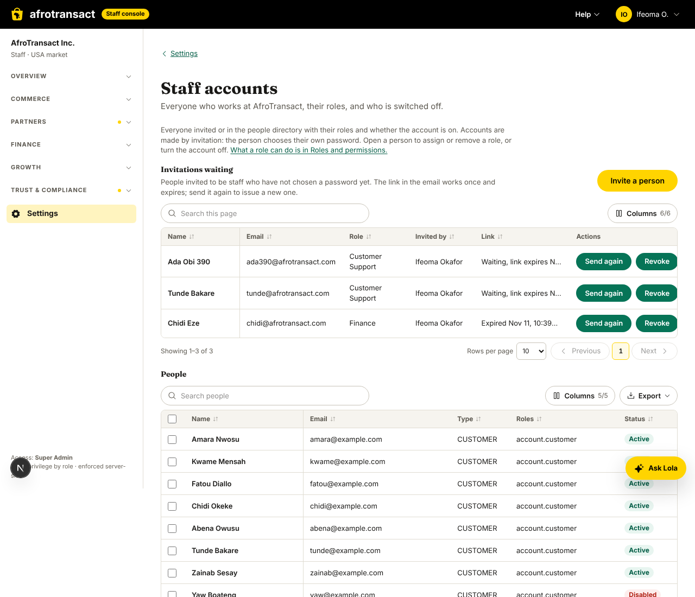
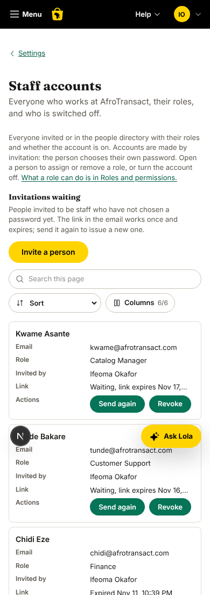
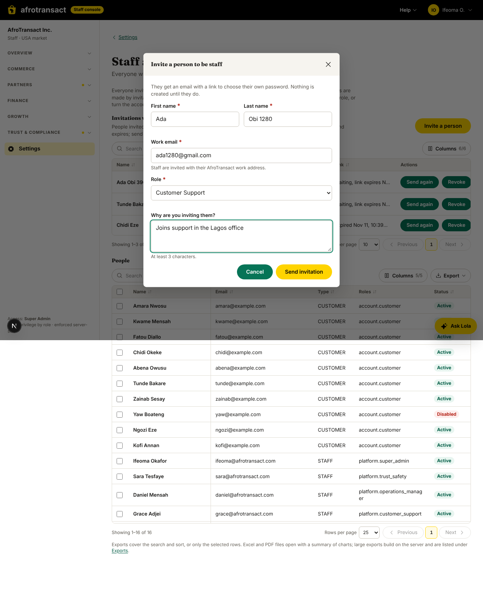
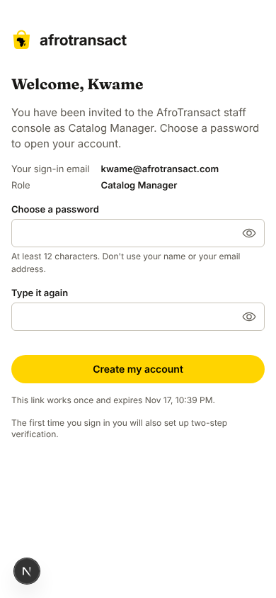

# Staff invitations

Staff accounts are made by **invitation**: nobody picks a temporary password for another person. Settings > Staff accounts
(`/settings/staff`, needs `access:admin` and Edit on Users & roles; `access:read` can look) invites by name, work email and one platform
role with a reason; the invitee opens the emailed link, chooses their own password, and the account opens.

## The flow

```
staff (access:admin) ── POST /v1/staff/access/invitations ──► BFF ──► identity POST /v1/admin/staff-invitations
   identity: pending invitation (token SHA-256 at rest, expires in 72 h), audit "staff.invitation.created", outbox event
   identity.staff-invitation.created  ──► notifications (template account.staff_invitation, email to the payload's address)
invitee opens  https://<staff console>/invite#token=…   (fragment: never sent to a server, proxy or log)
   page: POST /v1/staff/invitations/preview {token}   → name, email, role, status        (no session)
   page: POST /v1/staff/invitations/accept {token, password, confirmPassword}              (no session)
   identity: password policy, creates the enabled, email-verified account with the role, spends the token,
             audit "staff.invitation.accepted" + "role.granted", events identity.user.registered / identity.role.granted
first sign-in: the usual staff two-step verification enrolment (MFA policy is unchanged: staff and portal switches force enrolment)
```

| Step | Who | What is kept | Audit entry (access change log) |
|---|---|---|---|
| Invite | `access:admin` | name, email, role, reason, token hash, expiry (72 h, `STAFF_INVITATION_TTL`) | `staff.invitation.created` with the reason; an earlier open invitation for the same email is `staff.invitation.revoked` ("replaced") |
| Send again | `access:admin` | a **new** token and expiry; the old link stops working; `sendCount` rises | `staff.invitation.resent` |
| Revoke | `access:admin` + reason (3 to 300) | status `REVOKED` | `staff.invitation.revoked` with the reason |
| Expire | nobody | derived from `expires_at` (never stored); the list shows it as Expired and offers Send again | none (a derived state), visible in the list |
| Accept | the invitee | account, password hash (identity's hasher), role | `staff.invitation.accepted` (by the new account), `role.granted` |

Rules: only a **Super Admin can invite a Super Admin**; only **platform (staff) roles**; the email must be at one of the staff domains
(`at.identity.staff-email-domains`, default `afrotransact.com`); an existing account answers 409. The token is 256 bits, single use (the
claim is one conditional `UPDATE ... WHERE status = 'PENDING' AND expires_at > now()`), and is returned by no API: the list shows
**names and emails** and an opaque id only keys Send again and Revoke. The password must meet identity's password policy (the
configured minimum length, never containing the person's name or email); MFA and the session settings are identity's, unchanged.

## Tokens and secrets

- Hashed at rest (SHA-256); the raw token exists in the browser link and in the queued `identity.staff-invitation.created` event only
  (the outbox row, like the one-time codes and organisation invitations; notifications renders it into the email and keeps nothing else).
- Not in a URL path or query anywhere: the link carries it after `#`, and the two session-less calls take it in the body. Not in any log, the
  access change log, an API answer, a cache key on the server, or the console's address bar (the page removes the fragment after reading it).
- The public routes are rate limited like sign-in at the BFF (`AUTH_PER_MINUTE`); responses are `Cache-Control: no-store`.
- The BFF's `StaffInviteAccept` value redacts itself if it is ever formatted.

## Email, locally and elsewhere

Email goes through the **existing notification path**: identity's transactional outbox, Kafka (`at.identity.events`), the notifications
service (rule `identity.staff-invitation.created` -> template `account.staff_invitation`, migration `0028`), then the configured provider
(Resend in prod, SES/SendGrid adapters, or **SMTP -> Mailpit** locally: SMTP 1025, UI `http://localhost:8025`, see `infra/local/PORTS.md`). Run
notifications with its SMTP adapter pointed at Mailpit and the invitation appears there with the link. Identity on its own (no Kafka, no
notifications) still queues the event and the link can be read from `platform_outbox` (`payload->>'acceptUrl'`) in local development only.
The template is English (staff are invited in the console's working language).

## The old temporary-password path

`POST /v1/admin/users` (an account with a temporary password) answers **409 `identity.temp-password-disabled`** unless
`at.identity.staff-invitations.temp-password-enabled` (`STAFF_TEMP_PASSWORD_ENABLED`) is `true`. It is off in every profile. Nothing depends on it:
the BFF's "New staff account" form (People resource) and its mock were removed, no test or tool calls it. Remove the endpoint after one
release with no use.

## Configuration

| Setting | Env | Default |
|---|---|---|
| `at.identity.staff-invitations.accept-url` | `STAFF_INVITATION_ACCEPT_URL`, else `STAFF_CONSOLE_URL` + `/invite` | `http://localhost:3002/invite` (admin-dev / admin-uat / admin per profile) |
| `at.identity.staff-invitations.ttl` | `STAFF_INVITATION_TTL` | `PT72H` |
| `at.identity.staff-invitations.temp-password-enabled` | `STAFF_TEMP_PASSWORD_ENABLED` | `false` |

## Screens

`components/access/InvitationsPanel` (a server-paged TanStack table: name, email, role, invited by, expiry, Send again, Revoke), `InviteDialog`
(name, work email, role, reason), `components/invite/InviteAccept` and `app/invite/page.tsx` (a standalone page outside the console layout:
no header, no navigation, no session check). A link that is invalid, expired, withdrawn or used says so and what to do. Strings are in all
five locales (`st.inv.*`); fr, es, ar and yo are machine drafts marked for review.






## Tests

Identity: `StaffInvitationServiceImplTest` (12: hash only, 72 h, audit, domain and role rules, Super Admin rule, replace, resend, revoke, accept,
weak password, race, preview), `StaffInvitationIT` (real PostgreSQL: the whole flow, resend and the old link failing, expiry, revoke, audit
without token or password, temp-password path off). Go: `TestStaffInvitationsConformance` (contract-checked; token and password only in bodies;
no bearer for the invitee), notifications `TestStaffInvitationEmail` and the branded-layout golden. Console: `test/staff-invitations.test.tsx`
(incl. StrictMode and axe), Playwright `staff-console.settings-invitations.spec.ts` at 1280 and 390 (action buttons on one line, fields on one
column, no sideways scroll, axe, standalone page has no navigation, the token leaves the address bar).

## Not verified

Email delivery to a real mailbox (Resend/SES/SMTP) and the Kafka hop between identity and notifications; the staff console against a real
identity and gateway-bff running together; MFA enrolment at the invitee's first sign-in (unchanged code, not exercised here).
