# Staff console Settings

Staff Settings follows the Seller Center pattern ([seller-settings.md](seller-settings.md)): **one content column** (no sub-nav column;
the console sidebar is the only navigation beside it), a Settings home that is a **flat list** (name, one line, live status, no cards),
and **each section its own route** with its own save and permission and a "Settings" link back. Each setting lives in exactly one section.

## Why the owner could not find permissions (root cause)

Reported: "I do not see permission in staff console settings." The owner is a Super Admin, so this was not a permission check.

1. **No Settings entry existed.** Roles lived in the module **Users & roles** (`/users`, sidebar group *Partners*, collapsed by default), as a
   second tab called *Roles*. The Settings hub (`/settings?section=`) listed 17 sections and none was about access.
2. **The "Capabilities tab" in the identity README was never built in the console.** The README documents identity's API
   (`PUT/DELETE /v1/admin/roles/{role}/permissions/{perm}`); the console only had a generic *Roles* table whose sheet printed the
   permissions as one comma-separated string and offered "Add permission" / "Remove permission" as forms where you **typed a permission key**
   (`refunds:issue`). No catalogue, no grouping, no descriptions, no toggles. (Contract drift in the docs, not in the API.)
3. Platform roles only; no seller/provider/account roles, no "who has this role", no effective permissions, no direct grants, and the
   change log was only the per-person activity list.
4. Not mock-only: the BFF did proxy `users` and `roles` tables to identity. Only the catalogue, per-portal roles, direct grants and a role/person
   filtered log had no BFF route.

## Sections

| Section (route) | Holds | Gate (module level, plus permission) | Status |
|---|---|---|---|
| Staff accounts `/settings/staff` | invitations waiting (invite, send again, revoke), then the people table: roles, disable (the old *People* tab) | Users & roles, `access:read`; invitations `access:admin` + Edit | View only |
| Roles and permissions `/settings/access` | roles by portal, permissions by module, who has a role, people, change log | Users & roles, `access:read`; changes `access:admin` + Edit | "15 platform roles" |
| Security and sign-in `/settings/security` | the identity admin screen (clients, sessions, keys, token inspector, sign-in settings, sign-out policy); was *Identity & access* | Identity & access (`identity:admin`) | |
| Social sign-in `/settings/sign-in` | which social buttons appear | Developers | |
| Audit log (row, opens `/audit`) | link, not duplicated | Audit log | |
| Markets and locations `/settings/markets` | countries and states | Markets | "1 country live" |
| Language and display (row, opens `/account/preferences`) | personal | none | the language |
| Notification templates `/settings/notifications` | templates, preview, versions | Notifications | |
| AI and MCP spend cap `/settings/ai` | today's spend by feature against the cap, what is in force (the cap, where it comes from, the ceiling, what is left today; 0.50 per caller; 20/120 calls per minute), the form to change the cap (confirm step, required reason) and the history of changes by name | look `ai:manage`; change `ai:cap.manage` | the cap in force, e.g. "USD 2.00 a day", or "AI is switched off" |
| Published pages, Site details and legal, Application review | as before | Site content / Applications | |
| Payments, Credit, Membership, Referral, Fees, Flat delivery fee, Delivery fees, Run economics, Exchange rates, Plans | as before | their module | |
| Sales tax review (row, opens `/tax?tab=tax-review-settings`) | link, not duplicated | Sales tax | "By risk" / "Every item reviewed" |

The AI cap page shows **today's spend against the cap, by feature** (ai-gateway `GET /v1/ai/usage/today`, relayed as `GET /v1/staff/ai/spend-today`, needs
`ai:manage`; read from the usage ledger, zero with "No AI call has been recorded today" when nothing was recorded, never an estimate of ours), then **what is in force**
(`GET /v1/staff/ai/spend-cap`): the cap, where it comes from ("the starting value set on the deployment" until someone saves one, then who, when and why), the **ceiling**
it cannot pass, and what is left today. Cost is estimated by ai-gateway from provider usage after each call.

**The cap is editable** (owner request: "the AI spend cap can be configurable"). Staff with **`ai:cap.manage`** (Super Admin and Developer by default; V52) see, below the
rows, one field "New daily limit (USD)" and a "Review the change" button; the confirm dialog says "From USD 2.00 to USD 5.50 per UTC day. It takes effect within seconds and
applies to today", warns when the new value is below what was already spent today (AI stops straight away until 00:00 UTC) or is 0 (AI off for everyone), and **requires a reason
(3 to 300 characters)** that is kept with the person's name. Everyone else with `ai:manage` sees the same text with no field and no button ("You can look but not change").
The save is `PUT /v1/staff/ai/spend-cap` with `If-Match` (the version loaded; a stale one answers "Someone else changed this since you loaded it" and saves nothing). The
**history** below lists every change newest first: who (by name), when, from what to what, and why; the same change is written to the audit log (`ai.spend-cap.changed`).
Names of other people come from identity's user lookup (`access:read`); a viewer without it sees "Unknown user" for others and their own name for themselves. The
deployment keeps only the starting value (`AI_GLOBAL_DAILY_COST_USD`) and the hard ceiling (`AI_GLOBAL_DAILY_COST_MAX_USD`, default USD 20); see
[ai-spend-and-mcp-access.md](../runbooks/ai-spend-and-mcp-access.md). The section is listed for staff with `ai:manage`; give `ai:cap.manage` together with it. The caller's
share, the per-minute rates and the per-feature budgets stay deployment configuration and are only described.
Staff accounts are made by **invitation** (Staff accounts, "Invite a person"): see [staff-invitations.md](staff-invitations.md). There is no temporary password.
Statuses come from saved state only; sections with nothing live to say show "View only" for read-only staff, or nothing.

### Where things moved

| Before | Now |
|---|---|
| `/users` (People tab) | `/settings/staff` (redirect, query kept) |
| `/users?tab=roles` | `/settings/access` |
| `/settings?section=<key>&...` | `/settings/<key>?...` (`identity` is `security`, `signin` is `sign-in`); `section=tax` still opens `/tax` |
| `/markets`, `/site-content`, `/developers`, `/notifications`, `/identity`, `/fees` | their section pages |
| Sidebar *Users & roles* | gone; the sidebar has one **Settings** entry (shown to anyone who can open a section, so with `access:read` + Users & roles view they see Roles and permissions) |

There is no command palette or global search in the staff console, so there is no search hit to add.

## Roles and permissions

Four tabs, one column:

- **Roles**: portal select (Platform staff, Seller, Provider, Account) and a TanStack table with a search and the permission count. Open a role:
  who has it (by name, with the market a role is limited to), then its permissions **grouped by catalogue module**, each a switch with a plain label
  ("Refunds: issue"), the catalogue's description and the key (small). Filters: search, on/off, area. Switching asks for confirmation and a
  **required reason (3 to 300 characters)**, then changes it at identity; the reason and the staff member's name go in the change log.
- **People**: server-side search by name or email (TanStack table). Open a person: roles, then **what they can do** (role permissions plus direct grants)
  with the source of each ("From Customer Support", "Granted directly"), grant or take away a direct permission (confirmation + reason), their recent changes.
- **Module access**: the module access matrix of a portal (Platform staff, Seller, Provider, Account): **modules down, roles across, a level in every cell**
  (No access, View, Edit, Approve, Full), by name, never by key. Staff with `access:admin` and Edit on Users & roles change a cell with a **confirmation and a
  required reason (3 to 300 characters)**; the change is in the change log ("approve → full: reason") with their name. Staff with only `access:read` see the same
  grid as text. Filters: portal, role (on a phone it starts on one role at a time), module name. Super Admin always keeps at least Edit on **Users & roles** and
  **Access control** (the options below Edit are disabled, identity answers 409 `identity.access-lockout`, the BFF 409 `ACCESS_LOCKOUT`), the same rule as the
  two permissions Super Admin keeps on the Roles tab. A change reaches the staff console within about a minute (the BFF caches the platform matrix; it drops its copy
  after a change made through it).
- **Change log**: filter by role, permission or person, search the page; who, what, whom/which role, why.

A note on every tab: **changes reach a person's sign-in within about 5 minutes** (identity access tokens last 5 minutes).
Super Admin sees everything and can change everything; staff with `access:read` but not `access:admin` (or only View on the module) get the same
screens with switches disabled and "You can look but not change". Super Admin keeps `access:admin` and `access:read` (BFF refuses removing them, 409 `ACCESS_LOCKOUT`).

**Nothing is hard-coded**: the catalogue is read from identity on every load (`GET /v1/staff/access/permissions`), grouped by its `module`, labelled from the key.
`delivery:read` and `delivery:manage`, once their identity migration is deployed, appear under *Delivery* with no console change
(`test/access.test.tsx` adds them to the mock catalogue and toggles one).

### BFF (gateway-bff, `/v1/staff/access/*`, contract tag *Access*)

`permissions`, `roles?portal=`, `roles/{role}/members?page=&size=`, `modules?portal=`, `PUT modules/{portal}/{module}/{role}` (body `{level, reason}`), `PUT/DELETE roles/{role}/permissions/{permission}`, `people?q=`, `people/{id}`,
`PUT/DELETE people/{id}/permissions/{permission}` (body `{reason}`), `log?userId=&role=&permission=`. Every call goes out with the staff member's own
token, so identity's `access:read` / `access:admin` is the final word; the BFF also requires View (reads) or Edit (changes) on Users & roles and the reason.
Both answers are exact and server-paged, with nothing scanned in the BFF: identity filters its directory by role (`GET /v1/admin/users?role=`) and its
change log by person, role and permission (`GET /v1/admin/access-log?userId=&role=&permission=`, exact indexed matches, migration V50) and returns `total`.
The console shows "Showing x to y of total" and no "may be incomplete" notice; the change log has a Permission filter beside Role. The table's own search
box on the change log narrows the page that is showing only.

## Code map

`web/apps/staff-console/src/lib/settings-sections.ts` (sections, gates, legacy keys; pure, tested), `components/settings/` (`SettingsShell`, `SettingsHome`,
`SettingsSectionScreen`, `SectionBodies`, `StaffAccountsView`, `AiSpendView`), `components/access/` (`AccessView`, `RolesPanel`, `RoleDetail`, `PeoplePanel`,
`PersonDetail`, `LogPanel`, `ModuleMatrixPanel`, `ReasonDialog`, `InvitationsPanel`, `InviteDialog`), `lib/access.ts` (labels, grouping, sources), `app/(console)/settings/{page,[section]/page}.tsx`,
`next.config.ts` (redirects), `web/packages/api-client/src/staff-access.ts` and `mocks/staff/access*.ts` (mock BFF; the catalogue fixture is generated by
`tools/identity/gen_access_fixture.py` from identity's migrations), `go/services/gateway-bff/internal/app/staff_access.go`.

Strings are in all five locales (`st.sx.*`, `st.acc.*`); fr, es, ar and yo are machine drafts marked for review (`$meta.needsReview`).

## Tests

Vitest: `test/settings-home.test.tsx` (flat list, statuses, who sees what by role, back link, no access, redirect keys, axe), `test/access.test.tsx` (roles, portals,
detail, toggle flow with reason through the mock BFF, filters, catalogue-added permissions, read-only auditor, people and direct grants, axe). Go:
`TestStaffAccessConformance` (every answer validated against the contract; reasons, access, lock-out, the module matrix and its lock-out). Playwright:
`tests/e2e/specs/staff-console.settings-access.spec.ts`, `staff-console.settings-modules.spec.ts` (module access: filter row on one centre line, each row's cells on one line, each role's column one left and right edge, the grid scrolls inside its own region, axe) and `staff-console.settings-invitations.spec.ts` at 1280 and 390 (journey, axe, measured alignment: the filter row shares one height and, wide,
one centre line; every permission row centres its switch; no sideways scroll).

## Pictures (mock BFF)

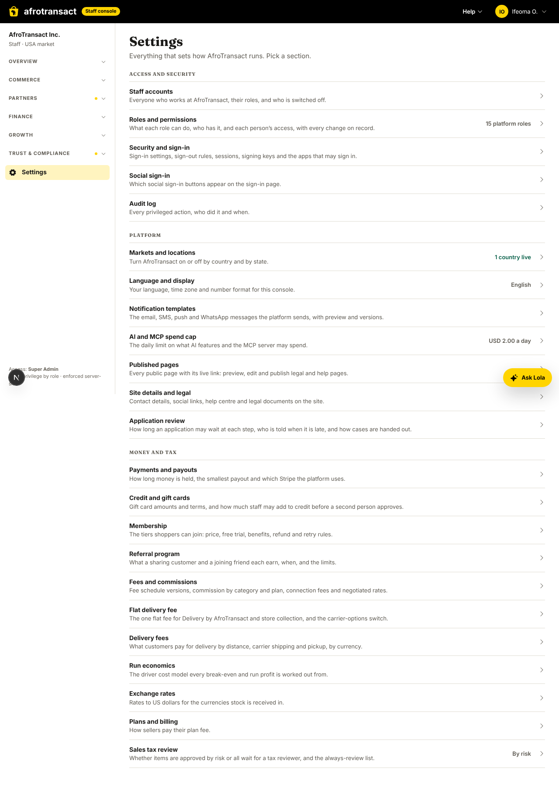
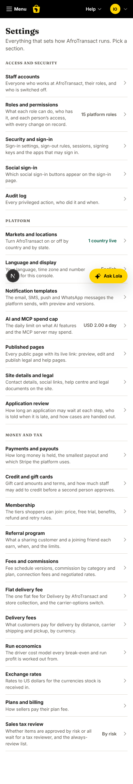
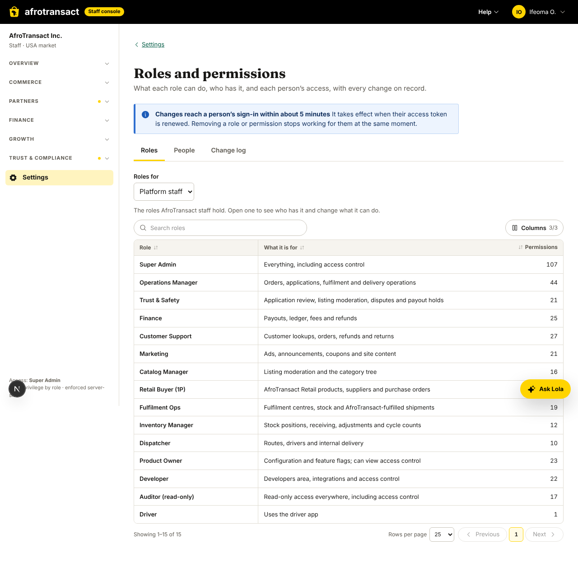
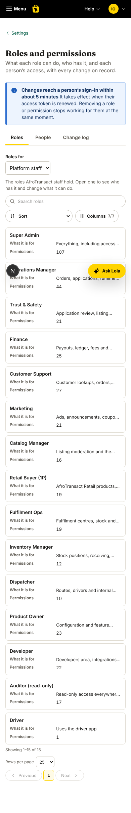
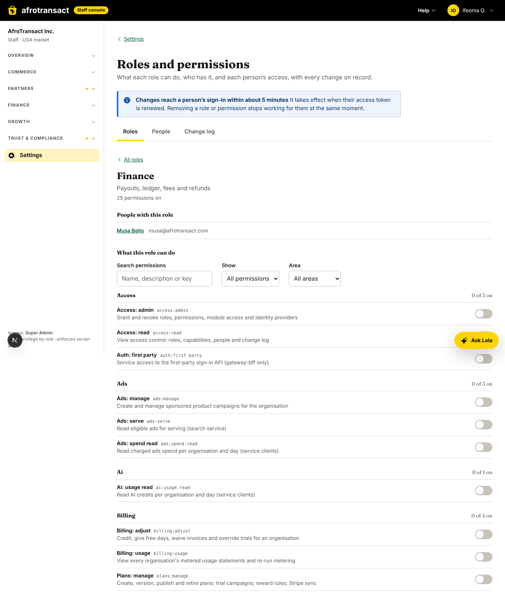
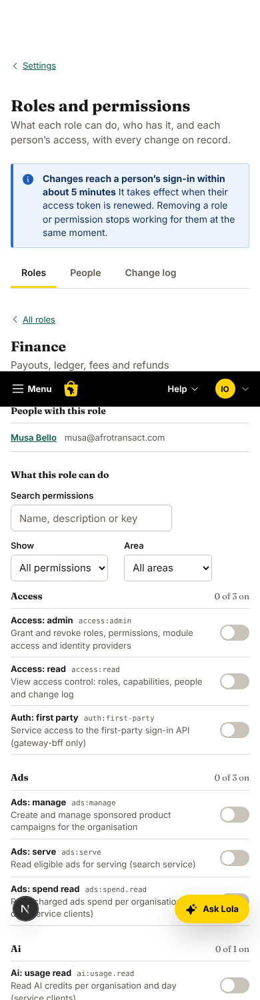
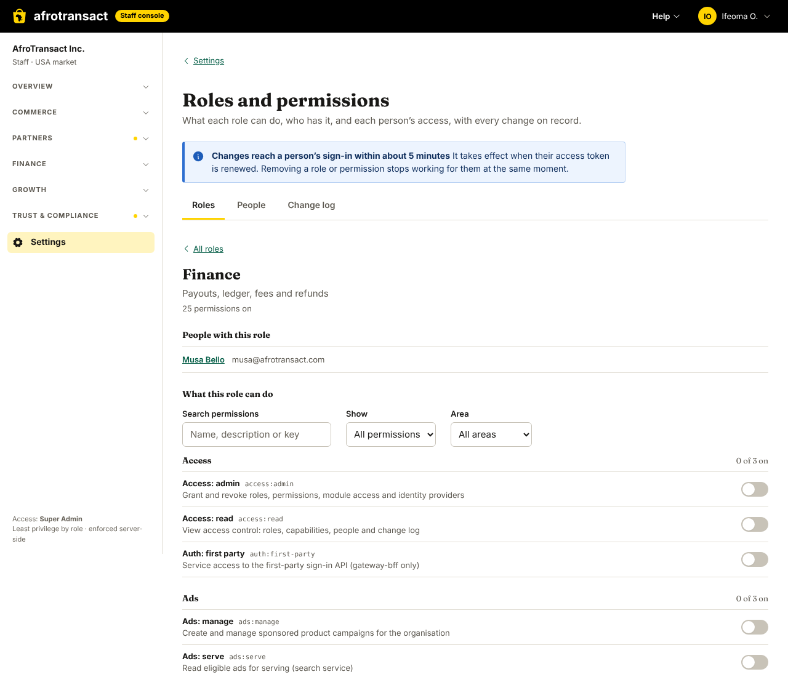
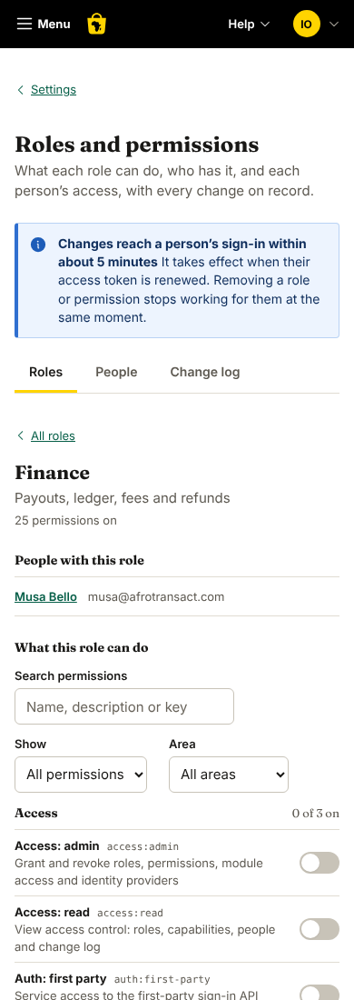
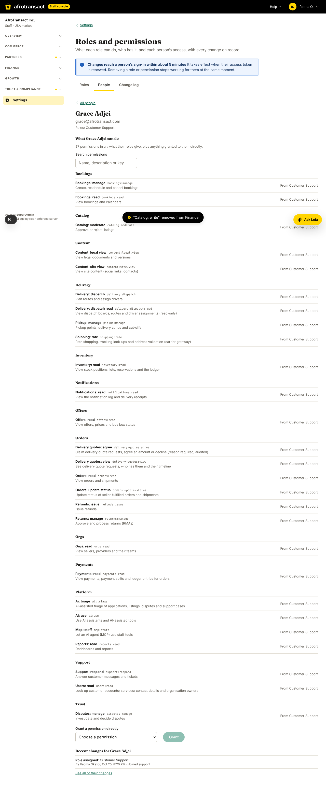
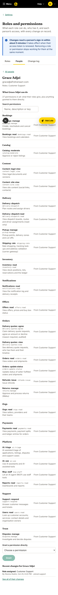
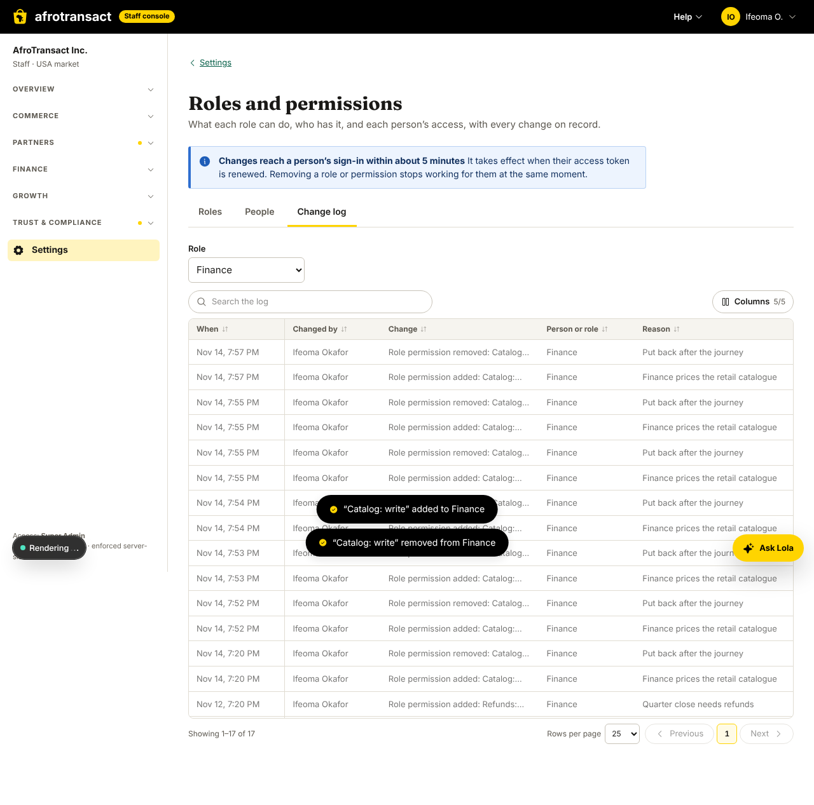
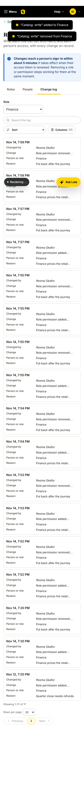

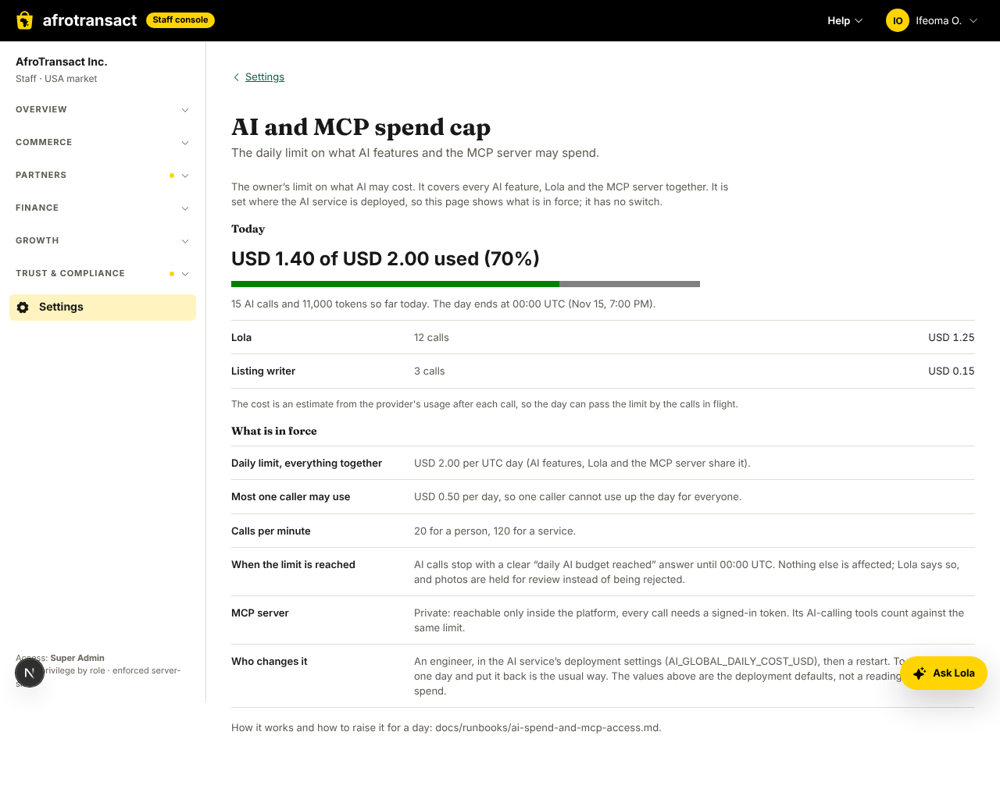
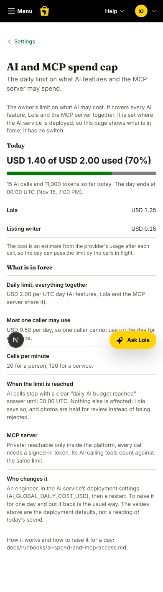
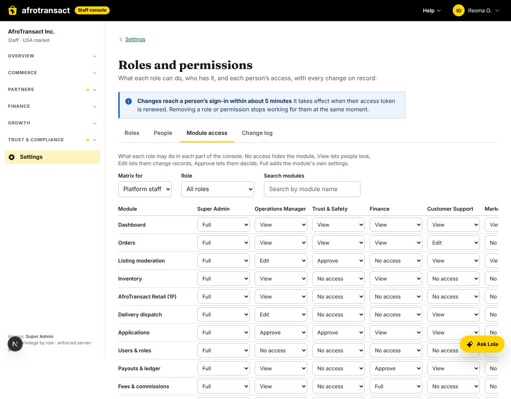
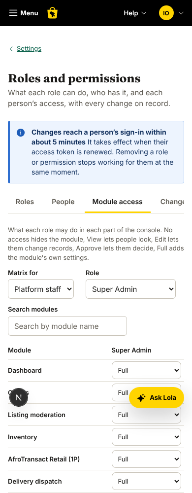
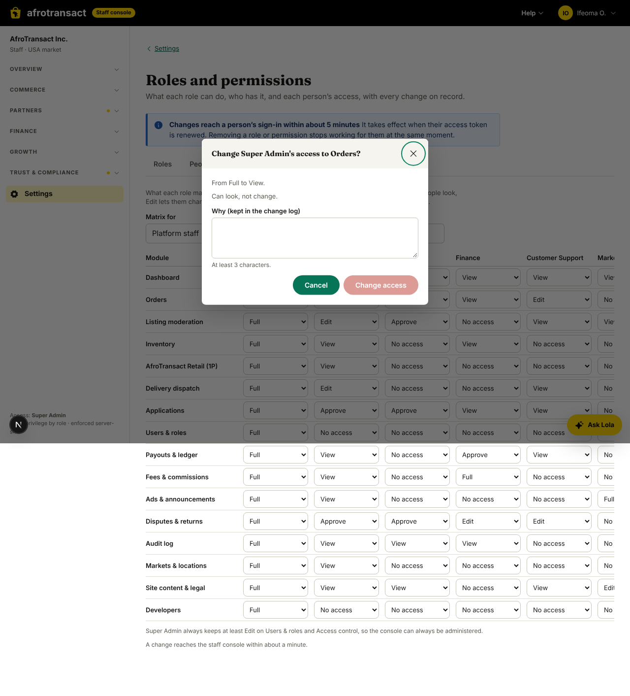

## Not verified

Against a real identity, gateway-bff, ai-gateway and console running together: each side was exercised separately (identity and ai-gateway against a real PostgreSQL 16 with
their full Spring application, gateway-bff against contract-checked fakes, the console against the mock BFF), so the exact JSON identity sends for the access log's role entries
(`subject`/`targetRole`), the 5-minute propagation and the BFF's one-minute matrix cache were not seen end to end. Testcontainers integration tests (`StaffInvitationIT`, `ModuleAccessIT`,
`SpendTodayIT`) are written for CI; they were run here only through a local PostgreSQL copy because there is no Docker. Email delivery and the Kafka hop for invitations are in
[staff-invitations.md](staff-invitations.md#not-verified).
