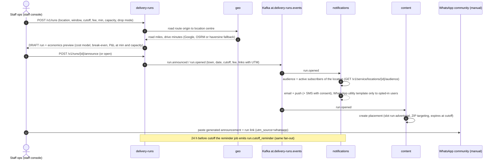
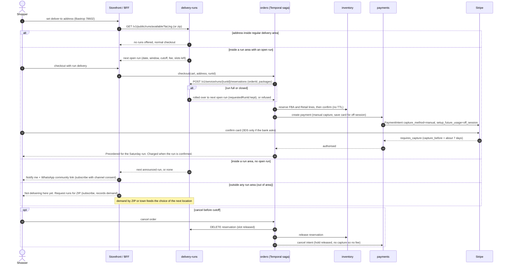
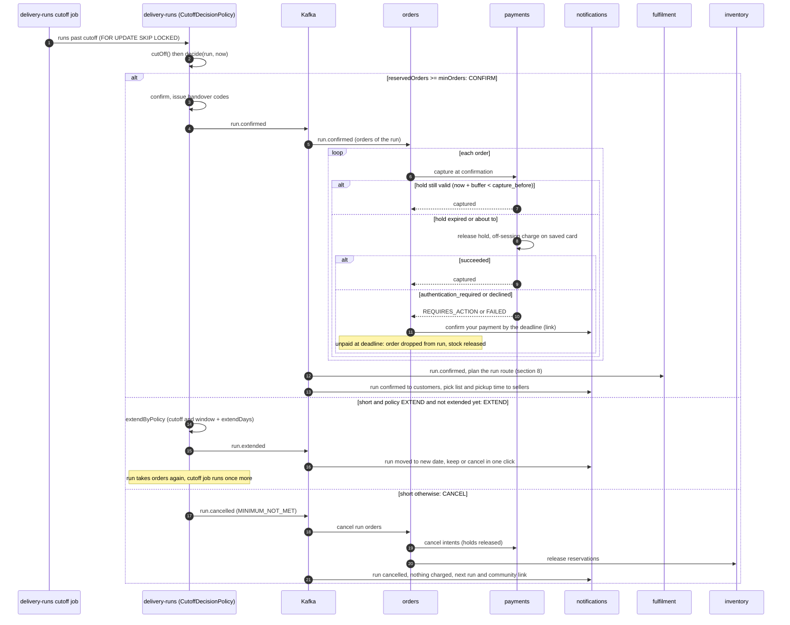
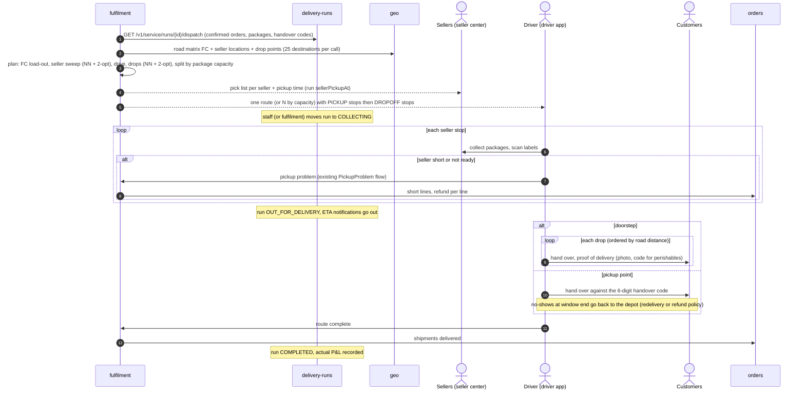
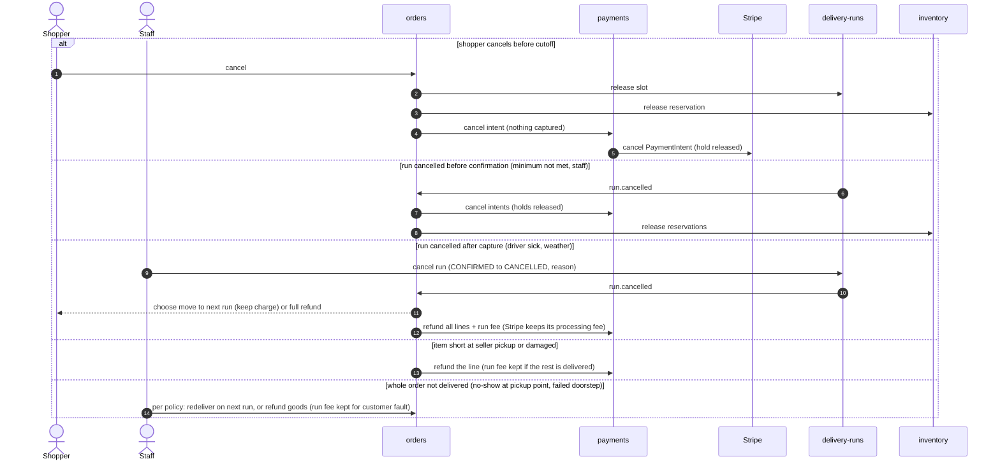
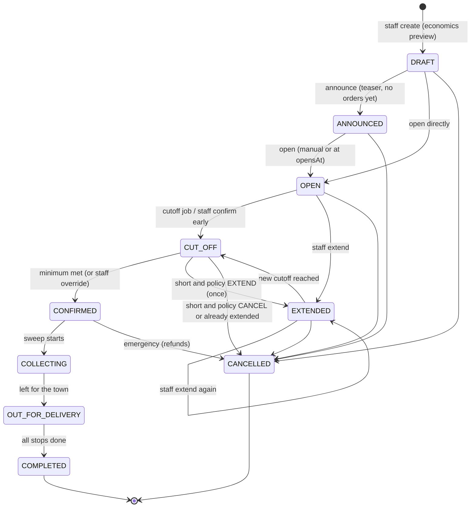
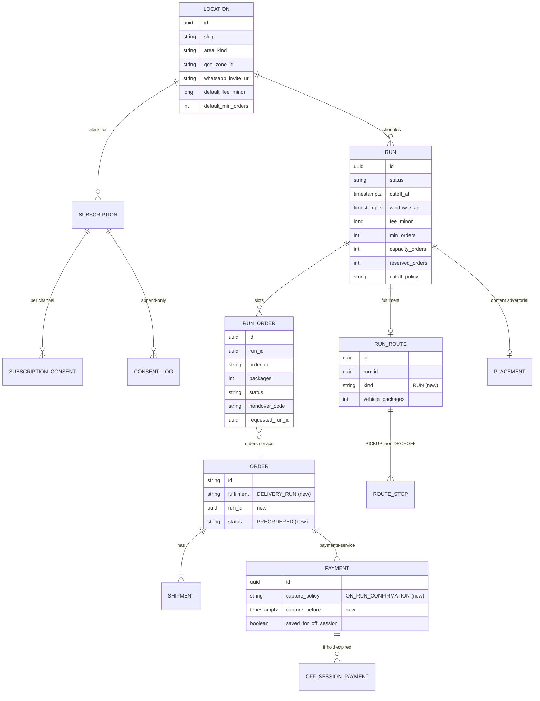

# Spike: preorder community delivery runs (E34, S260–S265)

| | |
|---|---|
| Status | Spike / decision document. Not production code. |
| Date | 2026-10-10 |
| Backlog | Epic **E34**, stories **S260**–**S265** (`docs/backlog/backlog.csv`) |
| Calculator | `tools/spikes/run_economics.py` (Python 3, stdlib only) |
| Code read | `java/services/{delivery-runs,orders,payments,fulfilment,inventory,content,bookings}`, `go/services/{geo,notifications}`, storefront |

> **Confidence legend.** **[code]** means verified in this repo. **[doc]** means confirmed by a vendor's own documentation, through a search summary. **[3p]** means only third-party sources, so treat it as indicative. **[unverified]** means an assumption or something I could not check. The sandbox's egress policy blocked direct fetches of `docs.stripe.com` and `developers.facebook.com` (HTTP 403), so vendor facts come from search results that quote those pages. Re-check them before committing money or contracts.

---

## 1. Summary of recommendations

| Topic | Recommendation |
|---|---|
| **Shape** | Run scheduled **preorder runs per location** (Bastrop first): orders open, a cutoff, a minimum and a capacity, then one sweep that collects from sellers and delivers in a window. The `delivery-runs` service already models this. |
| **Payment** | Use a **hybrid**: at order time, authorise with a manual-capture PaymentIntent and save the card (`setup_future_usage=off_session`). Capture at run confirmation while the hold is still valid (`capture_before`). If it isn't, release the hold and charge **off-session** with the existing `OffSessionChargeService`, which bookings already uses. If the bank asks for authentication, email or push a confirm link with a grace deadline. **Extended authorisation is not an option** for a US grocery marketplace. |
| **WhatsApp** | **Post to Communities manually** (there is no API) and store the **invite link** on the location (already modelled). Use **utility templates 1:1** for transactional messages: order on a run, run confirmed or cancelled, out for delivery, handover code. **Don't plan on WhatsApp marketing templates in the US**, because Meta has paused them to +1 numbers. The Groups API is capped at 8 participants and is useless for a town. Announcements go through email, push, SMS (with TCPA consent), social, advertorials and the community post. |
| **Inventory** | **Reserve at order time.** Confirmed reservations with no 15-minute TTL cover FBA and Retail stock. Sellers' own stock relies on their **commitment to the run** and is enforced at cutoff through the pick list. Phase 1 has no hot or made-to-order food. FEFO must allocate against the **delivery date**, not today. |
| **Routing** | **Phase 1** is a heuristic in fulfilment. One route per run: an ordered seller sweep, then drops ordered by nearest-neighbour plus 2-opt over geo's road matrix, split by package capacity. **Phase 2** moves to Google Route Optimization API, or VROOM on our OSRM, once there are several vehicles, binding time windows or multi-town runs. |
| **Economics** | Bastrop round trip from the Austin origin: about **$105 fixed plus $2.50 per doorstep order**. A single Bastrop order today **loses about $100** in delivery cost. At **$7.99** the run fee alone breaks even at **20 orders**. Counting seller fee plus take on the basket, it breaks even at **9 orders**. Recommended terms: **$7.99, minimum 10, capacity 30**, extend once and then cancel. |
| **Advertorials** | `delivery-runs` already serves advertorial data. Content places it in a storefront slot, **targeted by ZIP** in this order: signed-in default address, then deliver-to ZIP, then Cloudflare `cf-postal-code`. The countdown is rendered client-side and the placement expires at cutoff. Measure conversion with UTM, with run attribution on the order. |
| **Rollout** | **Phase 0** (now): a manual Bastrop pilot on existing checkout plus a WhatsApp community, run as a weekly Saturday run with ordering Sunday to Thursday. **Phase 1**: preorder checkout and announcements built on `delivery-runs`. **Phase 2**: optimisation, seller commitments, A/B tests and more towns. |

---

## 2. Problem, goals, non-goals

### Problem
AfroTransact delivers in some Texas cities for a flat **$7.99** during customer acquisition. Towns like **Bastrop** are about 30–37 road miles and 40–60 minutes from Austin ([mapsof.net](https://www.mapsof.net/distance/austin-to-bastrop-tx), [meetways](https://www.meetways.com/info/driving-time/Austin,%20Texas/Bastrop,%20Texas)). One order there costs roughly **$108 of driver and vehicle cost** against a $7.99 fee (see §9). The seeded AfroTransact Delivery tariff also caps service at **25 miles** (`max_radius_miles = 25` in `payments/.../V9__afrotransact_delivery_pricing.sql` **[code]**). Today, Bastrop is either refused or delivered at a large loss.

### Goals
1. Serve outlying towns economically by **batching** orders into scheduled runs with a cutoff and a minimum.
2. Build **local demand** before each run: a WhatsApp community, email, push, SMS, social and on-site advertorials.
3. Let **sellers** reach those towns without driving there. AfroTransact drivers collect from them in one sweep.
4. Give staff a **run P&L before and after** each run, so they can set fees and minimums per location.
5. Never take money for a run that doesn't happen, and keep refunds automatic.

### Non-goals (for this epic)
- Same-day or on-demand delivery to outlying towns.
- Multi-vehicle fleet optimisation, or several towns in one run (Phase 2).
- Hot or made-to-order food on runs (Phase 2, needs seller run commitments).
- Automated posting into WhatsApp Communities (not possible via API, see §6).
- Dynamic pricing of the run fee (Phase 2; staff set the fee per run).
- Carrier-shipped (USPS/UPS) orders to these towns. They keep working as today.

---

## 3. What exists today (grounding)

| Area | What is already there **[code]** | Gap for runs |
|---|---|---|
| `delivery-runs` (port 8115, being built) | Locations: polygon via a geo zone or a radius, origin, default fee, minimum and capacity, drop mode, pickup point, **WhatsApp invite URL**, social links. Runs carry the full lifecycle and `RunTerms` (window, cutoff, opensAt, sellerPickupAt, fee, min, capacity in orders and packages, drop mode, `CutoffPolicy` EXTEND or CANCEL, extendDays). `DefaultCutoffDecisionPolicy` decides at cutoff. Run slots (`run_order`) roll over to the next run when a run is full or closed, and issue handover codes at confirmation. Subscriptions carry per-channel consent and an append-only `consent_log`. Run economics (`DefaultRunEconomicsCalculator`) and advertorial data (`GET /v1/public/runs/{id}/advertorial`). Jobs handle auto-open, the 24 h reminder and cutoff. Events: `delivery-runs.run.{announced,opened,cutoff_reminder,confirmed,extended,cancelled,out_for_delivery,completed}` on `at.delivery-runs.events`. Tests: `CutoffPolicyTest`, `EconomicsTest`, `RunLifecycleTest`, `RunFlowIT`. | No AsyncAPI fragment yet (`contracts/asyncapi/fragments/` has no `delivery-runs.yaml`). No other service consumes its events yet. |
| `orders` | Temporal checkout saga: prepare → reserve → createPayment (manual capture) → await authorisation → place, with compensations. | No run-aware checkout. Needs a `DELIVERY_RUN` fulfilment option, a run slot step and a "preordered" state until confirmation. |
| `payments` | Manual-capture PaymentIntents with multicapture per shipment, `release`, `cancel` and per-line refunds. **`OffSessionChargeService`** for saved cards beyond the ~7-day hold, reporting `authentication_required` as `REQUIRES_ACTION`. SetupIntents, saved methods, `saveForOffSession`. Delivery pricing: customer charge, seller pickup fee **$2/package** (seed), 25-mile radius. | No capture-at-run-confirmation policy and no per-payment `capture_before` check. Reuse the bookings pattern (`at.bookings.balance.authorisation-window: 5d`). |
| `inventory` | Reservations: RESERVE (15 min TTL), then confirm, then ship. FEFO skips lots expiring within **7 days of today** (`fefo-min-remaining-days`). | A preorder for a run 14 days out can allocate a lot that expires before delivery. FEFO needs a "deliver-by" date. |
| `fulfilment` | `ZoneRoutePlanner` groups by zone and sorts drops **by ZIP, then order number** (no road-distance sequencing). Nearest-driver assignment joins seller pickups to the nearest driver's route (max 40 packages). Stops are PICKUP, DROPOFF or RETURN_PICKUP. Handover methods and proof of delivery exist. | No "run route" (sweep then drops), no distance sequencing and no capacity split by packages. |
| `geo` | Road distance and duration through Google Routes `computeRouteMatrix`, then OSRM `table`, then a haversine × 1.3 fallback. Max **25 destinations per call**. Zones in PostGIS. | No trip or optimisation endpoint. Fine for Phase 1 because the heuristic runs on the matrix. |
| `notifications` | Email (Resend, SendGrid, SES, SMTP), SMS (Twilio, Vonage, SNS), push (APNs, FCM), **WhatsApp Cloud API** templates (`v21.0`), template registry with categories, consent rules (marketing needs an explicit per-channel opt-in, quiet hours). | No consumer for `delivery-runs.*` events and no run templates. |
| `content` | Placements with `Targeting` (markets, communities, **ZIP prefixes**, DMAs, devices, new vs returning), schedule, frequency cap, priority, sponsorship. Ads campaigns with clicks and order attribution. | No A/B variants on placements. No auto-generated placement from a run. |
| `seller` | Ship-from addresses and locations (geocoded). | Sellers can't see run deadlines or pick lists yet (S264). |
| Docs portal | Docusaurus. | **Mermaid is not enabled** (`@docusaurus/theme-mermaid` is not installed) and `docs/spikes/` is not synced by `scripts/sync-contracts.mjs`. Diagrams render on GitHub today. See §15 for the follow-up. |

---

## 4. End-to-end flow by actor

| Actor | Before cutoff | At cutoff | After confirmation |
|---|---|---|---|
| **Staff ops** | Create the location once (area, origin, WhatsApp link). Create a run from the location defaults and check the **economics preview** (break-even shown). Announce, then open. Post the generated copy to the WhatsApp community. | Automatic decision: confirm, extend once, or cancel. Can override with confirm or cancel. | Check the run route and seller pickup times. Start collecting, mark out for delivery, complete. Review run P&L. |
| **Shopper** | Sees the advertorial or community post, joins or subscribes, preorders before the cutoff. The card is authorised and saved. Can cancel before the cutoff. | Gets "run confirmed" (and the handover code for pickup-point runs), or "extended: keep or cancel", or "cancelled: hold released". | Charged (if not already). Gets "out for delivery" with an ETA, then delivery with proof. |
| **Seller** | Opts in to runs for a location (Phase 1: implied by AfroTransact Delivery eligibility). Sees upcoming runs. | Receives the **pick list** for all run orders and the **pickup time**. | Packs by the pickup time and hands over to the driver, who scans packages. Paid through the usual settlement hold. |
| **Driver** | Nothing. | Nothing. | One route: FC load-out, then seller pickups, then drive to town, then doorstep drops or the pickup point with handover codes. Proof of delivery per order. |
| **Finance** | Holds are authorisations, not revenue. | Captures at confirmation. Off-session charges for expired holds. | Run fee goes to *4250 Local delivery fees*, seller fees and commission as today. Run P&L (estimated against actual cost). Refunds per line. |

### 4.1 Creating and announcing a run



### 4.2 A shopper preorders (including the out-of-area case)



### 4.3 Cutoff: minimum met, extend, or cancel



The decision logic already exists and is tested (`DefaultCutoffDecisionPolicy`, `CutoffPolicyTest`) **[code]**. The minimum counts **orders holding a slot** (`reservedOrders`). Orders whose payment fails after confirmation do not undo the confirmation. Ops accept that risk, which is small when US off-session declines are low **[unverified]**.

### 4.4 Seller batch pickup and delivery



### 4.5 Refunds and cancellations



---

## 5. Run state machine

The state machine below matches `RunStatus.NEXT` **[code]**.



Run slot (`RunOrderStatus`): `RESERVED` (holds capacity, payment authorised) → `CONFIRMED` (run confirmed, capture) → or `RELEASED` (customer cancelled or moved to another run) or `CANCELLED` (run cancelled).

Two observations for the other agent, not blocking:
- `COLLECTING` and `OUT_FOR_DELIVERY` have **no path to `CANCELLED`**. A breakdown mid-run then needs per-order handling in fulfilment and orders (redeliver or refund) while the run still completes. That's acceptable, but it should be documented.
- **Customer protection on extension.** The FTC Mail, Internet, or Telephone Order Merchandise Rule requires a delay notice with a revised date and a right to cancel for a prompt refund ([FTC business guide](https://ftc.gov/business-guidance/resources/business-guide-ftcs-mail-internet-or-telephone-order-merchandise-rule)) **[doc, legal review recommended]**. The `run.extended` notification must include a one-click cancel.

---

## 6. WhatsApp approach

### What is possible (October 2026)

| Capability | Status | Source |
|---|---|---|
| Post into a **Community** or its announcement group via API | **Not available.** The Cloud API has no Communities endpoint. | [Meta Groups API docs](https://developers.facebook.com/documentation/business-messaging/whatsapp/groups/) (via [Unipile summary](https://www.unipile.com/whatsapp-group-api/)) **[doc/3p]** |
| **Groups API** (business-created groups) | Open to businesses with an **Official Business Account**. **Max 8 participants per group.** One Cloud API business per group. Joining is **invite-link only**. Text, media and templates are supported. Up to 10,000 groups per number. Built for small support or concierge chats, **not town broadcasts**. | Meta docs, last updated 2026-06-16, per search summary **[doc]** |
| **Communities** in the consumer or Business app | Created by a human in the app. Announcement group where only admins post, joined by **invite link**. Third-party guides cite up to 50 groups and about 5,000 members per community and 1,024 per group. | [getkanal](https://getkanal.com/blog/whatsapp-communities-guide) **[3p]** |
| **1:1 template messages** (business-initiated) | Per-message pricing since 2025-07-01. Categories: marketing, utility, authentication, service. **Utility** costs about **$0.004–0.006** per message in the US. Service replies inside the 24 h customer-service window are free. | [Courier](https://www.courier.com/guides/whatsapp-pricing), [chatdaddy](https://chatdaddy.tech/blog/whatsapp-business-api-pricing), [messagecentral](https://www.messagecentral.com/blog/whatsapp-business-api-pricing-usa) **[3p]**. Check Meta's rate card. |
| **Marketing templates to US (+1) numbers** | **Paused by Meta since 2025-04-01** (error `131049`). Still paused as of July 2026 per several sources, with no end date announced. Status in October 2026 is **[unverified]**. | [Manychat](https://manychat.com/blog/whatsapp-pausing-marketing-templates-in-u-s/), [Braze](https://www.braze.com/resources/articles/whatsapp-marketing), [getkanal](https://getkanal.com/blog/whatsapp-marketing-usa-2026) **[3p]** |
| **Messaging limits** | A cap on unique users messaged **outside** a service window per rolling 24 h, set at the **business portfolio** level. New portfolios start at **250**. Business verification and quality raise it to 1k/2k, then 10k, 100k and unlimited (third-party guides disagree on the steps). Throughput is about 80 msg/s. | [Meta messaging limits](https://developers.facebook.com/documentation/business-messaging/whatsapp/messaging-limits), [aisensy](https://m.aisensy.com/blog/whatsapp-message-limits-guide/) **[doc/3p]** |
| **Opt-in** | Business-initiated messages require the user's **opt-in to receive WhatsApp messages from the business**, recorded by us. Our `notifications` consent rules already require explicit marketing opt-in per channel **[code]**. | Meta policy **[unverified wording]** |

### Decision

1. **Community: manual, one per location.** Ops create *"AfroTransact Bastrop"* in the WhatsApp Business app, with an announcement-only group. The **invite URL is stored on the location** (`location.whatsapp_invite_url` **[code]**) and shown on the location page, the advertorial, out-of-area checkout and emails. For each run, the staff console offers **"Copy announcement"**, with text generated from the run and a link carrying `utm_source=whatsapp&utm_medium=community&utm_campaign=run-<id>`. An ops person pastes it. The cost is zero and it takes about 2 minutes per post.
2. **1:1 WhatsApp through the Cloud API: utility templates only.** Use them for messages about **the customer's own order on a run**: preorder received, run confirmed (with handover code), run extended (keep or cancel), run cancelled, out for delivery with ETA, payment action required. At about $0.005 each and roughly 4 messages per order, that's about **$0.02 per order**. Send them only to customers who opted in to WhatsApp at checkout or subscription.
3. **Run announcements to subscribers.** Use email, push and SMS (SMS needs TCPA prior express written consent plus A2P 10DLC registration **[unverified, legal]**). Announcing a new run to non-customers is **marketing**. Submit a "run alert" template as utility, framed as an alert the user explicitly subscribed to, but **expect Meta to classify it as marketing**, which means blocked to +1 numbers. **Don't depend on it.**
4. **Inbound keyword (optional, Phase 1+).** "Message us *BASTROP*" opens a free 24 h service window. Reply free-form with the run link and capture the WhatsApp opt-in. That's cheap, compliant, and it grows the 1:1 audience.
5. **Groups API: no.** The 8-participant cap rules it out. Revisit only if Meta adds Communities or large-group support.
6. Do Meta **business verification** before launch to lift the 250/day limit.

---

## 7. Payment approach

### Facts
- An online card authorisation is valid for about **7 days** for most networks. Stripe says to rely on each payment's **`capture_before`** field ([Stripe: place a hold](https://docs.stripe.com/payments/place-a-hold-on-a-payment-method), [capture later](https://docs.stripe.com/payments/capture-later)) **[doc]**.
- **Extended authorisation** (up to about 30 days) is offered to **IC+ pricing** users only. For Visa outside lodging, rental and cruise, *"the extended window doesn't apply to transactions with merchants in US or JP"*. Amex and Discover limit it to travel and lodging categories. Mastercard allows all categories (not Maestro or Cirrus) ([Stripe: extended authorization](https://docs.stripe.com/payments/extended-authorization)) **[doc]**. For a US grocery marketplace that is **not a general solution**.
- A failed off-session confirmation returns **402**, and the intent sits in `requires_payment_method`. Stripe's guidance is to bring the customer back on-session to authenticate or choose another method ([save and reuse](https://docs.stripe.com/docs/payments/save-and-reuse), [Stripe support: manual confirmation for SCA](https://support.stripe.com/questions/manual-confirmation-for-off-session-payments-requiring-strong-customer-authentication-sca)) **[doc]**. Our gateway already surfaces this as `authentication_required` or `REQUIRES_ACTION` **[code]**. In the US, 3-D Secure challenges are uncommon, so **declines** (funds, expired card) are the bigger risk **[unverified]**.
- **Refunds don't return Stripe's processing fee** ([Stripe support](https://support.stripe.com/questions/understanding-fees-for-refunded-payments)) **[doc]**. Cancelling an **uncaptured** intent involves no capture, so prefer cancel over refund wherever possible. Whether any fee applies to uncaptured authorisations depends on our Stripe pricing plan **[unverified]**.

### Options

| | A. Authorise at order, capture at confirmation | B. Extended authorisation | C. SetupIntent at order, off-session charge at cutoff | **D. Hybrid (recommended)** |
|---|---|---|---|---|
| Customer effort | One confirmation | One | One (card saved, $0) | One (authorise + save together) |
| Funds checked at order | Yes | Yes | **No** (card validity only) | Yes |
| Works for 1–14-day cutoffs | **No**: holds lapse after about 7 days | Mostly no (US Visa non-travel ineligible, IC+ only) | Yes | **Yes** |
| Failure at charge time | Expired hold, so capture fails | Same, for ineligible cards | Declines and SCA for **every** order at cutoff | Only for **long-lead** orders (placed more than about 5 days before cutoff) |
| Visible "pending" on customer's card | Yes, until capture or cancel | Yes, for longer | No | Yes, until capture or cancel (one hold only) |
| Run cancelled | Cancel the hold (free) | Same | Nothing to do | Cancel the hold (free) |
| Build cost | Already exists | Stripe plan change + contracts | New flow | **Existing pieces**: `saveForOffSession`, `capture`, `release`, `OffSessionChargeService`, the bookings `authorisation-window` pattern |

### Decision: D, hybrid
1. **At order:** create the PaymentIntent with `capture_method=manual` and `setup_future_usage=off_session` (`CreateIntent.saveForOffSession=true` **[code]**). Store `capture_before` on the payment, read from the latest charge's `payment_method_details.card.capture_before`.
2. **At run confirmation** (`run.confirmed`): for each order, if `now + safetyBuffer(12 h) < capture_before`, **capture the whole order** (all lines plus the run fee) and treat later shortages as **per-line refunds**. Otherwise **release** the expired or expiring hold and run an **off-session charge** for the same lines. This reuses `OffSessionChargeService`, which creates a new manual-capture payment on the order, and then captures it.
3. **If the off-session charge fails:** send `payments.intent.action_required` to notifications (email, push and WhatsApp utility) with a confirm link valid until **sellerPickupAt minus 6 h**. Retry declines once after 6 h, matching bookings' `max-attempts` and `retry-delay`. If the order is still unpaid at the deadline, the order is **removed from the run** (slot released, stock released, customer told).
4. **Why capture at confirmation, not at delivery:** the hold can lapse between cutoff and delivery, and sellers start packing at confirmation. If ops prefer capturing at pickup (no refunds for shorts), keep that as a per-location option once data shows short-pick rates.
5. **Cancellations:** before cutoff, the shopper cancels and the intent is cancelled (free). After confirmation, the order is **not cancellable by the shopper**, since sellers have committed (support can still override). A run cancelled before capture cancels the intents. A run cancelled after capture refunds in full, or offers a move to the next run with an optional goodwill credit.
6. **Card-on-file disclosure:** at checkout, say *"We'll hold $X now and charge when the run is confirmed. If the hold expires we'll charge your saved card."* That covers the consent for the off-session merchant-initiated charge **[legal wording to review]**.

### Refund matrix

| Event | Run fee | Goods | Mechanism |
|---|---|---|---|
| Shopper cancels before cutoff | n/a | n/a | Cancel intent |
| Run cancelled before confirmation | n/a | n/a | Cancel intents |
| Run cancelled after capture | Refund | Refund (or move to next run) | `refund` all lines |
| Seller short or damaged at pickup | Keep | Refund line | `refund` line (existing) |
| Doorstep failed, customer fault | Keep | Redeliver next run, or refund less restocking (perishables: no restock) | Policy question Q9 |
| Not delivered, our fault | Refund | Refund or redeliver | `refund` |

---

## 7b. Inventory approach

| Stock type | When reserved | How |
|---|---|---|
| **FBA / AfroTransact Retail** (inventory-managed) | **At order time** | The existing reservation (all-or-nothing per order), **confirmed** right after authorisation like regular checkout, so the 15-minute TTL doesn't apply. It's released on cancellation or a cancelled run and committed at FC load-out. |
| **Seller-held stock** (AfroTransact Delivery from the seller's store; not tracked by inventory) | **Seller commitment** | Phase 1: run orders appear in seller center **as they arrive** (not only at cutoff), with a running pick list, so sellers can mark items unavailable before cutoff (which refunds the line or cancels the hold). Phase 2: **run allocations**, where a seller commits a quantity per product per run (for example 20 trays of fresh pepper soup base) and the storefront enforces it like stock. |
| **Perishables** | At order (FBA/Retail), but with **shelf life checked against the delivery date** | **Gap:** FEFO skips lots expiring within `fefo-min-remaining-days` (7) **of today** **[code]**. A preorder for a delivery 10 days away needs `deliverBy + minRemainingDays`. Add a `deliverBy` date to the reservation command (orders passes `run.window.end`). Chilled and frozen items count as **cool-box packages** against the run's package capacity. |
| **Hot or made-to-order food** | Not on runs in Phase 1 | Needs a seller run commitment and cook-time rules (Phase 2). |

Why reserve at order rather than at cutoff: shoppers commit days ahead and expect the item. Reserving only at cutoff would mean cancelling lines after the fact, the worst experience in a community channel where word travels. The cost is stock locked for up to about 14 days, which is fine at run volumes of about 30 orders. Ops can watch the "reserved for runs" number in inventory insights.

---

## 8. Routing approach

### What a run needs
One vehicle (sometimes two), departing the FC/hub, which does **FC load-out, then k seller pickups** (Austin metro, k ≈ 3–8), **then a 30–60 minute drive**, then **n drops** (n ≈ 10–40) **or one pickup point**, and optionally returns. Constraints: every pickup before any drop (a precedence constraint, met trivially by doing all pickups first), **vehicle capacity** in packages and cool boxes, seller **ready times** (`sellerPickupAt`) and the **delivery window** (for example 10:00–14:00).

### What exists **[code]**
- `geo`: a road **matrix** (Google `computeRouteMatrix` or OSRM `table`, ≤ 25 destinations per call, cached) and a fallback.
- `fulfilment`: `ZoneRoutePlanner` (group by zone, **sort by ZIP**, split by max drop-offs) and nearest-driver for **single seller pickups** (40-package cap). There's no road-distance sequencing and no "sweep then drops" route.

### Options

| | Phase 1 heuristic (recommended) | OSRM `trip` | Google Route Optimization API | VROOM (self-hosted on OSRM) |
|---|---|---|---|---|
| Solves | Two chained open TSPs (sweep, then drops), capacity split by angular sweep | TSP (farthest insertion), round trip or fixed start and end only | Full VRP: capacity, time windows, pickup-and-delivery pairs, multi-vehicle | VRP: capacity, time windows, pickup-delivery, multi-vehicle |
| Capacity / time windows | Capacity by split; windows checked, not optimised | **No** | Yes | Yes |
| Cost | Matrix calls only (we already pay for them) | Free (self-host) | Billed **per shipment**: Single Vehicle Routing SKU (Pro) or Fleet Routing (Enterprise) ([Google billing](https://developers.google.com/maps/documentation/route-optimization/usage-and-billing)) **[doc; unit price not retrieved]** | Free (BSD), ops cost |
| Effort | Small (domain code in fulfilment) | Small, but needs an OSRM `trip` endpoint in geo | Medium (new adapter, GCP project) | Medium (new container) |
| Source | n/a | [osrm-talk](https://lists.openstreetmap.org/pipermail/osrm-talk/2017-October/001538.html) **[3p]** | Google docs | Same thread notes VROOM beats OSRM `trip` **[3p]** |

### Decision
- **Phase 1:** a `RunRoutePlanner` in fulfilment, behind an interface so a solver can replace it later.
  1. Get the matrix for FC, sellers and drops from geo, chunked to 25 per call.
  2. Order the **sweep**: nearest-neighbour from the FC, then 2-opt, then check `sellerPickupAt` ready times (warn, don't optimise).
  3. Order the **drops**: start at the drop closest to the area entry, nearest-neighbour, then 2-opt (open path).
  4. If packages exceed vehicle capacity, **split drops into angular sectors** around the town centre, one route each, and share the sweep or duplicate seller stops.
  5. Compute ETAs and check against the window.

  For n ≤ 40 this is within a few percent of optimal in practice **[unverified, typical for 2-opt at this size]** and well below the noise of stop-time variance. Pickup-point runs need no drop optimisation at all.
- **Phase 2:** once **several vehicles, binding windows or multi-town corridors** (for example Bastrop, Elgin and Smithville) appear, replace the planner with **Google Route Optimization** (pay per shipment, no ops) or **VROOM** (free, run it next to OSRM). Choose by cost at volume once Google's unit price is confirmed.
- **Phase 0:** a free multi-stop route planner app or Google Maps directions by hand.

---

## 9. Economics model (Bastrop)

### Model
This is the **same model as `delivery-runs`** (`DefaultRunEconomicsCalculator` **[code]**), so the staff console and this spike agree:

```
cost(n)   = fixed + n × perOrder
fixed     = (driveMin × 2 + collectionMin [+ pickupPointMin]) / 60 × driver$/h + roadMiles × 2 × vehicle$/mi
perOrder  = (doorstep stop min | handover min) / 60 × driver$/h
```

There are two break-even lenses:
- **Delivery lens:** the run fee alone covers the run. This is what S265 shows.
- **Contribution lens:** each order also brings the **seller pickup fee** ($2/package, seed tariff **[code]**) and AfroTransact's **take on the basket** (commission or Retail margin, net of basket card fees). The run fee loses about 2.9% to card fees.

### Assumptions (all CLI flags)

| Assumption | Value | Basis |
|---|---|---|
| Origin | Downtown Austin (30.2672, −97.7431) | `delivery-runs` default origin **[code]**. **Q12:** confirm the real hub. |
| Road miles one way | **32** | Austin to Bastrop is about 30–31 mi via TX-71, 37 via US-290 ([mapsof.net](https://www.mapsof.net/distance/austin-to-bastrop-tx)). In production this comes from geo. |
| Drive minutes one way | **50** | 38–40 off-peak, about 50+ at peak. The PO says "about 1 hour". 60 is run as a sensitivity. |
| Round trip | yes | Matches service default |
| Driver cost | **$25/h** loaded | Service default `DRIVER_COST_PER_HOUR_MINOR=2500` **[assumption]** |
| Vehicle cost | **$0.70/mi** | Service default, about the IRS 2025 standard mileage rate **[check the 2026 rate]** |
| Collection (FC + seller sweep) | **45 min** fixed | Service default. Use `--sellers N` for extra stops. |
| Doorstep stop | **6 min** incl. local driving | Service default |
| Pickup point | 30 min stop + 1 min/order | Service default |
| Avg basket (excl. fees) | **$45** | **[assumption]**. Replace with actual AOV. |
| Take rate on basket | **10%** net of card fees | **[assumption]**. Bookings' fallback commission is 10% **[code]**. Retail margin is likely higher. |
| Seller pickup fee | **$2.00**/order (1 package) | Seed tariff **[code]** |

### Today, one Bastrop order
`cost(1) = $105.22 + $2.50 = $107.72` against a $7.99 fee, a **loss of about $99.73**, or about $93 after the basket's contribution.

### Calculator output (defaults: doorstep, 32 mi, 50 min)

`python3 tools/spikes/run_economics.py`

```
## Cost model
- fixed: 145 min + 64 mi = $105.22 per run
- per order: $2.50

## Break-even orders per run
| run fee | delivery lens | contribution lens | contribution / order |
|--------:|--------------:|------------------:|---------------------:|
|   $5.99 |            31 |                11 |               $12.32 |
|   $7.99 |            20 |                 9 |               $14.26 |
|   $9.99 |            15 |                 8 |               $16.20 |
|  $12.99 |            11 |                 7 |               $19.11 |

## Run P&L, delivery lens (run fees - estimated cost)
| orders |    cost | cost / order | fee $5.99 | fee $7.99 | fee $9.99 | fee $12.99 | fee to break even |
|-------:|--------:|-------------:|----------:|----------:|----------:|-----------:|------------------:|
|      5 | $117.72 |       $23.54 |   -$87.77 |   -$77.77 |   -$67.77 |    -$52.77 |            $23.55 |
|     10 | $130.22 |       $13.02 |   -$70.32 |   -$50.32 |   -$30.32 |     -$0.32 |            $13.03 |
|     15 | $142.72 |        $9.51 |   -$52.87 |   -$22.87 |     $7.13 |     $52.13 |             $9.52 |
|     20 | $155.22 |        $7.76 |   -$35.42 |     $4.58 |    $44.58 |    $104.58 |             $7.77 |
|     25 | $167.72 |        $6.71 |   -$17.97 |    $32.03 |    $82.03 |    $157.03 |             $6.71 |
|     30 | $180.22 |        $6.01 |    -$0.52 |    $59.48 |   $119.48 |    $209.48 |             $6.01 |
|     40 | $205.22 |        $5.13 |    $34.38 |   $114.38 |   $194.38 |    $314.38 |             $5.14 |

## Run P&L, contribution lens (fees net of card + seller fees + take on baskets - cost)
| orders | fee $5.99 | fee $7.99 | fee $9.99 | fee $12.99 |
|-------:|----------:|----------:|----------:|-----------:|
|      5 |   -$56.14 |   -$46.43 |   -$36.72 |    -$22.15 |
|     10 |    -$7.06 |    $12.36 |    $31.78 |     $60.91 |
|     15 |    $42.02 |    $71.15 |   $100.28 |    $143.98 |
|     20 |    $91.11 |   $129.95 |   $168.79 |    $227.05 |
|     25 |   $140.19 |   $188.74 |   $237.29 |    $310.11 |
|     30 |   $189.27 |   $247.53 |   $305.79 |    $393.18 |
|     40 |   $287.43 |   $365.11 |   $442.79 |    $559.31 |
```

### Sensitivities (break-even orders at $5.99 / $7.99 / $9.99 / $12.99)

| Scenario | Fixed cost | Per order | Delivery lens | Contribution lens |
|---|---|---|---|---|
| Base (32 mi, 50 min, doorstep) | $105.22 | $2.50 | 31 / **20** / 15 / 11 | 11 / **9** / 8 / 7 |
| Peak or "1 hour" drive (37 mi, 60 min): `--road-miles 37 --drive-minutes 60` | $120.55 | $2.50 | 35 / **22** / 17 / 12 | 13 / **11** / 9 / 8 |
| Pickup point: `--drop-mode pickup-point` | $117.72 | $0.42 | 22 / **16** / 13 / 10 | 10 / **9** / 8 / 7 |
| 4 extra seller stops, 12 min each: `--sellers 4` | $125.22 | $2.50 | 36 / **23** / 17 / 12 | 13 / **11** / 10 / 8 |

### Reading it
- At **$7.99** the run pays its own delivery cost from **about 20 doorstep orders** (16 at a pickup point). With the basket counted, it is **contribution-positive from about 9–11 orders**.
- **$5.99** needs 30+ orders to fund delivery and only makes sense as a pickup-point promo.
- **$9.99–12.99** roughly halves the delivery break-even. That's worth testing once a town has a habit. Communicate it as "town run" pricing, not a price rise.
- **Recommended Bastrop terms (Phase 0/1):** fee **$7.99**, **minimum 10 orders** (contribution break-even plus 1), **capacity 30 orders / 45 packages** (about 5.5 h of driver time doorstep), `CutoffPolicy.EXTEND` once by 7 days. Treat runs between 10 and 20 orders as acquisition spend (≤ $50 delivery loss per run, already contribution-positive).
- The service already shows the delivery lens. **S265 follow-up:** add the contribution lens (seller fees and commission share from payments) to `RunEconomics`. `atOrders` already accepts a `commissionShareMinor`.

---

## 10. Advertorials

| Concern | Approach |
|---|---|
| **Data** | `GET /v1/public/runs/{id}/advertorial` already returns town, date, window, cutoff (`countdownTarget`, `expiresAt`), fee, drop mode, headline, CTA with `utm_medium=advertorial`, WhatsApp link and area **[code]**. |
| **Placement** | On `run.opened`, content creates a placement in a new **`run-advertorial`** slot (home hero, category top, cart and checkout out-of-area message). The payload is a run reference, the schedule runs open → cutoff, priority is high, and targeting is the location's **ZIP prefixes** (Bastrop 78602 and neighbours). Content's `Targeting` already supports 5-digit ZIP prefixes and DMAs **[code]**. Staff can also author custom placements (S263). |
| **Visitor location** (first match wins) | 1. Signed-in shopper's **default address ZIP**. 2. **Deliver-to ZIP** chosen in the header (`DeliverToDialog` **[code]**). 3. **Cloudflare** `cf-postal-code` or `cf-ipcity` via the *Add visitor location headers* managed transform ([Cloudflare reference](https://developers.cloudflare.com/rules/transform/managed-transforms/reference/)) **[doc]**, which the BFF must forward. IP-to-ZIP is coarse, especially on mobile carriers **[unverified accuracy]**, so for case 3 show **"Delivering to Bastrop? Runs every Saturday"** with a ZIP confirm, not a hard claim. 4. Nothing known: no run advertorial, only a generic "We deliver to towns near Austin on runs" banner. |
| **Countdown** | Rendered client-side from `countdownTarget` (server time sent alongside to avoid clock skew). Hidden at cutoff, and the placement expires (`expiresAt`). Show **"N slots left"** when capacity is under 25%, a real scarcity cue. |
| **Measurement** | Count views (impression beacon), clicks (existing `AdClick`-style tracking) and **orders**. An order carries `runId` and the first-touch UTM (`utm_source` = advertorial, whatsapp, email, push, sms, facebook or instagram, with `utm_campaign=run-<id>`). Report per run: views → clicks → preorders, CTR and conversion, and share of run orders per channel. Feed this into S265's location history. |
| **A/B variants** | Not supported by content placements today **[code]**. Phase 2: a variant key on the placement, hashed per visitor. |

---

## 11. Data model and service responsibilities



| Service | Owns | Changes for E34 |
|---|---|---|
| **delivery-runs** | Locations, runs and lifecycle, cutoff decision, slots and capacity, rollover, handover codes, subscriptions and consent, run economics, advertorial data, run events | Being built (S260). Add the AsyncAPI fragment, the contribution lens and the ZIP list per location for targeting. |
| **orders** | The order: lines, shipments, run fee as the delivery charge, status (`PREORDERED` until confirmation), cancellation rules, the saga | Run option in checkout, a slot reservation step (with compensation), a consumer for `run.confirmed` / `run.cancelled` / `run.extended`, removal of unpaid orders from the run. |
| **payments** | Intents, capture, off-session, refunds, ledger, run fee to 4250 | `capture_before` stored. "Capture at run confirmation" command (capture or release-then-off-session). Action-required deadline. |
| **inventory** | Reservations, FEFO | `deliverBy` on reservations for FEFO. A "reserved for runs" view. |
| **fulfilment** | Run route planning, driver route, seller pickups, proof of delivery, handover at pickup point | `RunRoutePlanner`, a run route kind, consumption of `dispatch`, moving the run to COLLECTING / OUT_FOR_DELIVERY / COMPLETED (or emitting events that delivery-runs consumes). |
| **notifications** | Channels, templates, consent, quiet hours, WhatsApp | Consume `delivery-runs.*`. Run templates (email, push, SMS, WhatsApp utility). Audience from delivery-runs. UTM links. |
| **content** | Placements, slots, targeting, measurement | `run-advertorial` slot, auto-placement from run events, run attribution. |
| **seller / seller-center** | Ship-from locations, seller UI | Run calendar, live pick list, pickup time. |
| **storefront / BFF** | Screens | Run offer in checkout, out-of-area subscribe, location page (`/delivery-runs/<slug>`), advertorial slot, Cloudflare header forwarding. |
| **geo** | Distances, zones | None for Phase 1. Phase 2 may add an optimisation adapter. |

---

## 12. Risks and mitigations

| Risk | Likelihood | Impact | Mitigation |
|---|---|---|---|
| Minimum not met repeatedly, and cancellations erode trust in the community | Medium | High | Extend once. Guarantee the first two runs per town (go ahead at ≥ 5 orders as acquisition spend, capped). Use a pickup point to lower costs. Make the minimum and progress visible ("12 of 10 — this run is on!"). |
| Off-session charge fails for long-lead orders | Low–medium | Medium | Hybrid keeps most orders inside the hold window. Confirm link with a deadline, one retry. Show a "charge expected" banner in the account. |
| WhatsApp marketing stays blocked to +1 numbers | High | Medium | Design never depends on it. The community post is manual. Utility templates only. Email, push and SMS carry announcements. |
| Meta classifies our "utility" templates as marketing | Medium | Low | Keep utility strictly tied to an existing order. Monitor template category on approval. |
| Community spam or privacy (members' phone numbers visible to admins and others) | Medium | Medium | Announcement-only group, posting rules, ops moderation, privacy note on the join page. Whether member numbers are visible to other members in Communities is **[unverified]**. |
| SMS without TCPA-grade consent | Low (if built right) | High (statutory damages) | Separate SMS opt-in with explicit wording (consent is logged in `consent_log` **[code]**), STOP handling (notifications has keyword handling **[code]**), 10DLC registration. Legal review. |
| Perishables spoil on a long run | Medium | Medium | Cool boxes counted as packages, FEFO against delivery date, no hot food in Phase 1, safe-place handover disallowed for perishables (exists **[code]**). |
| Seller not ready at pickup | Medium | Medium | Live pick list from the first order, a reminder 24 h and 2 h before pickup, a short-pick refund flow, seller scorecard. |
| One driver, single point of failure | Medium | High | Backup driver roster. Run can be cancelled after confirmation with refunds or moved to the next run. |
| Bastrop orders slip into regular delivery at $7.99 with the old flow | Medium | Medium | Within the 25-mile seed radius it can't happen, but **check production's fee schedule** (the PO's flat $7.99 isn't in the repo seed). Once runs exist, regular checkout excludes run areas. |
| Sales tax on delivery charges | Medium | Low | Texas generally taxes delivery charges on taxable items **[unverified]**. Route the run fee through the existing tax calculation (`CheckoutTax`) as a delivery charge, and confirm with the tax owner. |
| FTC delay rules on extension | Low | Medium | Extension notice with a revised date and one-click cancel. Automatic refund if a run is cancelled. |
| Economics assumptions wrong (driver cost, stop time) | High | Medium | Phase 0 records actual times and miles. Feed them back into `at.delivery-runs.economics.*` and the calculator. |

---

## 13. Open questions for the product owner (with recommended answers)

| # | Question | Recommended answer |
|---|---|---|
| Q1 | Keep **$7.99** for runs or price them differently? | **Keep $7.99** during acquisition (contribution-positive from about 10 orders). Test **$9.99** in Phase 1 once a town averages 20+ orders. |
| Q2 | **Minimum orders and capacity** for Bastrop? | **Minimum 10, capacity 30 orders / 45 packages**, one car. |
| Q3 | What happens when the minimum isn't met? | **Extend once by 7 days** (merge into next week), notify with keep or cancel, then **cancel**. First two runs in a new town go ahead at ≥ 5 orders. |
| Q4 | **Cadence and timing**? | **Weekly, Saturday 10:00–14:00**. Ordering opens **Sunday 00:00**, cutoff **Thursday 20:00**, seller pickup **Saturday 07:30–09:00**. A Sunday-to-Thursday order window keeps every hold under 7 days in Phase 0. |
| Q5 | **Doorstep or pickup point**? | **Doorstep** in Bastrop (compact town, better experience at 10–30 orders). Use a pickup point (church, community centre or partner store) for spread-out areas or below 10 orders. Price both the same at first. |
| Q6 | Which **sellers and products** are eligible? | Retail + FBA + Austin-metro sellers already on AfroTransact Delivery. **Shelf-stable, chilled and frozen only**, no hot or made-to-order food in Phase 1. |
| Q7 | Can shoppers **cancel after cutoff**? | **No** (sellers have committed). Support can make exceptions. |
| Q8 | Can customers inside the **regular delivery area** join runs? | **No.** Runs are for outlying towns. Keep the two offers separate. |
| Q9 | Failed doorstep delivery due to the customer, or pickup-point **no-show**? | Keep the run fee. Offer one free redelivery on the next run, or refund the goods (perishables are written off, not restocked). Revisit after data. |
| Q10 | Who **owns the WhatsApp community** and moderates it? | **Ops**, with two admins per location, announcement-only, posting rules in the description. |
| Q11 | Real **driver cost**: employee or contractor, $/h, own vehicle? | Model assumes **$25/h + $0.70/mi**. Please confirm, since it moves break-even by about ±3 orders. |
| Q12 | Where do runs **start**? The service default is downtown Austin, and "about 1 hour" suggests a different hub or peak traffic. | Set the actual hub as the location `origin`. Use **50 min / 32 mi** until confirmed. |
| Q13 | Is **SMS** in scope for announcements? | **Yes, opt-in only**, after legal sign-off on wording and 10DLC. Email and push first. |
| Q14 | Should first-run shoppers get a **promo**? | Yes: **free run fee for the first preorder per town**, funded as acquisition, capped by run (existing coupons in offers). |
| Q15 | Which **towns next**? | Use out-of-area subscriptions per ZIP (demand) plus the calculator. Candidates near Austin: Elgin, Smithville, Lockhart, Taylor **[suggestion]**. |

---

## 14. Phased rollout

### Phase 0: manual pilot with existing tools (2–4 weeks, Bastrop only)
- **Ops create the WhatsApp community** "AfroTransact Bastrop" (Business app, announcement-only) and share the link on socials, in the email newsletter (content has a newsletter **[code]**) and to the existing Bastrop customer.
- **Weekly run:** orders Sunday to Thursday 20:00, delivery Saturday 10:00–14:00. Customers order on the **existing storefront and checkout**, so payment is authorised at order and captured at shipment as today, and the Sunday-to-Thursday window keeps holds under 7 days. Ops tag Bastrop orders, hold them until Saturday and **cancel and refund** if the run doesn't happen.
  - **Prerequisite:** confirm that production checkout accepts Bastrop addresses at $7.99 (repo seed: 25-mile radius, distance tariff).
- Seller pickups are booked manually and the route is built with a multi-stop planner. **Record actual minutes, miles and stops** for every run.
- The decision sheet is `tools/spikes/run_economics.py`, fed with actuals.
- **Exit criteria:** 4 runs, ≥ 10 orders in at least 3, ≥ 150 community members, no spoilage incidents.

### Phase 1: MVP (S260, S261, S262 core, S263 basic, S264 basic, S265)
- `delivery-runs` live, with staff console screens: locations, runs, economics preview, run orders, copy-to-WhatsApp.
- Preorder checkout in orders with the **hybrid payment** and slot reservation. Run events consumed by orders, payments, notifications, fulfilment and content.
- Notifications: email, push and WhatsApp **utility** templates for order-level run messages. Email and push for subscriber announcements. SMS if Q13 says yes.
- Location page plus out-of-area subscribe. **ZIP-targeted run advertorial** with countdown, plus UTM attribution.
- Fulfilment `RunRoutePlanner` (NN + 2-opt, capacity split). Seller-center pick list and pickup time. Pickup-point handover codes.
- Inventory `deliverBy` for FEFO.
- Run P&L before and after, including the contribution lens.

### Phase 2
- Route optimisation (Google Route Optimization or VROOM) for multi-vehicle and **multi-town corridor runs**.
- **Seller run commitments** (per-product quantities per run) and made-to-order or hot food with prep rules.
- Advertorial **A/B variants** and auto-generated creatives with featured products.
- Fee and minimum **recommendations** per location from history. Dynamic "slots left" pricing experiments.
- WhatsApp marketing templates **if** Meta lifts the US pause. Click-to-WhatsApp ads (free 72 h window **[3p]**).
- Driver app "run mode" (sweep checklist, cool-box scan, pickup-point queue).

---

## 15. Success metrics

| Metric | Phase 0 target | Phase 1 target |
|---|---|---|
| Orders per run (Bastrop) | ≥ 10 median | ≥ 20 median |
| Runs confirmed (minimum met) | ≥ 75% | ≥ 90% |
| Contribution per run (contribution lens) | ≥ $0 | ≥ $100 |
| Delivery cost per order | ≤ $13 | ≤ $8 |
| Subscribers and community members per location | 150 | 500 |
| Subscriber → preorder conversion per run | n/a | ≥ 8% |
| Repeat customers (ordered on ≥ 2 runs within 8 weeks) | ≥ 30% | ≥ 45% |
| Advertorial CTR / click → order | measured | ≥ 2% / ≥ 10% |
| Off-session charge success (long-lead orders) | n/a | ≥ 95% |
| On-time delivery within window | ≥ 90% | ≥ 95% |
| Seller ready at pickup time | ≥ 85% | ≥ 95% |
| Run-related refunds as % of run GMV | ≤ 5% | ≤ 3% |

### Follow-ups outside this spike's scope (for whoever owns them)
1. **Docs portal:** enable Mermaid (`@docusaurus/theme-mermaid` plus `markdown.mermaid: true`) and sync `docs/spikes/*.md` in `scripts/sync-contracts.mjs`. Until then, the diagrams render on GitHub only.
2. Add `contracts/asyncapi/fragments/delivery-runs.yaml`, since the events are defined in code only.
3. Backlog candidates: inventory `deliverBy` FEFO; payments `capture_before` and capture-at-run-confirmation; fulfilment `RunRoutePlanner`; content `run-advertorial` slot and A/B variants; the S265 contribution lens.

### Sources
- Meta: [Groups API](https://developers.facebook.com/documentation/business-messaging/whatsapp/groups/), [Messaging limits](https://developers.facebook.com/documentation/business-messaging/whatsapp/messaging-limits). Summaries: [Unipile: WhatsApp Group API 2026](https://www.unipile.com/whatsapp-group-api/), [aisensy limits guide](https://m.aisensy.com/blog/whatsapp-message-limits-guide/)
- WhatsApp pricing: [Courier](https://www.courier.com/guides/whatsapp-pricing), [ChatDaddy](https://chatdaddy.tech/blog/whatsapp-business-api-pricing), [MessageCentral US](https://www.messagecentral.com/blog/whatsapp-business-api-pricing-usa)
- US marketing pause: [Manychat](https://manychat.com/blog/whatsapp-pausing-marketing-templates-in-u-s/), [Braze](https://www.braze.com/resources/articles/whatsapp-marketing), [getkanal](https://getkanal.com/blog/whatsapp-marketing-usa-2026)
- Communities: [getkanal: Communities guide](https://getkanal.com/blog/whatsapp-communities-guide)
- Stripe: [Place a hold](https://docs.stripe.com/payments/place-a-hold-on-a-payment-method), [Capture later](https://docs.stripe.com/payments/capture-later), [Extended authorization](https://docs.stripe.com/payments/extended-authorization), [Save and reuse](https://docs.stripe.com/docs/payments/save-and-reuse), [SCA manual confirmation](https://support.stripe.com/questions/manual-confirmation-for-off-session-payments-requiring-strong-customer-authentication-sca), [Fees on refunds](https://support.stripe.com/questions/understanding-fees-for-refunded-payments)
- Routing: [Google Route Optimization billing](https://developers.google.com/maps/documentation/route-optimization/usage-and-billing), [OSRM trip limits (osrm-talk)](https://lists.openstreetmap.org/pipermail/osrm-talk/2017-October/001538.html)
- Cloudflare: [Managed transforms reference](https://developers.cloudflare.com/rules/transform/managed-transforms/reference/)
- FTC: [Mail, Internet, or Telephone Order Merchandise Rule](https://ftc.gov/business-guidance/resources/business-guide-ftcs-mail-internet-or-telephone-order-merchandise-rule)
- Distance: [mapsof.net Austin to Bastrop](https://www.mapsof.net/distance/austin-to-bastrop-tx), [meetways](https://www.meetways.com/info/driving-time/Austin,%20Texas/Bastrop,%20Texas)
